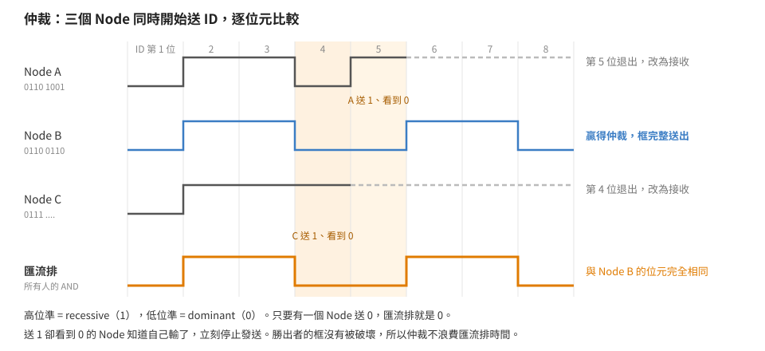
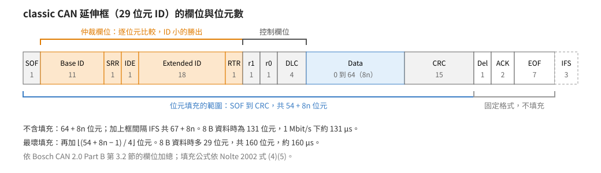
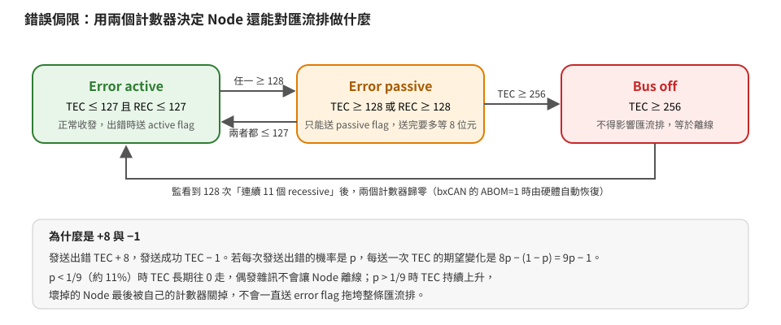

# CAN：仲裁、填充位元與錯誤侷限

CAN 讓多個 Node 共用一對線，不需要主控端，也能決定誰先講話，而且決定的過程不浪費匯流排時間。
這篇從「共用一對線」這個根本限制推起，說明仲裁、填充位元與錯誤計數器各自擋住什麼問題，
最後比較 STM32 的 bxCAN 與 FDCAN，並整理對 embnet-rs 設計的影響。

延伸閱讀：Bosch CAN Specification 2.0 Part B（欄位、填充、錯誤處理的原始定義）；
Nolte 2002（最壞情況填充位元的推導）；Cho & Shin 2016（bus-off 攻擊）。完整出處見文末。

## 一、根本問題：一對線、很多個發話者

車上或機器裡的控制器（ECU）很多，每兩個之間都拉線並不實際，所以大家共用一對線。共用帶來兩個問題：

1. 兩個 Node 同時開口時怎麼辦？
2. 沒有主控端，誰來決定順序？

乙太網路早期的做法是偵測到碰撞就雙方都停下，各自隨機等一段時間再重送。碰撞的那段時間就浪費了，
而且等多久是隨機的，延遲難以預期。控制系統需要可預期的延遲，所以 CAN 要另找方法。

## 二、仲裁：讓碰撞不破壞任何東西

### 2.1 從線路的物理特性開始

CAN 的線上只有兩種狀態：dominant（顯性，邏輯 0）與 recessive（隱性，邏輯 1）。
線路的設計讓「只要有一個 Node 送 dominant，整條線就是 dominant」，這種接法叫 wired-AND：
匯流排的值等於所有 Node 送出值的 AND。（Bosch 2.0 Part B，Bus values）

每個 Node 送出一個位元的同時，也在讀線上的值。這兩件事合起來就產生了仲裁：

- 送 dominant（0）的 Node 讀到的一定是 0，不會發現任何異狀。
- 送 recessive（1）卻讀到 0 的 Node 知道有別人在送 0，於是立刻停止發送，改為接收。

### 2.2 由此推出的三個性質

**ID 小的優先。** 所有 Node 從 ID 的最高位開始同時送。在第一個不相同的位元上，送 0 的一方勝出，
所以數值小的 ID 一定贏。ID 因此同時是名字，也是優先序。

**仲裁不浪費時間。** 勝出者從頭到尾讀到的都是自己送的值，它的框完全沒被破壞，繼續送完就好。
Bosch 規格的說法是仲裁時「neither information nor time is lost」。這是 CAN 和早期乙太網路最大的差別。

**同一個 ID 不能有兩個發送者。** 兩個 Node 若用同一個 ID 同時開始，仲裁分不出勝負，兩者都會繼續送資料欄。
到第一個內容不同的位元，送 1 的那一方讀到 0，被判定為 bit error。Nolte 把這條寫成前提：
來自不同來源、同時活躍的框必須有不同的 ID（Nolte 2002，第 3 頁）。

### 2.3 代價：位元時間不能太短

逐位元比較要成立，送出的位元必須在取樣之前傳遍整條線，讓最遠的 Node 也看到同一個值。
所以 CAN 的位元時間受線長限制，速率愈高，線能拉得愈短。classic CAN 的最高速率是 1 Mbit/s（RM0090 第 32.2 節）。

## 三、框的長相

CAN 框有兩種：ID 為 11 位元的標準框，與 29 位元的延伸框，由 IDE 位元區分。embnet-rs 用延伸框。CRC 是附在資料後的校驗碼，接收端重算後比對，原理見 [CRC 與 framing](../20-protocol/03-crc-and-framing.md)。

| 欄位 | 位元數 | 作用 |
|---|---|---|
| SOF | 1 | dominant，讓所有 Node 對齊框的起點 |
| Base ID、SRR、IDE、Extended ID、RTR | 11、1、1、18、1 | 仲裁欄位。SRR 固定為 recessive，所以 Base ID 相同時標準框贏延伸框。RTR 標示 remote frame（向別人要資料的框），本專案不用 |
| r1、r0 | 1、1 | 保留位元，發送端送 dominant |
| DLC | 4 | 資料長度。Bosch 2.0 只定義 0 到 8，「Other values may not be used」 |
| Data | 0 到 64 | 0 到 8 bytes |
| CRC | 15 | 多項式 x^15 + x^14 + x^10 + x^8 + x^7 + x^4 + x^3 + 1，涵蓋 SOF 到 Data |
| CRC delimiter、ACK、EOF | 1、2、7 | 固定格式。ACK slot 由正確收到的 Node 覆寫成 dominant |
| IFS | 3 | 框與框之間至少 3 個 recessive |

把欄位加起來：延伸框不含填充是 64 + 8n 位元，標準框是 44 + 8n 位元，n 是資料位元組數。
加上 IFS，8 B 資料的延伸框是 131 位元。（欄位定義見 Bosch 2.0 Part B 第 3.2 節，加總結果與 Linux 核心
`include/linux/can/length.h` 的分項一致。）

關於 DLC 9 到 15：ISO 11898-1 允許這些值並規定資料長度仍為 8 B。這一點我們只看到二手描述
（RM0440 Table 409 與 Linux 核心的註解），ISO 原文未讀。bxCAN 手冊只寫 DLC 範圍是 0 到 8，
收到大於 8 的值時怎麼回報，手冊沒有寫（待查證）。

## 四、填充位元：替沒有時脈線的匯流排找節拍

### 4.1 為什麼需要

CAN 只有資料線，沒有時脈線。接收端靠訊號的邊緣（0 變 1 或 1 變 0）校正自己的取樣時間。
若連續很多個位元都相同，線上就沒有邊緣，接收端的時鐘會慢慢漂掉，最後取錯位元。

CAN 的解法是：發送端每遇到 5 個連續相同的位元，就插入 1 個相反的位元。接收端看到 5 個相同位元後，
把下一個位元丟掉。這樣線上最多每 5 位元就有一次邊緣。若接收端看到 6 個連續相同的位元，
就知道出錯了，這叫 stuff error。（Bosch 2.0 Part B 第 6 節）

填充的範圍是 SOF 到 CRC sequence。CRC delimiter、ACK、EOF 是固定格式，不填充。
第五節的 error flag（偵測到錯誤的 Node 送出的警告訊號）正好是 6 個相同位元，它利用的就是「6 個相同位元一定是錯誤」這條規則，故意讓所有 Node 都看到 stuff error。

### 4.2 最壞情況多出幾個位元

填充讓框長變得不固定，而延遲分析需要最壞值。最壞的位元樣式是：開頭先有 5 個相同位元觸發第一次填充，
之後每 4 個位元換一次值。插入的填充位元本身也算進下一段的連續計數，所以除了第一段，
每 4 個位元就多插 1 個。設受填充的位元數為 L，最壞多出 ⌊(L − 1)/4⌋ 個。

延伸框的受填充範圍是 54 + 8n 位元（SOF 到 CRC），標準框是 34 + 8n 位元。最壞框長是：

- 延伸框：64 + 8n + 3 + ⌊(54 + 8n − 1)/4⌋，化簡為 80 + 10n 位元（含 IFS）
- 標準框：44 + 8n + 3 + ⌊(34 + 8n − 1)/4⌋，化簡為 55 + 10n 位元（含 IFS）

（Nolte 2002 第 2.2 節式 (3) 到 (5)；化簡形式見 Davis 的投影片第 18 頁。因為 8n/4 = 2n 剛好整除，
兩種寫法在 n = 0 到 8 時完全相等。）

| 8 B 資料、1 Mbit/s | 不含填充（含 IFS） | 最壞填充（含 IFS） |
|---|---|---|
| 標準框 | 111 位元，111 µs | 135 位元，135 µs |
| 延伸框 | 131 位元，131 µs | 160 位元，160 µs |

做延遲預算時要用最壞值。只用不含填充的數字，會低估約 20%。

## 五、錯誤偵測：五種錯誤各自抓什麼

| 錯誤 | 誰偵測 | 抓什麼 |
|---|---|---|
| Bit error | 發送端 | 送出的值和讀到的不同。仲裁欄位與 ACK slot 例外，因為那裡本來就允許被覆寫 |
| Stuff error | 所有 Node | 受填充範圍內出現 6 個相同位元 |
| CRC error | 接收端 | 算出的 CRC 和收到的不同 |
| Form error | 所有 Node | 固定格式欄位（delimiter、EOF）出現不合法的值 |
| ACK error | 發送端 | ACK slot 沒有任何 Node 覆寫成 dominant，表示沒人收到 |

偵測到錯誤的 Node 會送出 error flag，破壞這一框，讓所有 Node 一起丟棄它，發送端稍後自動重送。
所以原則上，一框只要有一個 Node 沒收對，就所有 Node 都不收。（Bosch 2.0 Part B 第 7 節）

這個原則有例外：接收端在 EOF 最後一個位元看到 dominant 時不算 form error，發送端卻會判定錯誤而重送。
於是有些 Node 收到兩次，有些只收到一次。這類一致性的邊界情況，本文沒有查到原始分析，列為待查證，
設計上當作「可能重複」處理。

## 六、錯誤侷限：防止一個壞掉的 Node 拖垮全部

### 6.1 根本問題

上一節的機制有一個漏洞：任何 Node 都能送 error flag 破壞別人的框。一個收發器故障、一直誤判錯誤的 Node，
會不斷破壞所有人的框，整條匯流排就癱瘓了。所以每個 Node 需要能判斷「問題出在我自己」，然後自己退出。

### 6.2 兩個計數器

每個 Node 有發送錯誤計數器 TEC 與接收錯誤計數器 REC。主要規則：發送出錯 TEC + 8，發送成功 TEC − 1；
接收出錯 REC + 1（部分情況 + 8），接收成功 REC − 1。計數值決定 Node 的狀態。（Bosch 2.0 Part B 第 8 節，共 12 條規則）

為什麼是 + 8 與 − 1？設一個 Node 每次發送出錯的機率是 p，每送一次，TEC 的期望變化是
8p − (1 − p) = 9p − 1。

- p < 1/9（約 11%）時，TEC 長期往 0 走。偶發的雜訊不會讓 Node 離線。
- p > 1/9 時，TEC 持續上升，最後到 256 進入 bus off。真正壞掉的 Node 被自己的計數器關掉。

error passive 是中間的緩衝：Node 還能收發，但只能送不會破壞別人框的 passive error flag，
送完還要多等 8 個位元，把匯流排讓給別人。

還有一個細節：只有一個 Node 在線上時，它送出的框沒有人回 ACK，會一直發生 ACK error。
規則 3 的例外讓這種情況最多進入 error passive，不會 bus off（Bosch 2.0 Part B 第 63 頁的附註），
所以先開機的 Node 不會因為「還沒有別人」而把自己關掉。

### 6.3 這個機制可以被惡意利用

Cho 與 Shin（ACM CCS 2016）展示了 bus-off 攻擊。攻擊者算準受害者週期送出某個 ID 的時間，
同時送出同一個 ID 的框，並讓某個位元是受害者送 1、攻擊者送 0。依 2.2 節的性質，受害者發生 bit error，TEC + 8。
重複幾輪之後，受害者先進入 error passive，接著 TEC 每輪淨增 7，最後被逼進 bus off。

這個攻擊在資料被驗證之前就發生了，所以 MAC（以金鑰計算的訊息認證碼，見 `docs/30-safety-security/02`；不是乙太網路的 MAC 位址）擋不住，而且攻擊者不需要知道資料內容。
後續的 CANnon（IEEE S&P 2021）更進一步，利用 MCU 周邊的時脈控制，不必送完整的框就能達到同樣效果
（目前只讀到論文摘要與海報）。

## 七、STM32 的兩種 CAN 控制器

embnet-rs 的參考板還沒決定，候選有 STM32F4（bxCAN）與 STM32G4、H7（FDCAN）。

| 項目 | bxCAN（STM32F4，RM0090） | FDCAN（STM32G4，RM0440） | FDCAN（STM32H7，RM0433） |
|---|---|---|---|
| 協定 | CAN 2.0A/B，最高 1 Mbit/s，不支援 CAN FD | classic 與 CAN FD | classic 與 CAN FD；FDCAN1 另支援 TTCAN |
| 發送緩衝 | 3 個 TX mailbox | 3 個 Tx buffer | 最多 32 個，可配置 |
| 接收 FIFO | 2 個，每個 3 格 | 2 個，每個 3 格，配置固定 | 2 個，每個最多 64 格，可配置 |
| 過濾器 | 28 個 bank，CAN1 與 CAN2 共用（`CAN2SB` 決定分界） | 11 位元 ID 28 個、29 位元 ID 8 個 | 11 位元 ID 最多 128 個、29 位元 ID 最多 64 個 |
| FIFO 滿時 | `RFLM=0` 新框覆寫最後一筆；`RFLM=1` 丟棄新框。溢位旗標 `FOVR0`、`FOVR1` | 預設丟棄新框並設 message lost 旗標；可改成覆寫最舊的 | 待查證 |
| bus off 恢復 | `ABOM=1` 時硬體自動恢復；`ABOM=0` 時由軟體觸發 | 進入 bus off 時自動設 `INIT`，由軟體恢復 | 待查證 |

出處是 ST 參考手冊的第三方 HTML 鏡像（見文末），官方 PDF 的版次與頁碼尚未核對。
G4 各型號有幾個 FDCAN instance、message RAM 的確切大小，手冊內部說法不一致，待查 datasheet。

### CAN FD 改了什麼

- **資料段可以換更高的速率。** 仲裁段仍用原速率，確保仲裁成立；BRS 位元之後切到資料段速率，CRC delimiter 切回來。
- **資料最長 64 B。** DLC 9 到 15 依序對應 12、16、20、24、32、48、64 B。
- **原本的保留位元拿來標示框型。** 標準框中原本 r0 的位置、延伸框中原本 r1 的位置改成 FDF，表示這是 FD 框。
  另有 ESI 位元帶出發送端是否處於 error passive。
- **更強的 CRC。** 16 B 以內用 CRC-17，以上用 CRC-21；另加 stuff count 欄位，記錄填充位元數，防止填充錯誤騙過 CRC。
  （Mutter & Hartwich 2015）

## 八、對 embnet-rs 的影響

| CAN 的性質 | 對設計的影響 |
|---|---|
| ID 同時是優先序 | Priority 放在 CAN ID 最高位，由硬體保證優先序（`001` 第 5.1 節） |
| 同一 ID 不能有兩個發送者 | CAN ID 必須包含來源 Node-ID，草案已經這樣配置 |
| 框長隨填充變動，最壞約多 20% | Wire time 與流量預算一律用最壞框長；8 B 延伸框以 160 µs 計 |
| 出錯的框由硬體自動重送，原則上所有 Node 一起丟棄 | 線上出錯的框不需要應用層重送；但接收端 FIFO 溢位造成的遺失不會重送（控制器已回 ACK，`003` 第 1.3 節），EOF 的例外與自動重送可能造成重複，接收端要靠 Transfer-ID 去除 |
| 接收 FIFO 只有 3 格（bxCAN 與 G4） | 中斷只搬框不處理，風險見 `003` 第 1.3 節 |
| bus-off 攻擊擋不住 | 只能偵測，TEC、REC 與 bus off 狀態放進 Heartbeat（`003` K-23） |
| 保留位元由硬體產生 | 不能拿來放 MAC（`002` 第 4.2 節） |

## 來源

- Bosch, *CAN Specification Version 2.0*, 1991. 本文讀的是第三方託管的原件掃描：
  <https://customdesignspros.github.io/wp-content/uploads/CAN-specification.pdf>
- T. Nolte, *Reducing pessimism in CAN response time analysis*, MRTC report ISRN MDH-MRTC-51/2002-1-SE, 2002：
  <https://www.es.mdh.se/pdf_publications/322.pdf>
- R. Davis, *Real-Time Scheduling and Automotive Networks*（投影片）：<https://www-users.york.ac.uk/~rd17/papers/CESEC_CAN.pdf>
- Linux 核心 `include/linux/can/length.h`：<https://raw.githubusercontent.com/torvalds/linux/master/include/linux/can/length.h>
- F. Hartwich, *Bit Time Requirements for CAN FD*, iCC 2013：
  <https://www.bosch-semiconductors.com/media/ip_modules/pdf_2/papers/icc14_2013_paper_hartwich_1.pdf>
- A. Mutter, F. Hartwich, *Advantages of CAN FD Error detection mechanisms compared to Classical CAN*, iCC 2015：
  <https://www.bosch-semiconductors.com/media/ip_modules/pdf_2/papers/icc_2015_mutter_1.pdf>
- K.-T. Cho, K. G. Shin, *Error Handling of In-vehicle Networks Makes Them Vulnerable*, ACM CCS 2016：
  <https://rtcl.eecs.umich.edu/rtclweb/assets/publications/2016/ktcho_busoff_CCS_16.pdf>
- S. Kulandaivel et al., *CANnon: Reliable and Stealthy Remote Shutdown Attacks via Unaltered Automotive Microcontrollers*, IEEE S&P 2021：
  <https://users.ece.cmu.edu/~vsekar/assets/pdf/oakland21_cannon.pdf>
- ST RM0090 第 32 章（bxCAN）、RM0440 第 44 章（FDCAN）、RM0433 第 56 章（FDCAN），第三方 HTML 鏡像：
  <https://docs.dirba.io/rm0090-stm32f405-415-407-417-427-437-429-439/32-controller-area-network-bxcan/>、
  <https://docs.dirba.io/rm0440-stm32g4/44-fd-controller-area-network-fdcan/>、
  <https://docs.dirba.io/rm0433-stm32h742-743-753-750/56-controller-area-network-with-flexible-data-rate-fdcan/>

## 待查證

- ISO 11898-1 原文：DLC 9 到 15 的條文、CAN FD 不支援 remote frame 的明文。
- bxCAN 收到 DLC 大於 8 時，暫存器回報原值還是截成 8。
- ST 參考手冊官方 PDF 的版次與頁碼；STM32G4 各型號的 FDCAN 數量與 message RAM 大小。
- Davis 等人 2007 年論文的原式與頁碼。
- EOF 最後一位例外造成的重複或遺漏，其原始分析文獻。
- STM32H7 FDCAN 在 FIFO 滿與 bus off 恢復時的行為。
