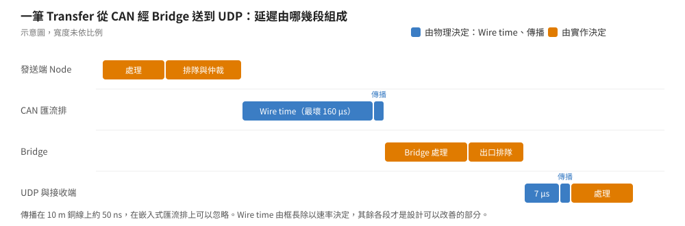
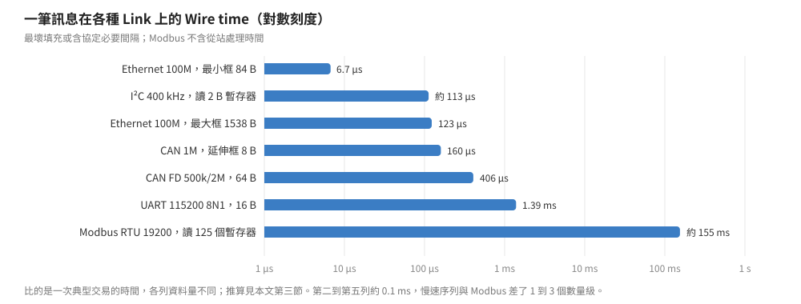
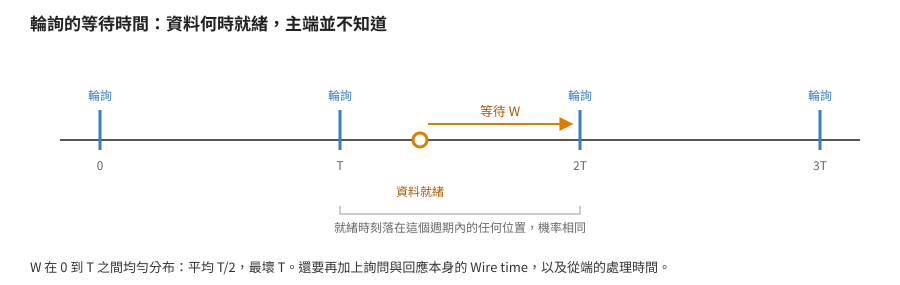

# Wire time 與延遲的組成

一筆訊息從發出到收到，時間花在哪裡？這篇把延遲拆成幾段，說明哪些段由物理決定、哪些段可以靠設計改善，
再逐一推算 UART、Modbus、I²C、SPI、Ethernet、CAN FD 上的 Wire time。這些數字是 embnet-rs 流量預算的基礎。

延伸閱讀：Kurose & Ross《Computer Networking: A Top-Down Approach》中節點延遲的定義；Modbus over Serial Line V1.02；
NXP UM10204（I²C 規格）；CAN 的部分見上一篇 [CAN：仲裁、填充位元與錯誤侷限](01-can-arbitration.md)。

## 一、延遲的四個組成

網路教科書把一個節點造成的延遲拆成四段（Kurose & Ross）：

| 組成 | 定義 | 由什麼決定 |
|---|---|---|
| 處理（processing） | 檢查標頭、決定往哪裡送 | 程式與 CPU |
| 排隊（queuing） | 在輸出佇列等前面的訊息送完；CAN 上還包括仲裁輸掉後的等待 | 流量與排程策略 |
| 序列化（transmission） | 把整個框的所有位元推上線，等於框長 L 除以速率 R | 框格式與 Link 速率 |
| 傳播（propagation） | 一個位元從線的一端走到另一端，等於線長 d 除以訊號速度 s | 線長與線材 |

本專案把序列化時間稱為 Wire time。下圖是一筆 Transfer 從 CAN 經 Bridge 轉到 UDP 的情形：

在嵌入式匯流排上，傳播幾乎可以忽略。RS-485 雙絞線的訊號速度約為光速的 78%，延遲約 4.3 ns/m
（TI SLLA272D 第 5 節）；一般雙絞線約 4.6 到 4.9 ns/m。10 m 的線只有約 50 ns，而 115200 baud 的一個位元就要 8.68 µs。
所以要分析的是另外三段：Wire time 由框格式與速率決定，處理與排隊才是設計可以改善的部分。

## 二、Wire time 的通式

Wire time = 線上的總位元數 ÷ 位元速率。

線上的總位元數比資料多，多出來的是協定開銷：起始與結束標記、標頭、校驗碼、框間隔、填充或跳脫。
各種 Link 的差別主要在開銷的形式：

| Link | 開銷的形式 |
|---|---|
| UART | 每個 byte 多 start 與 stop（有時加 parity）；另外加上 framing 自己的旗標、跳脫與 CRC |
| Modbus RTU | 每個字元 11 位元；框前後要有 3.5 個字元的靜默 |
| I²C | 每個 byte 多 1 個 ACK 時脈；每筆交易多 START、位址、STOP |
| SPI | 協定本身幾乎沒有開銷，只有片選（CS）的切換 |
| Ethernet / UDP | 每個封包固定 66 B：前導碼、MAC 標頭、IP 與 UDP 標頭、FCS、框間隔 |
| CAN / CAN FD | 每框固定的欄位，加上隨資料變動的填充位元 |

## 三、各種 Link 的推算

### 3.1 UART 與 RS-485

UART 的線路閒置時是高電位。每個字元以一個低電位的 start bit 開始，接著 5 到 9 個資料位元（通常 8 個，LSB 先送），
可選的 parity，最後 1 或 2 個 stop bit（Microchip AVR32LA 資料手冊第 25.3.2.1 節）。

| 格式 | 每 byte 位元數 | 9600 baud | 19200 baud | 115200 baud |
|---|---|---|---|---|
| 8N1（無 parity、1 stop） | 10 | 1.042 ms | 520.8 µs | 86.8 µs |
| 8E1（even parity、1 stop） | 11 | 1.146 ms | 572.9 µs | 95.5 µs |

UART 只傳 byte，不知道一個訊息從哪裡開始、到哪裡結束，所以上面還要一層 framing。常見的兩種：

- **HDLC 式 octet stuffing**（RFC 1662）：用 0x7E 標示框的開頭與結尾。資料中出現 0x7E 或 0x7D 時，改送 0x7D 加上原值 XOR 0x20。
  最壞情況每個 byte 都要跳脫，長度變成兩倍。（RFC 1662 第 4.2 節；最壞開銷的說法見 Cheshire & Baker 1999 第 I 節）
- **COBS**（Consistent Overhead Byte Stuffing）：用 0x00 當框界，並把資料改寫成不含 0x00 的形式。
  每 254 B 最多多 1 B，開銷固定且可預期。（Cheshire & Baker 1999）

做最壞延遲預算時，這個差別很重要：同樣 64 B 的資料，HDLC 式最壞要送約 130 B，COBS 最多 65 B 加框界。

RS-485 讓多個裝置共用一對線，所以是半雙工：同一時間只能有一個線路驅動器（line driver，收發器裡負責把訊號送上線的部分）在線上，否則會發生 bus contention
（TI SLLA272D 第 3 節）。每次換人發話，都要切換收發器的方向：

- 收發器本身的切換時間在奈秒到微秒級。例如 TI SN65HVD72 的 driver enable 最長 1 µs，SN65HVD75 最長 20 ns（SLLSE11H 第 7.7 到 7.9 節）。
- 軟體才是容易出錯的地方：必須等最後一個 stop bit 真的送完（UART 的 transmission complete 旗標），才能關掉線路驅動器。
  若在發送暫存器一空就關，最後一個 byte 會被截斷。這段軟體延遲沒有找到原廠的數量級資料，待查證。

### 3.2 Modbus RTU

Modbus RTU 跑在 RS-485 上，規格對時序寫得很明確（Modbus over Serial Line V1.02）：

- **每個字元固定 11 位元。** 1 start、8 data、1 even parity、1 stop；不用 parity 時改成 2 個 stop，仍是 11 位元（第 2.5.1 節）。
- **框界靠靜默。** 框與框之間至少靜默 3.5 個字元時間（t3.5）；框內字元之間的空隙超過 1.5 個字元時間（t1.5），整個框就作廢（第 2.5.1.1 節）。
- **高速率時用固定值。** baud 超過 19200 時，建議 t1.5 用 750 µs、t3.5 用 1.75 ms。
- **框最長 256 B**，一次最多讀 125 個 holding register（Modbus 從站上可讀寫的 16 位元暫存器，見下一篇第 6.1 節）（Modbus Application Protocol V1.1b3 第 6.3 節）。
- **一次只進行一筆交易。** 只有一個主站，主站送出請求後要等回應或逾時，才能問下一個（第 2.1 節）。

以 19200 baud 讀 125 個暫存器為例：

| 段落 | 計算 | 時間 |
|---|---|---|
| 請求框 8 B | 8 × 11 位元 ÷ 19200 | 4.58 ms |
| 回應框 255 B（位址、功能碼、byte 數、250 B 資料、CRC） | 255 × 11 ÷ 19200 | 146.1 ms |
| 兩次框前靜默 t3.5 | 2 × 3.5 × 11 ÷ 19200 | 4.01 ms |
| 合計（不含從站處理時間） | | 約 155 ms |

回應逾時要設多久，規格沒有規定，只說由應用決定，並給了 9600 baud 時「1 秒到數秒」的典型值（第 2.4.1 節）。
這表示一個沒有回應的從站，可以讓整條 Modbus 線停擺好幾秒。

### 3.3 I²C

I²C 用兩條線：SCL（時脈）與 SDA（資料），時脈由主端產生（NXP UM10204 Rev. 7.0）。

- **速率等級：** Standard-mode 100 kbit/s、Fast-mode 400 kbit/s、Fast-mode Plus 1 Mbit/s（摘要頁）。
  STM32F427 的 I²C 只支援前兩種（DS9405 第 3.23 節）。
- **每個 byte 占 9 個時脈。** 8 個資料位元之後必定跟一個 ACK 位元（第 3.1.5、3.1.6 節）。
- **每筆交易有固定開銷。** START、7 位元位址加讀寫位元、STOP。讀暫存器通常要先寫暫存器位址，再用 repeated START 轉成讀取（第 3.1.10 節，Figure 13）。

以 Fast-mode 讀一個 2 B 的暫存器為例：位址（寫）、暫存器位址、位址（讀）、2 B 資料，共 5 個 byte，45 個時脈，約 112.5 µs，
再加上 START、repeated START、STOP 的幾微秒（Table 11）。

I²C 有一個讓延遲難以預測的機制：clock stretching。從端可以把 SCL 拉低，讓主端暫停等它（第 3.1.9 節）。
會這樣做的從端，交易時間就沒有固定上限。

### 3.4 SPI

SPI 沒有正式標準，以下依 Motorola 的 SPI Block User Guide（S12SPIV2）。

- **只有主端能發起傳輸**（第 4.2 節）。從端只能等主端拉低片選、送出時脈。
- **每次傳輸雙向同時交換。** 主端與從端的移位暫存器串成一個環，主端送出 8 位元的同時收進 8 位元（第 4.1 節）。
- **時脈極性與相位**（CPOL、CPHA）有四種組合，兩端必須設成一樣（第 3.3.1 節）。

SPI 本身沒有框頭、校驗或 ACK，所以速率幾乎全拿來傳資料。STM32F427 的 SPI1、4、5、6 最高 45 Mbit/s，
1 個 byte 約 178 ns（DS9405 第 3.25 節）。代價是協定的事全部要自己做：框界、校驗、從端怎麼通知主端有資料。

### 3.5 Ethernet 與 UDP

一個 UDP 封包在線上的長度是 payload P 加上 66 B（以下依 Wikipedia "Ethernet frame" 整理的 IEEE 802.3 欄位，以及 RFC 791、RFC 768）：

| 項目 | 長度 |
|---|---|
| 前導碼與 SFD | 8 B |
| MAC 標頭 | 14 B |
| IPv4 標頭（無選項） | 20 B |
| UDP 標頭 | 8 B |
| FCS | 4 B |
| 框間隔（IFG） | 12 B |

Ethernet 的框最短 64 B，所以 P 小於 18 B 時會補零，線上一律占 84 B。

| 情況 | 線上長度 | 100 Mbit/s | 1 Gbit/s |
|---|---|---|---|
| 最小框（P ≤ 18 B） | 84 B | 6.72 µs | 0.67 µs |
| 最大框（P = 1472 B） | 1538 B | 123.0 µs | 12.3 µs |

小封包的效率很差：8 B 的 payload 在線上占 84 B，有效率不到 10%。所以 Bridge 把 CAN 資料轉往 UDP 時，
要把多筆 Transfer 打包進同一個封包（`003` 第 1.1 節）。

### 3.6 CAN FD

classic CAN 的推算見上一篇。CAN FD 的框分成兩種速率：仲裁段與結尾用 nominal 速率，資料段用較高的 data 速率。
Ikumapayi 等人（RTAS 2023）把框拆成四段，並給出含最壞填充的公式。以標準框、資料超過 16 B 為例：

C = 33 τ_bit + (40 + 10 z) τ_dbit

τ_bit 與 τ_dbit 分別是 nominal 與 data 速率的位元時間，z 是能容納資料的最小合法長度（0 到 8、12、16、20、24、32、48、64）。

| 64 B 資料、標準框 | 計算 | 最壞時間 |
|---|---|---|
| 500 kbit/s 與 2 Mbit/s | 33 × 2 µs + 680 × 0.5 µs | 406 µs |
| 500 kbit/s 與 5 Mbit/s | 33 × 2 µs + 680 × 0.2 µs | 202 µs |
| 1 Mbit/s 與 5 Mbit/s | 33 × 1 µs + 680 × 0.2 µs | 169 µs |

對照 classic CAN 1 Mbit/s 傳 8 B 要 160 µs（延伸框），CAN FD 在相近的時間內可以傳 8 倍的資料。
這篇論文只是 work in progress，ISO 原文沒有讀到，公式的正確性待查證。

### 3.7 放在一起比較

## 四、輪詢的等待時間

SPI、I²C、Modbus 的從端不能主動發話，資料就緒後要等主端下一次來問。

推導：主端每隔 T 輪詢一次。資料就緒的時刻和輪詢的時刻無關，所以它落在一個週期內任何位置的機率相同。
等待時間 W 因此在 0 到 T 之間均勻分布，平均 T/2，最壞 T。總延遲還要加上詢問與回應的 Wire time，以及從端的處理時間。
（這是推導，沒有找到教科書的原句。）

這給了一個直接的取捨：要把最壞延遲壓到 1 ms，輪詢週期就不能超過 1 ms，而大部分詢問會得到「沒有資料」。
從端多拉一條中斷線通知主端，就能跳過這個取捨。

## 五、對 embnet-rs 的影響

| 觀察 | 對設計的影響 |
|---|---|
| 傳播延遲可以忽略 | 延遲預算只算 Wire time、處理、排隊與輪詢等待 |
| 慢速 Link 上 Wire time 主導延遲；快速 Link 上換成處理時間主導 | 經 CAN 的路徑，Bridge 處理時間要遠小於 160 µs；經 100 Mbit/s 乙太網路時，一框只要 6.7 µs，Bridge 的處理時間會直接決定延遲。P1 要分別量這兩種情況 |
| HDLC 式跳脫最壞讓長度加倍，COBS 最多每 254 B 多 1 B | UART 的 framing 選擇要在 P1 重新評估：作者的另一個專案 `xrce-rs` 用的是 HDLC，COBS 的最壞值比較好算進預算 |
| RS-485 必須等最後一個 stop bit 送完才能放開線路驅動器 | `embnet-link-uart` 的 RS-485 模式要用 transmission complete 旗標，並把方向切換時間算進預算 |
| Modbus 一次一筆，逾時可達數秒 | Adapter 的逾時與重試次數要寫進設定檔，並算進流量預算；一個不回應的從站不能拖住其他 Link（`003` 第 1.4 節） |
| I²C 的 clock stretching 讓交易時間沒有上限 | Polled link 規格要限制或禁止 clock stretching，否則該 Link 的延遲無法保證 |
| 小 UDP 封包效率不到 10% | Bridge 往 UDP 的方向要打包 |
| STM32F427 的 I²C 只到 400 kHz，bxCAN 不支援 CAN FD | 參考板的選擇會直接限制 Polled link 與 CAN 的速率。參考板定為 STM32F767，它的 bxCAN 同樣不支援 CAN FD；I²C 與 SPI 的上限待查 DS11532 |

## 來源

- J. Kurose, K. Ross, *Computer Networking: A Top-Down Approach*，第 1 版第 1.6 節線上版：
  <https://netlab.ulusofona.pt/rc/book/1-introduction/1_06/index.htm>
- TI, *The RS-485 Design Guide*, SLLA272D：<https://www.ti.com/lit/an/slla272d/slla272d.pdf>
- TI, SN65HVD72/75/78 資料手冊 SLLSE11H：<https://www.ti.com/lit/ds/symlink/sn65hvd72.pdf>
- Microchip AVR32LA 資料手冊 DS40002684A 第 25.3.2.1 節（UART 框格式）：
  <https://onlinedocs.microchip.com/oxy/GUID-7BB81102-57F6-474D-9BFE-B2AF8EA02A1E-en-US-5/GUID-F84E04E8-3235-4E21-89A9-D1911E9B91DD.html>
- Modbus Organization, *MODBUS over Serial Line Specification and Implementation Guide V1.02*, 2006：
  <https://www.modbus.org/file/secure/modbusoverserial.pdf>
- Modbus Organization, *MODBUS Application Protocol Specification V1.1b3*, 2012：
  <https://www.modbus.org/file/secure/modbusprotocolspecification.pdf>
- RFC 1662, *PPP in HDLC-like Framing*：<https://www.rfc-editor.org/rfc/rfc1662.txt>
- S. Cheshire, M. Baker, *Consistent Overhead Byte Stuffing*, IEEE/ACM Transactions on Networking 7(2), 1999（preprint）：
  <http://www.stuartcheshire.org/papers/COBSforToN.pdf>
- NXP, *UM10204 I²C-bus specification and user manual*, Rev. 7.0, 2021：<https://www.nxp.com/docs/en/user-guide/UM10204.pdf>
- Motorola, *SPI Block User Guide* S12SPIV2/D V02.07：
  <https://www.eecs.yorku.ca/course_archive/2011-12/W/3215/labs%20documentation/S12SPIV2.pdf>
- ST, STM32F427xx/STM32F429xx 資料手冊 DocID024030 Rev 8（大學鏡像）：
  <https://www.engr.scu.edu/~dlewis/book3/docs/STM32F429Datasheet.pdf>
- Wikipedia, *Ethernet frame*：<https://en.wikipedia.org/wiki/Ethernet_frame>；RFC 791、RFC 768
- O. Ikumapayi et al., *Work in Progress: Schedulability Analysis of CAN and CAN FD Authentication*, IEEE RTAS 2023：
  <https://par.nsf.gov/servlets/purl/10498715>

## 待查證

- IEEE 802.3 原文中的框間隔與最大框長條文（目前依二手來源）。
- RS-485 方向切換的軟體延遲數量級；STM32F427 的 USART 是否有硬體 driver enable 控制。
- ST 官方最新版資料手冊（Rev 14）的 SPI 與 I²C 數字是否與 Rev 8 相同。
- CAN FD 公式出自一篇 work in progress 論文，ISO 11898-1 原文未讀；該論文的圖說與正文對速率的描述不一致。
- 輪詢等待「平均 T/2、最壞 T」沒有教科書原句。
