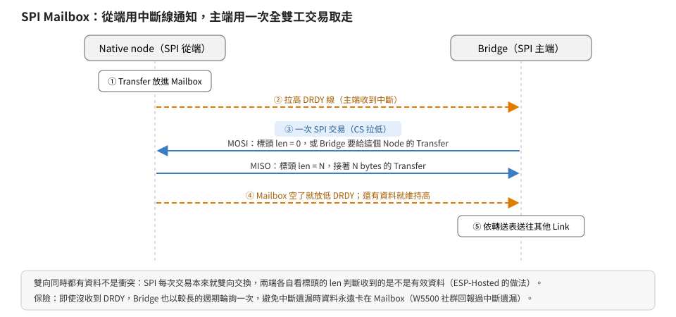
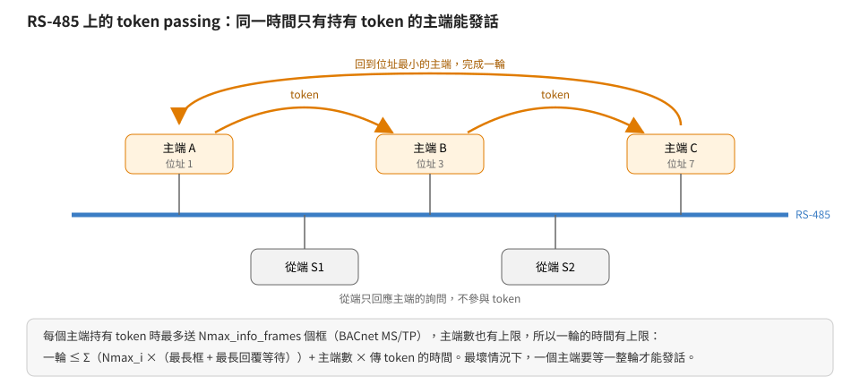
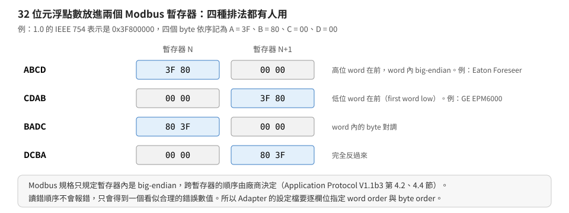

# Polled link：讓不能主動發話的從端也能發佈

Cyphal 式的 pub/sub（發送端把資料發佈到某個 Subject，訂閱的 Node 自己收下，細節見 [Cyphal 的設計](../20-protocol/01-cyphal-design.md)）假設每個 Node 都能隨時發送。SPI、I²C、Modbus 打破了這個假設：只有主端能發起交易。
這篇說明在這類 Link 上要解決的兩件事：主端怎麼知道從端有資料，以及多個從端時主端怎麼排輪詢。
接著看 RS-485 多主的 token passing，以及 Modbus 暫存器對應到資料欄位的慣例。
這些是 embnet-rs 的 Mailbox 規格、輪詢排程與 Adapter 設定檔的基礎。

延伸閱讀：上一篇 [Wire time 與延遲的組成](02-wire-time.md) 的輪詢等待推導；SMBus Specification 3.3.1 附錄 A.2；
Baker & Shaw 1988（cyclic executive）；Modbus Application Protocol V1.1b3。

## 一、兩個要解決的問題

在 Polled link 上，Bridge 是主端，Node 是從端。從端產生一筆 Transfer 後，要經過兩步才能送出去：

1. **通知：** 主端要知道「這個從端現在有資料」。
2. **取走：** 主端要在期限內排出一筆交易，把資料讀走。

最簡單的做法是只靠輪詢：主端定期問每個從端。上一篇推導過，等待時間平均是輪詢週期的一半，最壞是一整個週期。
要壓低延遲就得縮短週期，而大部分詢問會得到「沒有資料」，白白占用匯流排。

另一種做法是從端多拉一條中斷線。從端有資料時拉這條線，主端收到中斷才去讀。代價是多一條線與一支 GPIO。
實務上兩者常一起用：中斷線負責低延遲，低頻率的輪詢當保險。

## 二、既有的做法

### 2.1 SPI 從端

| 實例 | 怎麼通知 | 怎麼知道有多少資料 | 值得借鏡的地方 |
|---|---|---|---|
| Espressif ESP-Hosted | Handshake 線表示從端準備好交易，Data Ready 線表示從端有資料要送 | 每筆交易開頭有 12 B 的標頭，含長度欄位；沒資料時長度填 0 | SPI 每次交易本來就雙向交換。兩端都有資料時一次交換完，沒有衝突 |
| WIZnet W5500 | INTn 腳。中斷狀態暫存器不為 0 時拉低，主端對位元寫 1 清除 | `Sn_RX_RSR` 暫存器記錄已收到的 byte 數 | 清除中斷後隔一段可設定的時間才再次拉低，讓主端看得到邊緣。社群回報過中斷遺漏，官方建議另外定期輪詢 |
| Nordic nRF52840 SPIS | 本身不通知主端，要另拉 GPIO | `RXD.AMOUNT`、`TXD.AMOUNT` 記錄上一筆實際收送的 byte 數 | 用硬體 semaphore 決定緩衝區歸 CPU 還是 SPI。從端沒拿到緩衝區時，這筆交易直接被忽略，回傳預設字元 |
| TI CC3100 | 一條 IRQ 線 | 主端送同步字，持續讀到從端的同步樣式為止 | 從端沒資料時送 dummy 訊息，雙方才不會失去同步 |

出處：ESP-Hosted 的協定文件原頁抓取失敗，以上依搜尋引文與第三方 Rust crate 整理（二手）；
W5500 Datasheet V1.0.2 第 2.2 節與暫存器說明（第 34、35、56、57 頁）；nRF52840 Product Specification 的 SPIS 章；
CC3100 SPI Host Interface（TI wiki 鏡像）。

把這四個例子放在一起，可以整理出一個共通的形式：

- 一條**通知線**。
- 一個**狀態或長度欄位**，讓主端知道要讀多少。
- 一個**清除機制**：讀取就清除，或寫 1 清除。
- 一個**保險輪詢**，防止通知遺漏時資料永遠卡住。

### 2.2 I²C 從端

I²C 有兩種標準化的通知方式（SMBus Specification 3.3.1）：

- **SMBALERT# 加 Alert Response Address（ARA）**（附錄 A.2）：所有從端共用一條 SMBALERT# 線，它和 SCL、SDA 一樣是 wired-AND。
  主端收到中斷後，對 ARA（7 位元位址 0x0C）做一次讀取。只有拉線的從端會回應，並回傳自己的位址。
  多個從端同時拉線時，依 I²C 的仲裁，位址最小的先回應；主端看到線還是低，就再讀一次 ARA。
  沒有接這條線的主端，可以改成定期讀 ARA。
- **Host Notify**（第 6.5.9 節）：從端暫時變成主端，直接把自己的位址與 16 位元狀態寫給主機。

一般感測器則多半是「INT 腳加狀態暫存器」：中斷腳拉低，主端讀狀態暫存器判斷原因，讀取的同時清除旗標
（例如 TI INA226 的 Alert 腳，這部分只讀到資料手冊的摘要，待查證）。

## 三、embnet-rs 的 Mailbox 草案

依上面的共通形式，Polled link 的 Mailbox 草案如下。正式格式在 P1 寫進 `docs/spec/`，在 P4 實作。

- **每次 SPI 交易兩個方向都帶固定長度的標頭。** 標頭至少有長度欄位，長度 0 表示這個方向沒有資料。
  這樣 Bridge 要下傳資料給 Node 時，也能順便把 Node 的資料帶回來。
- **DRDY 線的語意是「Mailbox 不是空的」。** Node 只要還有資料就維持高電位，Bridge 讀完一筆若 DRDY 仍高就再讀。
  用位準觸發，比用邊緣觸發不容易漏：位準觸發只要線還在有效位準就會再觸發；邊緣觸發若在中斷關閉時錯過那次跳變，就永遠漏掉（類似 epoll 的 level-triggered 與 edge-triggered）。
- **保險輪詢。** Bridge 另外以較長的週期輪詢每個 Node 一次。
- **Mailbox 有固定深度。** 滿了要丟哪一筆，依 Subject 的設定處理（`002` 第 2.2 節），並把丟棄數放進 Node 的狀態欄位。
- **I²C 的版本沿用同一個格式。** 有 SMBALERT# 就用 ARA 找出是誰；沒有就用每個 Node 各自的 INT 線，或退回輪詢。
  clock stretching 要限制或禁止（`003` K-08）。

## 四、輪詢排程

一個 Bridge 可能要服務多個從端，每個的期限不同。排程有兩類做法。

### 4.1 Cyclic executive：事先排好的時刻表

Baker 與 Shaw（1988）描述的 cyclic executive，是把所有週期性工作事先排進一張固定的時刻表：

- **Major cycle** 是所有週期的最小公倍數，時刻表每隔一個 major cycle 重複一次。
- Major cycle 切成等長的 **minor cycle**（文獻稱為 frame，這裡稱「時槽」，以免和 CAN 的 Frame 混淆），每個時槽放幾筆固定的工作，由計時中斷強制時槽的邊界。
- minor cycle 的長度要滿足幾個條件，例如不能長於任何工作的期限、不能短於最長的單筆工作，還要能整除 major cycle（原文第 2.1 節）。

套到輪詢：假設有三個從端，期限分別是 10 ms、20 ms、40 ms，每次交易都遠短於 10 ms。

| 時槽（每格 10 ms） | 0 | 1 | 2 | 3 |
|---|---|---|---|---|
| 從端 A（每 10 ms） | 輪詢 | 輪詢 | 輪詢 | 輪詢 |
| 從端 B（每 20 ms） | 輪詢 | | 輪詢 | |
| 從端 C（每 40 ms） | | 輪詢 | | |

minor cycle 是 10 ms，major cycle 是 40 ms。時刻表固定，所以每個從端的最壞等待在建置時就能算出來。
找最佳時刻表是 NP-hard（原文第 2.2 節），但從端數量少時，用簡單的啟發法就夠了。

### 4.2 固定優先序

另一類是給每個從端一個優先序，每次挑最高優先序且到期的從端來問。Liu 與 Layland（1973）證明：
週期愈短、優先序愈高（rate monotonic）是最佳的固定優先序指派。他們也證明了一個充分條件：
使用率是每個工作的執行時間除以週期，再全部加總。m 個工作的總使用率不超過 m(2^(1/m) − 1) 就一定排得進去；m 很大時，這個值趨近 ln 2，約 69%（定理 5）。

這個結論有一個前提不符合匯流排：它假設工作可以被搶占。一筆 SPI、I²C 或 Modbus 交易一旦開始就要做完。
所以套到匯流排時，要加上「被一筆低優先序交易擋住」的時間。CAN 是同一類問題，Davis 等人（2007）有完整的分析（全文待讀）。

### 4.3 embnet-rs 的選擇

建議以 cyclic executive 為主：`embnet-config` 在建置期依設定檔產生輪詢時刻表，並算出每個從端的最壞等待。
DRDY 觸發的讀取則放在時刻表的空檔處理。理由是時刻表可以在建置期檢查，也和「轉送表在建置期固定」的原則一致。

## 五、RS-485 多主：token passing

Modbus 在 RS-485 上只有一個主站。若一條 RS-485 上有多個 Native node 都想發佈，有兩條路：
由 Bridge 當唯一的主端輪詢所有 Node，或讓 Node 輪流當主端。後者的成熟做法是 token passing。

BACnet MS/TP（ASHRAE 135 第 9 節）的機制，參數依開源實作 bacnet-stack 的註解（二手，但逐字轉述標準）：

- 持有 token 的主端最多送 `Nmax_info_frames` 個框，就要把 token 交給下一個主端。這個值可以逐台設定，用來分配頻寬
  （ASHRAE 解釋文件 IC 135-2024-6）。
- 每使用 50 次 token（`Npoll`），主端就做一次 Poll For Master，找有沒有新加入的主端。
- 線上靜默超過 500 ms（`Tno_token`），各主端依位址在 10 ms 的時槽（`Tslot`）內競爭，重建 token。
- 從端不參與 token，只回應主端的詢問。

Profibus 的做法類似，但用時間控制：所有主端共用一個目標輪轉時間 TTR，token 到達時，主端可以用的時間是 TTR 減掉實際輪轉時間
（Tovar 與 Vasques 的系列論文，只讀到摘要，待查證）。

token passing 的價值在於最壞延遲可以算。每個主端每輪的占用時間有上限，主端數也有上限，所以一輪的時間有上限，
任何一個主端最多等一輪就能發話（推導，正式的 MS/TP 最壞輪轉公式待查證）。

對 embnet-rs 來說，第一階段建議由 Bridge 當唯一主端：實作簡單，排程也集中在一處。
token passing 留到有「RS-485 上的 Node 之間直接互通」的需求時再做。

## 六、Modbus 的資料模型與對應

### 6.1 規格規定了什麼

依 Modbus Application Protocol V1.1b3：

- **四張資料表**（第 4.3 節）：Discrete Inputs（1 位元，唯讀）、Coils（1 位元，讀寫）、Input Registers（16 位元，唯讀）、
  Holding Registers（16 位元，讀寫）。四張表可以重疊，每張最多 65536 項。
- **暫存器內是 big-endian**（第 4.2 節）：16 位元值 0x1234 先送 0x12。
- **位址怎麼對應到設備的資料，完全由廠商決定**（第 4.4 節）。
- **例外碼**（第 7 節）：回應的功能碼加 0x80 表示出錯，後面接一個例外碼。常見的有 01（不支援的功能碼）、02（位址無效）、
  03（資料值不合法）、04（從站故障）、06（從站忙碌，稍後重送）。

### 6.2 規格沒規定的：跨暫存器的順序

一個 32 位元整數或浮點數要占兩個暫存器，哪個在前，規格沒有寫。

實務上四種排法都有：libmodbus 提供 `modbus_get_float_abcd`、`_badc`、`_cdab`、`_dcba` 四個函式；
Chipkin 的整理中，GE EPM6000 用 CDAB，Eaton Foreseer 用 ABCD；Kepware 的驅動預設採 Modicon 的「低位 word 在前」慣例
（Software Toolbox 2024 年的文章）。讀錯順序不會報錯，只會得到一個看似合理的錯誤數值。

### 6.3 從站要多久才回應

規格沒有規定從站的處理時間。廠商手冊的數字從幾毫秒到幾百毫秒都有（二手，待查原文）。所以 Adapter 不能假設固定的回應時間，
每台從站的逾時要分開設定。

### 6.4 既有 gateway 怎麼寫設定

ThingsBoard IoT Gateway 與 Eclipse Kura（Eurotech ESF 的 Modbus driver）都用宣告式設定描述對應：

| 層級 | ThingsBoard | Kura / ESF |
|---|---|---|
| 每台從站 | `unitId`、`pollPeriod`、`byteOrder`、`wordOrder` | `unit.id` |
| 每個欄位 | `tag`、`functionCode`、`address`、`objectsCount`、`type`、`divider`、`multiplier` | `primary.table`、`memory.address`、`data.type`、`data.order` |

兩者的共通點：從站位址、資料表、起始位址、數量、型別、word 與 byte 順序、比例，對應到一個具名的欄位，再加上輪詢週期。
embnet-rs 的 Adapter 設定可以沿用這組欄位，把「具名的欄位」換成某個 Subject 的某個欄位，並加上逾時與重試次數。

## 七、對 embnet-rs 的影響

| 觀察 | 對設計的影響 |
|---|---|
| 既有 SPI 協定都是「通知線、長度欄位、清除機制、保險輪詢」 | Mailbox 規格照這個形式定義（第三節） |
| SPI 每次交易雙向交換 | 標頭兩個方向都帶長度，上下行可以在同一筆交易完成 |
| 中斷可能遺漏 | DRDY 用位準觸發，並保留低頻率的保險輪詢 |
| SMBus 已有 ARA 的標準做法 | I²C 版 Mailbox 有 SMBALERT# 時用 ARA，不另發明 |
| Cyclic executive 的最壞等待可以在建置期算出 | `embnet-config` 產生輪詢時刻表，並納入流量預算 |
| 匯流排交易不能被搶占 | 用固定優先序時，回應時間分析要加上阻擋時間 |
| token passing 讓多主的最壞延遲可算 | 第一階段由 Bridge 當唯一主端；多主需求出現再做 |
| Modbus 跨暫存器順序沒有標準，從站回應時間差異很大 | Adapter 設定逐欄位指定 word 與 byte 順序，逐台設定逾時 |

## 來源

- Espressif ESP-Hosted SPI 協定（原頁抓取失敗，依二手整理）：<https://github.com/espressif/esp-hosted>；
  第三方 crate 的標頭定義：<https://docs.rs/crate/esp-hosted/0.1.14/source/src/header.rs>
- WIZnet, *W5500 Datasheet* V1.0.2：<https://cdn.sparkfun.com/datasheets/Dev/Arduino/Shields/W5500_datasheet_v1.0.2_1.pdf>；
  中斷遺漏的討論：<https://forum.wiznet.io/t/topic/505>
- Nordic, nRF52840 Product Specification，SPIS 章：<https://docs.nordicsemi.com/r/bundle/ps_nrf52840/page/spis.html>
- TI, CC3100 SPI Host Interface（wiki 鏡像）：
  <https://rashkash103.github.io/ti-wiki/processors.wiki.ti.com/index.php/CC3100_SPI_Host_Interface.html>
- SMBus Specification Version 3.3.1, 2024：<https://smbus.org/specs/SMBus_3_3_1_20241020.pdf>
- C. L. Liu, J. W. Layland, *Scheduling Algorithms for Multiprogramming in a Hard-Real-Time Environment*, J. ACM 20(1), 1973：
  <https://www.cs.ru.nl/~hooman/DES/liu-layland.pdf>
- T. P. Baker, A. Shaw, *The Cyclic Executive Model and Ada*, IEEE RTSS 1988：<https://www.math.unipd.it/~tullio/RTS/2009/BS-1988.pdf>
- ASHRAE, Interpretation IC 135-2024-6：
  <https://www.ashrae.org/file%20library/technical%20resources/standards%20and%20guidelines/standards%20intepretations/ic-135-2024-6.pdf>
- bacnet-stack `mstpdef.h`：<https://raw.githubusercontent.com/bacnet-stack/bacnet-stack/master/src/bacnet/datalink/mstpdef.h>
- Modbus Organization, *MODBUS Application Protocol Specification V1.1b3*：
  <https://www.modbus.org/file/secure/modbusprotocolspecification.pdf>
- libmodbus `modbus_get_float_abcd`：<https://libmodbus.org/reference/modbus_get_float_abcd/>
- Chipkin, Modbus byte order reference：<https://docs.chipkin.com/articles/modbus-data-types-byte-order-reference/>
- Software Toolbox, Modbus TOP Server settings（2024）：<https://softwaretoolbox.com/blog/modbus-top-server-settings>
- ThingsBoard IoT Gateway Modbus connector：<https://thingsboard.io/docs/iot-gateway/config/modbus/>
- Eclipse Kura Driver 與 Asset：<https://eclipse-kura.github.io/kura/docs-develop/connect-field-devices/driver-and-assets>；
  Eurotech ESF Modbus driver：<https://esf.eurotech.com/v5.1.0/docs/modbus-driver>

## 待查證

- ESP-Hosted SPI 協定原文：標頭欄位、checksum 範圍、SPI mode。
- CC3100 同步字的數值，以及雙方同時要送時的處理。
- TI INA226 Alert 腳與 SMBus Alert Response 的資料手冊正文。
- ASHRAE 135 第 9 節原文中各時間參數的規定範圍（bacnet-stack 與 Chipkin 對 `Tusage_timeout` 上限的說法不一致）。
- MS/TP 與 Profibus 的正式最壞輪轉時間公式。
- Davis 等人 2007 年論文中非搶占阻擋時間的原式。
- Modbus 從站處理時間的廠商手冊原文，或有方法論的量測。
