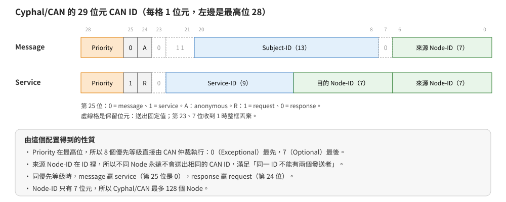
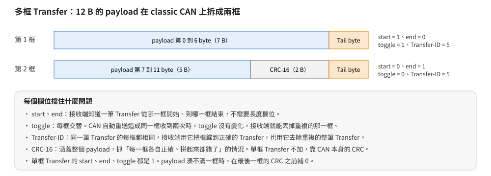
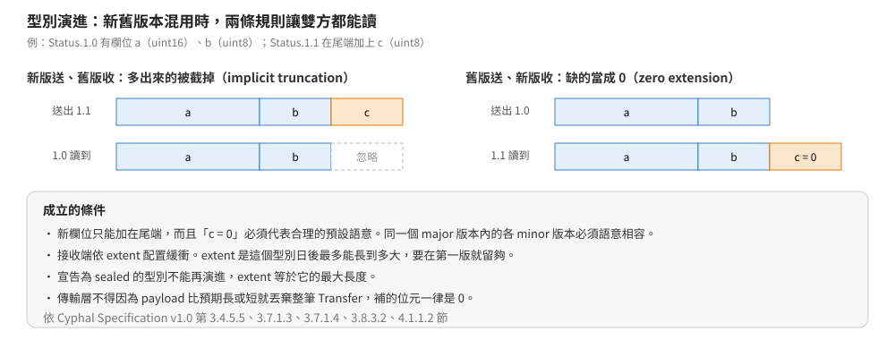

# Cyphal 的設計：去中心化、Subject 與 Service、Transfer

embnet-rs 借用 Cyphal 的設計，但線格式不相容。要決定借哪些、改哪些，得先知道 Cyphal 每個設計決定是為了解決什麼問題。
這篇依 Cyphal Specification v1.0 整理它的設計原則、通訊模型、ID 配置、Transfer 模型、CAN 線格式、Heartbeat 與型別系統，
最後列出 embnet-rs 借用與改動的部分。

延伸閱讀：Cyphal Specification v1.0（Revision 2025-05-16）；Pavel Kirienko 的 The Cyphal Guide；
CAN 的基礎見 [CAN：仲裁、填充位元與錯誤侷限](../10-buses/01-can-arbitration.md)。

## 一、來歷

Cyphal 原名 UAVCAN v1。UAVCAN 最早用在無人機的 CAN 匯流排上，v1 與 v0 不相容。2022 年 v1 改名為 Cyphal，
v0 則由另一群人以 DroneCAN 的名字繼續維護，因為 v1 對既有部署「沒有平順的遷移路徑」（DroneCAN 官網；論壇公告「UAVCAN v1 is now Cyphal」）。

兩者在 CAN 線上的主要差別：Cyphal 拿掉了 data type ID 與 data type signature，CAN ID 的位元配置不同，
多框傳輸的 toggle 位元從 1 開始而不是 0，硬體不需要改（The Cyphal Guide，Migration from DroneCAN 段）。

## 二、設計原則

規格第 1.3 節列的第一條原則是「民主網路」：

> There will be no master node. All nodes in the network will have the same communication rights; there should be no single point of failure.

另一條影響很大的原則是無狀態、低上下文（第 4.1.1.6 節）：Node 之間不對彼此的狀態做強假設。
結果是 Node 上電就能運作，不需要初始化程序；訂閱者增減時，發佈者也不會察覺。

規格沒有專門一段回答「為什麼不用 broker」。從這兩條原則可以推出來：broker 是所有通訊都要經過的單點，
它故障時整個網路停擺，違反第一條；Node 要先向 broker 註冊才能通訊，也就是要建立並維持狀態，違反第二條。
Cyphal 自己的比喻是「去中心化的 object request broker」（第 1.1 節）：broker 的功能還在，只是分散到每個 Node，
定址靠 port-ID 與 node-ID，不靠中央程序。

## 三、通訊模型

| | Message | Service |
|---|---|---|
| 型態 | 一對多的發佈與訂閱 | 一對一的請求與回應 |
| 傳送方式 | 只能廣播 | 只能單播 |
| 分類單位 | Subject | Service |
| 帶的資訊 | payload、Subject-ID、來源 Node-ID、Transfer-ID | payload、Service-ID、client 與 server 的 Node-ID、Transfer-ID |

（第 2.1.1、2.2、2.3 節；第 4.1.1.4 節）

Subject-ID 與 Service-ID 合稱 port-ID。規格把兩者分開管理，同一個 port-ID 不能用在語意不同的功能上。

Guide 建議大部分功能只用 Subject，Service 留給「本質上有狀態的低階互動」，例如讀寫設定、韌體更新。
這和無狀態原則一致：Subject 是單向廣播，發佈者不需要知道誰在聽。

還沒有 Node-ID 的 Node 只能送 anonymous message，而且只能是單框（第 4.1.1.4 節），主要用在自動分配 Node-ID。

## 四、ID 與分區

| ID | 範圍 | 出處 |
|---|---|---|
| Subject-ID | 0 到 8191（13 位元）。v1.0-beta 從 32767 縮減而來，規格註明日後可能恢復 | 第 1.4、1.7.2 節 |
| Service-ID | 0 到 511（9 位元） | 第 1.4 節 |
| Node-ID | Cyphal/CAN 0 到 127（7 位元）；Cyphal/UDP 與 serial 0 到 65534 | Table 4.1、4.5、4.8 |

port-ID 依用途分區（第 5.1.1 節 Table 5.1）：

| Subject-ID | Service-ID | 用途 |
|---|---|---|
| 0 到 6143 | 0 到 255 | 自由使用 |
| 6144 到 7167 | 256 到 383 | 廠商自定的固定 ID |
| 7168 到 8191 | 384 到 511 | 標準型別的固定 ID，例如 Heartbeat 用 7509 |

為什麼要有固定 ID？大部分 Subject 由系統整合者在設計期指定 ID，同一個型別可以用在多個 Subject 上。
但有些功能必須「不用設定就能互通」，例如 Heartbeat：每個 Node 都要發，每個工具都要能收。這類標準型別就給一個固定 ID，
寫在型別定義的檔名裡，例如 `7509.Heartbeat.1.0.dsdl`。

另外，規格建議 Node-ID 126 與 127 保留給診斷與除錯工具（第 5.2.1 節）。

## 五、Transfer 模型

### 5.1 Transfer-ID

每個 Node 為自己發出的每個 session（Subject 或 Service 加上來源）各維護一個計數器，每送一筆 Transfer 加 1。
這個值就是 Transfer-ID，它同時解決五件事（第 4.1.1.7 節）：

- 監看訊息序列，發現遺失。
- 配對 request 與 response：response 直接複製 request 的 Transfer-ID。
- 去除重複的 Transfer。
- 重組多框 Transfer。
- 管理冗餘介面：同一筆 Transfer 從兩條匯流排進來時，只收一次。

Transfer-ID 的寬度依傳輸而不同：

| 傳輸 | 寬度 | 規格的分類 |
|---|---|---|
| Cyphal/CAN | 5 位元，0 到 31 循環 | cyclic |
| Cyphal/UDP、serial | 64 位元，只增不減 | monotonic（規格定義：不同值的個數至少 2^48） |

CAN 的框太小，只放得下 5 位元。5 位元會循環，所以接收端要靠逾時判斷「這是新的一輪，還是舊的重複」：
同一個 session 太久沒收到東西，就把下一筆當成新的。規格沒有規定逾時多久，非規範的建議是取接收間隔移動平均的 2 倍；
參考實作 libcanard 的預設值是 2 秒（第 4.1.4 節；libcanard `canard.h`）。

### 5.2 Priority

規格要求至少 8 個優先等級（第 4.1.1.3 節），在 CAN 上直接對應 CAN ID 的最高 3 位元（第 4.2.1.1 節）：

| 值 | 名稱 | 值 | 名稱 |
|---|---|---|---|
| 0 | Exceptional | 4 | Nominal（Heartbeat 用這級） |
| 1 | Immediate | 5 | Low |
| 2 | Fast | 6 | Slow |
| 3 | High | 7 | Optional（診斷與除錯） |

service 的 response 要用和 request 相同的優先等級。

## 六、Cyphal/CAN 的線格式

### 6.1 CAN ID

Cyphal/CAN 只用 29 位元的延伸 ID，所以可以和只用 11 位元 ID 的協定（例如 CANopen）共用同一條匯流排（第 4.2.1 節）。

（Figure 4.3、Table 4.2、Table 4.3）

### 6.2 Tail byte 與多框 Transfer

每一框資料的最後一個 byte 是 Tail byte：最高 3 位元是 start、end、toggle，低 5 位元是 Transfer-ID（Table 4.4）。
classic CAN 的單框最多放 7 B payload，CAN FD 是 63 B。放不下時拆成多框：

多框 Transfer 的 CRC 是 CRC-16/CCITT-FALSE，以 big-endian 放在最後一框的 Tail byte 之前（第 4.2.2.4 節）。
DroneCAN 在算 CRC 前會先混入 data type signature，Cyphal 拿掉了這一步。

規格附了一個完整例子（第 4.2.3 節）：Node 42 發出 Heartbeat，CAN ID 是 `107D552A`，資料是 `00 00 00 00 00 01 A1 E0`。
拆開來看：

- `0x107D552A` 的最高 3 位元是 4，也就是 Nominal 優先等級。
- 第 20 到 8 位元是 7509，正是 Heartbeat 的固定 Subject-ID。
- 最低 7 位元是 `0x2A`，也就是 Node 42。
- Tail byte `E0` 是二進位 `1110 0000`：start、end、toggle 都是 1，表示單框 Transfer，Transfer-ID 為 0。

7509 的二進位是 `1110101010101`，規格的註解說，尾端交替的位元有助於收發器同步與自動偵測速率。

## 七、Heartbeat

`uavcan.node.Heartbeat.1.0` 是 Cyphal 唯一強制的功能，其餘都是選用（第 5.3.2 節）。

| 項目 | 內容 |
|---|---|
| 發佈週期 | 不超過 1 秒（`MAX_PUBLICATION_PERIOD = 1`） |
| 判定離線 | 超過 3 秒沒收到（`OFFLINE_TIMEOUT = 3`） |
| `uptime` | 開機後的秒數。數值往回跳，表示對方重啟過 |
| `health` | NOMINAL、ADVISORY、CAUTION、WARNING 四級，參考航空儀表的警示分級 |
| `mode` | OPERATIONAL、INITIALIZATION、MAINTENANCE、SOFTWARE_UPDATE |
| `vendor_specific_status_code` | 8 位元，由廠商定義 |

整個訊息 7 B，剛好放進一個 classic CAN 單框。

## 八、型別系統 DSDL

Cyphal 用一種型別定義語言 DSDL 描述每個 Message 與 Service 的欄位。型別是靜態的，序列化後的長度有上下界，
可以在建置期產生程式碼並做靜態分析（第 3.1.1 節）。

序列化規則（第 3.7 節）：

- 多位元組數值用 little-endian；位元組內從最低位開始放。
- 欄位以位元為單位緊密排列，不對齊到 byte；整個型別結尾補到 8 位元的倍數。

### 8.1 型別怎麼演進

系統會升級，新舊版本的 Node 常常同時存在。DSDL 用兩條規則讓雙方都能讀：

版本號是 major.minor。同一個 major 內的各 minor 版本必須語意相容；不相容的改動就升 major（第 3.8.3.2 節）。

### 8.2 Cyphal 不在執行期檢查型別

Cyphal v1.0 沒有型別雜湊，也不在執行期檢查收發兩端的型別是否一致。規格說這是系統整合者的責任（第 5.1.2 節）。
DroneCAN 則把 data type signature 混進 CRC，型別不同時 CRC 會錯。

Guide 說明 Cyphal 拿掉 data type ID 的理由：它把資料的語法（型別定義）和語意（這筆資料拿來做什麼）綁在一起。
在 Cyphal 裡，型別和 Subject-ID 是兩件獨立的事，同一個型別可以用在多個 Subject。

## 九、Port list 與自動分配 Node-ID

- **Port list**（`uavcan.node.port.List`，Subject 7510）：每個 Node 每 10 秒以內公布自己發佈、訂閱哪些 Subject，提供哪些 Service。
  收集所有 Node 的清單，就能重建整個網路的資料流（第 5.3.4 節）。
- **自動分配 Node-ID**（plug-and-play）：新 Node 用 anonymous message 廣播自己的 128 位元唯一 ID，分配者回覆一個 Node-ID。
  分配者可以有多台，用 Raft 共識演算法同步分配表（第 5.3.12 節、第 6.6 節）。規格明說這個功能「fundamentally non-deterministic」，
  高可靠的系統應該用靜態的 Node-ID。

## 十、Cyphal/UDP、serial 與 v1.1 的方向

- **Cyphal/UDP 與 Cyphal/serial** 在 2025 年 5 月的修訂才放進規格，兩者都標示為 experimental，日後可能有不相容的改動
  （第 4.3、4.4 節）。UDP 用 IPv4 multicast，每個 Subject 對應一個群組位址，Node 的 IP 位址與協定無關。
  serial 用 COBS 分框，每筆 Transfer 只用一框。
- **v1.1 的預覽**（論壇 RFC，2026 年 1 月，作者自述還不是正式的 RFC）：Subject 改用名稱，由 Node 之間的共識指派數字 ID；
  RPC（也就是 Service）不再是傳輸層的獨立概念；Cyphal/UDP 大幅簡化，不再和 v1.0 相容。後續回覆中的細節還在變動，待查證。

## 十一、已知的限制

| 限制 | 出處 |
|---|---|
| Cyphal/CAN 最多 128 個 Node | Table 4.1 |
| 跨傳輸轉送沒有標準元件。CAN 的 Transfer-ID 是 5 位元循環，UDP 是 64 位元，兩者之間沒有直接的對應；Service 無法跨網段 | 論壇「Cyphal/UDP Routing over Multiple Networks」 |
| 型別相容性不在執行期檢查 | 第 5.1.2 節 |
| anonymous 與自動分配 Node-ID 是非決定性的 | 第 4.2.1.2、6.6.1 節 |
| 安全性不在規格範圍內 | 第 5.3.13 節腳註 |
| 數字 Subject-ID 要人工管理，v1.1 預覽把這列為要解決的痛點 | v1.1 RFC |

## 十二、embnet-rs 借用與改動的部分

| Cyphal 的設計 | embnet-rs | 理由 |
|---|---|---|
| 民主網路，同匯流排的 Node 直接互通 | 借用 | Bridge 故障不影響同匯流排的通訊（`002` 第一節） |
| Subject 廣播、Service 單播 | 借用 | 與 ROS 2 的 topic 和 service 對應，使用端容易理解 |
| 數字 port-ID，在設計期指定 | 借用，由 `embnet-config` 在建置期產生 | 線上不送名稱；轉送表可以在建置期檢查。v1.1 改用名稱的方向值得追蹤 |
| Transfer-ID 的五種用途 | 借用 | 同一個欄位同時處理去重複、重組與配對 |
| Transfer-ID 寬度隨傳輸不同 | **待定** | 跨 Link 轉送時，寬度不同就沒有直接對應（`003` K-13） |
| 8 級 Priority 放在 CAN ID 最高位 | 借用 | 由硬體仲裁保證優先序 |
| Tail byte 與多框 CRC | 借用 | 設計成熟；toggle 解決 CAN 自動重送造成的重複框 |
| CAN ID 中的保留位元 | 不保留，部分改給 MAC 延伸用（`002` 第 4.2 節） | 不需要和 Cyphal 或 DroneCAN 共存在同一條匯流排 |
| Heartbeat：1 秒、3 秒、health、mode | 借用，另加 CAN 錯誤計數與 security 事件計數 | `003` K-23 |
| DSDL 的截斷與補零、extent | 借用概念 | 讓新舊版本 Node 共存 |
| 不在執行期檢查型別 | **改動**：Type hash 算進 E2E CRC | 型別不一致時接收端能發現，做法類似 DroneCAN（`002` 第 2.1 節） |
| Node-ID 範圍隨傳輸不同 | **改動**：全系統共用 7 位元 | 跨 Link 轉送不用轉換位址 |
| anonymous 與自動分配 Node-ID | 不做 | 非決定性；Node-ID 在設計期固定 |
| 沒有跨傳輸轉送 | **新增** Bridge | 本專案的主要工作 |
| 沒有安全機制 | **新增** E2E 保護與截短 MAC | `002` |

## 來源

- OpenCyphal, *Cyphal Specification v1.0*, Revision 2025-05-16：<https://specification.opencyphal.org/Cyphal_Specification.pdf>
- P. Kirienko, *The Cyphal Guide*：<https://forum.opencyphal.org/t/the-cyphal-guide/778>
- 論壇公告「UAVCAN v1 is now Cyphal」（2022-03-25）：<https://forum.opencyphal.org/t/uavcan-v1-is-now-cyphal/1622>
- 「Cyphal vs. DroneCAN」：<https://forum.opencyphal.org/t/1814>
- 「Cyphal/UDP Routing over Multiple Networks」：<https://forum.opencyphal.org/t/cyphal-udp-routing-over-multiple-networks/1657>
- 「Architectural issues caused by the dependency between the node's IP address and its identity」：<https://forum.opencyphal.org/t/1765>
- 「RFC: Early preview of Cyphal v1.1」：<https://forum.opencyphal.org/t/rfc-early-preview-of-cyphal-v1-1/2438>
- DroneCAN 官網與 CAN 傳輸層規格：<https://dronecan.github.io/>、<https://dronecan.github.io/Specification/4.1_CAN_bus_transport_layer/>
- OpenCyphal public_regulated_data_types：<https://github.com/OpenCyphal/public_regulated_data_types>
- libcanard `canard.h`：<https://raw.githubusercontent.com/OpenCyphal/libcanard/master/libcanard/canard.h>

## 待查證

- v1.1 預覽的細節（Subject 名稱的共識機制、16 位元 Subject-ID、UDP 標頭的改動），目前只讀到論壇回覆的摘要。
- 對應 Cyphal v1.0 的 libcanard v4 的預設 Transfer-ID 逾時（已確認的是 v5 的 2 秒）。
- 「為什麼不用 broker」沒有規格原文，第二節的說明是由兩條原則推導的。
