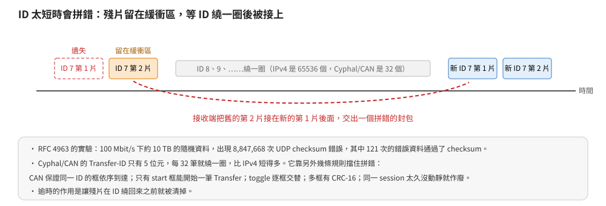
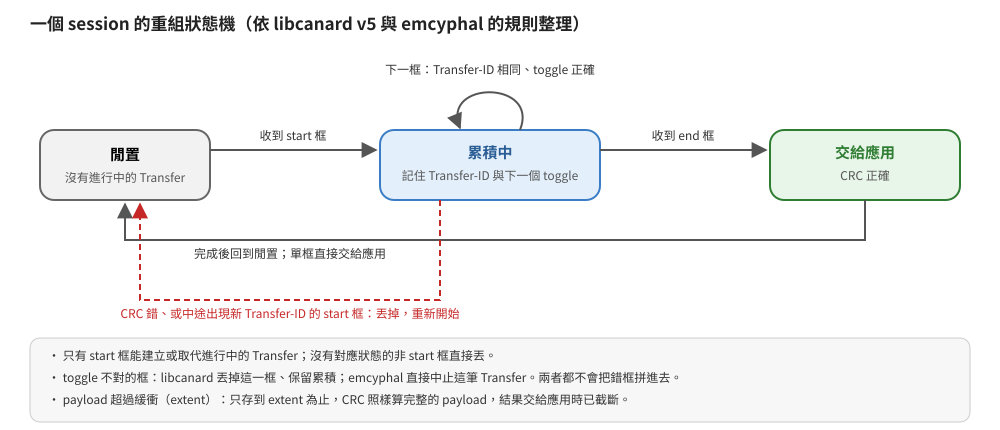
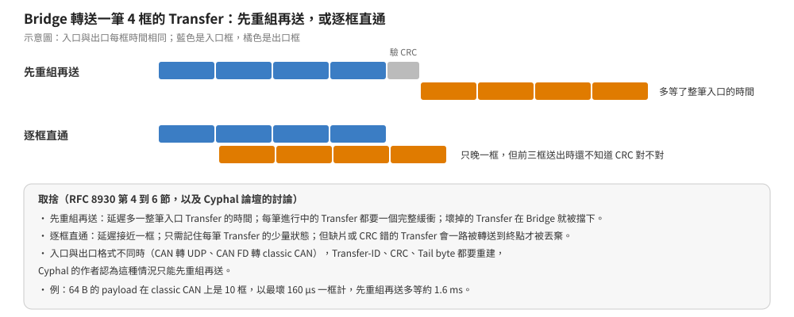

# 分片與重組：狀態機、緩衝與 Bridge 的轉送

一筆 Transfer 比一個框大時，要拆成多框送，接收端再拼回來。拼的過程有三個問題要解決：
每一框屬於哪一筆 Transfer、有沒有缺框、拼出來的對不對。這篇從這三個問題出發，看 Cyphal 的實作怎麼寫重組狀態機、
IP 分片留下了什麼教訓、不配置記憶體時緩衝怎麼開，最後討論 Bridge 在不同 MTU 的 Link 之間轉送時，要先重組還是逐框直通。

延伸閱讀：上一篇 [Cyphal 的設計](01-cyphal-design.md) 第六節的 Tail byte 與多框 CRC；RFC 4963、RFC 8900、RFC 8930。

## 一、三個問題

| 問題 | 例子 | 常見對策 |
|---|---|---|
| 歸屬：這一框是哪筆 Transfer 的 | 兩筆 Transfer 的框交錯到達 | 每框帶 Transfer-ID |
| 完整：有沒有缺框 | 中間一框遺失 | start、end 標記，加上逐框的序號或 toggle |
| 正確：拼出來的對不對 | 舊的殘框和新的框拼在一起 | 整筆 Transfer 的 CRC；逾時清掉殘框 |

第三個問題最容易被低估。下一節先看它在 IP 上造成過什麼後果。

## 二、ID 太短會拼錯

IPv4 的分片用 16 位元的 ID 標示同一個 datagram。RFC 4963 指出，ID 只要在封包存活期間重複，就可能拼錯：

速率愈高，ID 繞一圈所需的時間愈短。RFC 4963 第 2 節算過：1500 B 的封包、30 秒的存活時間，速率超過約 26 Mbit/s 就無法保證 ID 不重複。
拼錯的 datagram 有 1/65536 的機率通過 16 位元的 checksum，交給應用的就是錯誤的資料。

RFC 8900 進一步整理了 IP 分片的其他問題：只有第一片帶埠號，防火牆難以處理後續分片；同一個 flow 的分片可能走不同路徑；
攻擊者可以送「永遠缺一片」的封包耗盡重組緩衝（第 3.4 到 3.7 節）。它的結論是新協定不應依賴 IP 分片，
應在自己的層處理分段（第 6.1 節）。Cyphal/UDP 規格照做了，並說明自己分段的另一個好處：高優先等級的 Transfer 可以插隊，
不必等一個長的 Transfer 送完。

### Cyphal/CAN 怎麼避開

Cyphal/CAN 的 Transfer-ID 只有 5 位元，每 32 筆就繞一圈，比 IPv4 短得多。它沒有拼錯，靠的是另外幾條性質與規則：

- **CAN 保證同一個 ID 的框依序到達**，而來源 Node-ID 在 CAN ID 裡，所以同一個 session 的框不會亂序。
- **只有 start 框能開始一筆 Transfer。** 沒有對應狀態的中間框直接丟掉，殘框無法被「接上」。
- **toggle 逐框交替**，重複的框和跳過的框都會被發現。
- **多框 Transfer 有 CRC-16**，拼錯的結果過不了。
- **逾時**：同一個 session 太久沒動靜，舊的狀態就作廢。

## 三、接收端的重組狀態機

把上面的規則寫成狀態機，大致如下：

三個實作在細節上的差異：

| 情況 | libcanard v5（C） | canadensis（Rust） | emcyphal（Rust） |
|---|---|---|---|
| toggle 不對 | 丟掉這一框，保留已累積的部分 | 靜默忽略這一框 | 中止整筆 Transfer |
| 新 Transfer-ID 的 start 框 | 符合條件就取代同優先等級的舊 Transfer | 重設 session | 中止其他 Transfer-ID 的重組 |
| 逾時 | 只在判斷要不要接受 start 框時用；另以 30 秒回收閒置的狀態 | 依 Transfer-ID 逾時判斷重複 | 逾時後收到非 start 框就中止 |
| 超過緩衝 | 只存到 extent，CRC 照算 | 依 `payload_size_max` 配置 | 只存到呼叫者給的緩衝長度，CRC 照算 |
| 同一來源的多個優先等級 | 每個優先等級一個 slot，被插隊的 Transfer 不會遺失 | 每個來源一個 session | 不支援 |

出處：libcanard v5.0.0 `canard.c` 的 `rx_session_solve_admission`、`rx_session_update`、`rx_slot_advance`；
canadensis `canadensis_can/src/rx/buildup.rs`、`subscription.rs`；emcyphal `emcyphal/src/buffer/gather.rs`（各自的 commit 見文末）。

libcanard 的一個設計值得注意：每個來源 Node 為每個優先等級各保留一個重組 slot。Cyphal 允許高優先等級的 Transfer 插進來，
如果只有一個 slot，被插隊的低優先等級 Transfer 就會被丟掉重來。

## 四、逾時要設多久

逾時是兩種錯誤之間的取捨（Cyphal 規格第 4.1.4 節的說明）：

- **太短：** 一筆延遲很久的低優先等級 Transfer，可能被當成新的而重複收下。
- **太長：** 遠端 Node 重啟後，Transfer-ID 從 0 重新算，新的 Transfer 可能被誤判成重複而丟掉。

規格沒有給固定值，舉的例子是取接收間隔指數移動平均的 2 倍，並要求逐 session 調整：同一個 Subject 上兩個 Node 的發送速率可能差 100 倍，
共用一個值會讓慢的那個被誤判。常見的「2 秒」出自 DroneCAN 規格與 libcanard 的預設值，Cyphal v1.0 規格本身沒有寫。

作為對照，IP 的重組逾時：

| 來源 | 值 |
|---|---|
| RFC 791（IPv4） | 建議初始值 15 秒 |
| Linux（IPv4 預設） | 30 秒 |
| RFC 8200（IPv6） | 60 秒 |
| RFC 4944（6LoWPAN） | 不得超過 60 秒 |
| lwIP（IPv4 預設） | 15 秒 |

IP 的逾時以秒到分鐘計，因為封包可能在網際網路上繞很久。內部匯流排的延遲以毫秒計，逾時可以短得多，殘框也清得更快。

## 五、不配置記憶體時，緩衝怎麼開

Cyphal 的接收端在訂閱時就知道每個型別最大多長（extent），所以每個重組 slot 的大小可以事先決定。剩下的問題是 slot 要開幾個、用完怎麼辦。

| 實作 | slot 的大小與數量 | 用完時 |
|---|---|---|
| libcanard v5 | 依 extent，向使用者提供的 allocator 要 | allocator 失敗就丟棄並計數；定期回收最久沒用的 session |
| emcyphal | 編譯期以 const generic 決定 | 最舊的 session 已逾時才回收，否則丟新的 |
| lwIP | 依 pbuf；預設同時重組 5 個 datagram、共 10 個 pbuf | 丟最舊的 |
| smoltcp | 預設 1 個 1500 B 的緩衝 | 丟新的 |

libcanard v4 的註解給了一個最壞情況的公式：每個訂閱的記憶體是 (session 結構大小 + extent) × 來源 Node 數。依這個公式配足，
執行期就保證不會因記憶體不足而丟包。

丟新的與丟舊的各有風險。丟舊的，攻擊者不斷送 start 框，就能把正常的重組一直擠掉；丟新的，殘框會占住 slot 直到逾時。
RFC 8900 第 3.7 節把「永遠缺一片」列為耗盡資源的攻擊手法。對策是限制每個來源能占用的 slot 數，並用短逾時清掉殘框。

## 六、為什麼 Cyphal 不需要 flow control

CAN 上另一個常見的分段協定是 ISO-TP（ISO 15765-2）。它的流程是：發送端先送 First Frame 宣告總長度，接收端回 Flow Control，
說明一次可以收幾框（Block Size）、框與框之間至少隔多久（STmin），發送端照著送 Consecutive Frame（依 Linux 核心的 `can-isotp` 文件與原始碼，ISO 原文未讀）。

Cyphal 沒有這一步，原因有兩個：

- **Message 是一對多的廣播。** 要每個訂閱者都回 Flow Control 並不可行。Linux 的文件也註明，ISO-TP 標準的多框傳輸只涵蓋一對一。
- **接收端的緩衝在訂閱時就決定了。** 接收端知道 extent，不需要在執行期協商「你收得下嗎」。

代價是發送端不會因接收端忙碌而放慢。接收端必須跟得上匯流排的最高速率，這又回到 `003` 第 1.3 節的接收 FIFO 問題。

## 七、Bridge 在不同 MTU 之間轉送

Bridge 收到一筆多框 Transfer，要轉到另一條 Link。有兩種做法：

6LoWPAN 社群在 RFC 8930 中比較過這兩種做法：

- **先重組再送**：每一跳都要等齊所有分片，延遲隨跳數累加。重組緩衝很大，以 1280 B 計，一般節點只放得下 1 到 3 個（第 4 節）。
- **逐框直通**：第一片建立轉送狀態，後續分片照狀態轉送。狀態表比重組緩衝小兩個數量級，延遲低。
  但缺片時無法只補那一片，已知拼不回的分片仍會被一路轉送（第 6 節）。規則包括：第一片必須先送；沒有對應狀態的非第一片必須丟棄。

Cyphal 的情況多了一層：CAN 與 UDP 的 Transfer-ID 寬度不同，CRC 也不同（CAN 多框用 CRC-16，UDP 每筆都用 CRC-32C），
CAN FD 轉 classic CAN 時單框可能變多框。Cyphal 的作者在論壇上說 CAN 框與 UDP 框之間「沒有直接的對應」，
橋接節點必須完整重組再重新分段；他的概念驗證程式也是在 Transfer 層轉送。

## 八、對 embnet-rs 的影響

| 觀察 | 對設計的影響 |
|---|---|
| Cyphal/CAN 靠「依序到達、start 框才能開始、toggle、CRC、逾時」避免拼錯 | `embnet-core` 沿用這組規則；UART 與 SPI 上沒有「依序到達」的保證時，要另外確認 framing 能維持順序 |
| libcanard 為每個優先等級保留 slot | Bridge 的重組 slot 依（來源、優先等級）配置，被插隊的 Transfer 不會遺失 |
| 逾時取捨在「重複」與「重啟後遺失」之間 | 逾時逐 session 依接收間隔決定；Heartbeat 的 `uptime` 往回跳時，立即重設該來源的所有 session |
| 最壞記憶體 = (狀態 + extent) × 來源數 | `embnet-config` 在建置期依轉送表算出 Bridge 的重組記憶體，超過預算就拒絕建置 |
| 「永遠缺一片」可以耗盡 slot | 每個來源的 slot 數有上限；殘框用短逾時清除（`003` K-14） |
| 沒有 flow control，接收端要跟得上線速 | 與接收 FIFO 的風險合併處理（`003` 第 1.3 節） |
| 格式不同的 Link 之間只能先重組再送 | 預設在 Transfer 層轉送；入口與出口格式完全相同時（例如 CAN 轉 CAN）才允許逐框直通。延遲預算要算進一整筆入口 Transfer 的時間（`003` 第 1.2 節、K-06、K-13） |

## 來源

- libcanard v5.0.0（commit `f82291298ef19cf2ae1abee75007a5d8fae83801`）與 v4.0.0（commit `d362f195c074f37056dfe5aef33e4558da3cd53a`），
  `libcanard/canard.c`、`canard.h`：<https://github.com/OpenCyphal/libcanard>
- canadensis（commit `b28b8409efa6b1d70eb1d9a4518abbc3d9afa72f`）：<https://github.com/samcrow/canadensis>
- emcyphal（commit `58e81851aa16c88d3bfa3c3c951ad7d67823e5bb`）：<https://github.com/dan-stefanov/emcyphal>
- RFC 4963, *IPv4 Reassembly Errors at High Data Rates*：<https://www.rfc-editor.org/rfc/rfc4963.txt>
- RFC 8900, *IP Fragmentation Considered Fragile*：<https://www.rfc-editor.org/rfc/rfc8900.txt>
- RFC 8930, *On Forwarding 6LoWPAN Fragments over a Multi-Hop IPv6 Network*：<https://www.rfc-editor.org/rfc/rfc8930.txt>
- RFC 8931, *IPv6 over Low-Power Wireless Personal Area Network (6LoWPAN) Selective Fragment Recovery*：<https://www.rfc-editor.org/rfc/rfc8931.txt>
- RFC 791、RFC 8200、RFC 4944
- Cyphal 規格 LaTeX 原始碼（commit `efbcccd5696ec5cd96e083724f211780c4d80b2e`）`specification/transport/abstract.tex`、`udp/udp.tex`：
  <https://github.com/OpenCyphal/specification>
- DroneCAN CAN 傳輸層規格：<https://dronecan.github.io/Specification/4.1_CAN_bus_transport_layer>
- Cyphal 論壇「Cyphal/UDP Routing over Multiple Networks」：<https://forum.opencyphal.org/t/cyphal-udp-routing-over-multiple-networks/1657>；
  概念驗證程式：<https://github.com/pavel-kirienko/cyphal-bridge-and-router>
- Linux 核心 v6.12：`Documentation/networking/iso15765-2.rst`、`net/can/isotp.c`、`include/net/ip.h`
- lwIP `STABLE-2_2_1_RELEASE` 的 `src/include/lwip/opt.h`、`src/core/ipv4/ip4_frag.c`；smoltcp v0.14.0 的 `build.rs`、`src/iface/fragmentation.rs`

## 待查證

- Cyphal v1.0 規格是否在某處寫了「2 秒」：libcanard 的註解說出自規格，但規格的 LaTeX 原始碼搜不到。
- ISO 15765-2 原文的時間參數與 Block Size、STmin 的正式定義。
- RFC 8930 引用的 Tanaka、Minet、Watteyne 2019 年文章中的模擬數字。
- canadensis 是否有純粹依時間回收殘缺 session 的機制。
- Cyphal 論壇引文的完整原句。
