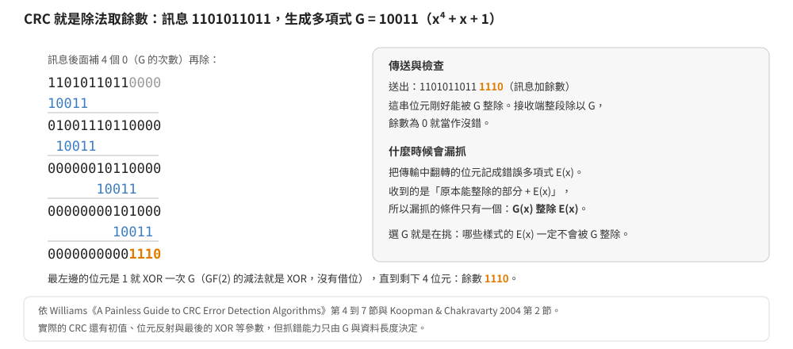
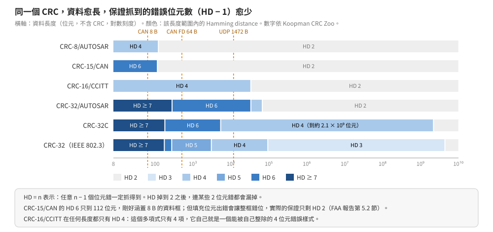
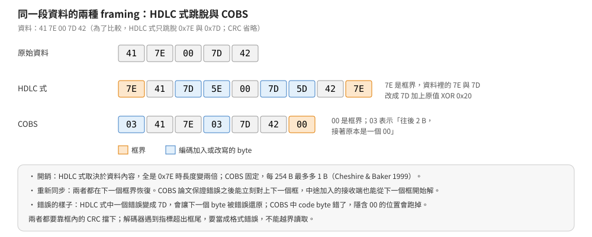

# CRC 與 framing

CRC 是嵌入式通訊中最常見的錯誤偵測手段，但很多人只知道「選一個多項式、算出來附在後面」。
這篇從多項式除法推起，說明 CRC 為什麼能抓錯、什麼時候會漏抓、為什麼同一個 CRC 在長資料上變弱，
再看 byte stream 上的兩種 framing：HDLC 式跳脫與 COBS，以及 framing 和 CRC 之間容易被忽略的交互作用。

延伸閱讀：Ross Williams《A Painless Guide to CRC Error Detection Algorithms》；Koopman & Chakravarty 2004；
Koopman 等人的 FAA 報告 DOT/FAA/TC-14/49（2015）；Koopman 的 CRC Zoo；Cheshire & Baker 1999（COBS）。

## 一、要解決的問題

線路雜訊會翻轉位元。接收端需要一個便宜的方法判斷「收到的和送出的一不一樣」。最直接的做法是把資料再送一次，
但那會讓頻寬加倍。CRC 用 8 到 32 個位元的校驗碼，就能保證某些類型的錯誤一定被抓到，其餘的錯誤也有極高的機率被抓到。

這裡的錯誤指隨機的位元翻轉。CRC 擋不住有人故意改資料，第六節會說明原因。

## 二、CRC 就是除法取餘數

把一串位元看成係數只有 0 和 1 的多項式。例如 `10011` 就是 x⁴ + x + 1。在這種算術（GF(2)）裡，加法和減法都是 XOR，
沒有進位也沒有借位（Williams 第 4、5 節）。CRC 的計算是：在訊息後面補 r 個 0（r 是生成多項式 G 的次數），除以 G，餘數就是 CRC。

送出的是「訊息加餘數」，它剛好能被 G 整除。傳輸中翻轉的位元可以寫成一個錯誤多項式 E(x)，接收端收到的是原本的位元串加上 E(x)。
原本的部分能被 G 整除，所以接收端算出的餘數是 0，**若且唯若 G 整除 E(x)**。CRC 漏抓的條件就只有這一個。

實務上的 CRC 還有初值、位元反射、最後 XOR 等參數（第五節），但抓錯的能力只取決於 G 和資料長度。
FAA 報告的說法是，以位元錯誤率模型來看，CRC 的偵錯能力與初值無關（第 3.10.1 節）。

## 三、從「G 整除 E」推出偵錯能力

選 G 就是在挑：哪些樣式的 E(x) 一定不會被 G 整除。

- **單位元錯。** E(x) = xⁱ。只要 G 至少有兩項（例如包含常數項 1），G 就不可能整除 xⁱ。
- **奇數個位元錯。** 若 G 含有 (x + 1) 這個因子，代入 x = 1 得 G(1) = 0。奇數個位元錯的 E(x) 代入 x = 1 得 1（奇數個 1 做 XOR）。
  如果 G 整除 E，E(1) 應該也是 0，矛盾，所以一定抓得到。代價是偶數個位元錯的漏抓比例約加倍（FAA 報告第 3.9 節）。
- **長度不超過 r 的連續錯誤（burst）。** 這種 E(x) 可以寫成 xⁱ · B(x)，B 的次數小於 r。G 的次數是 r，整除不了比自己低次的 B；
  G 有常數項，和 xⁱ 沒有公因式。所以一定抓得到。超過 r 的 burst，漏抓機率約 2⁻ʳ（Williams 第 7 節；Koopman 2004 第 1 頁）。
- **兩個位元錯。** E(x) = xⁱ (xᵏ + 1)，k 是兩個錯誤位元的距離。G 不會整除 xᵏ + 1 的條件是 k 小於 G 的週期（period：讓 G 整除 xᵏ + 1 的最小 k）。週期由 G 決定，也是兩位元錯一定抓得到的最大距離。
  所以資料一長，兩個錯誤位元的距離就可能達到那個值，CRC 開始漏抓某些 2 位元錯。這就是下一節「HD 隨長度下降」的根源。

## 四、Hamming distance 與資料長度

Hamming distance（HD）是 CRC 強度的單一指標：HD = n 表示任兩個合法的「資料加 CRC」至少差 n 個位元，所以翻掉 n − 1 個位元，一定變不成另一個合法的值，錯誤一定抓得到。HD 不是常數，它隨資料長度改變。

照 Koopman CRC Zoo 原樣抄的數字（長度單位為位元，不含 CRC 本身）：

| CRC | 多項式 | 各 HD 可用到的最大資料長度 |
|---|---|---|
| CRC-8/AUTOSAR | 0x2F | HD 4 到 119 |
| CRC-15/CAN | 0x4599 | HD 6 到 112 |
| CRC-16/CCITT | 0x1021 | HD 4 到 32751 |
| CRC-32/AUTOSAR | 0xF4ACFB13 | HD 8 到 274；HD 6 到 32736；HD 4 到 65502 |
| CRC-32C | 0x1EDC6F41 | HD 8 到 177；HD 6 到 5243；HD 4 到 2147483615 |
| CRC-32（IEEE 802.3） | 0x04C11DB7 | HD 6 到 268；HD 5 到 2974；HD 4 到 91607；HD 3 到 4294967263 |

FAA 報告 Table 7 對 CRC-32 與 CRC-32C 的 HD 3、HD 4 上限和 Zoo 略有差異，HD 5、6 一致，差異原因待查證。

幾個值得注意的地方：

- **CRC-16/CCITT 最高只有 HD 4，再短的資料也到不了 HD 6。** 這個多項式只有 4 項，它自己就是一個 4 位元的錯誤樣式，而且當然能被自己整除。
- **CRC-15/CAN 的 HD 6 只到 112 位元**，剛好涵蓋 8 B 的資料框（Koopman 2004 第 5.2 節）。但 FAA 報告指出，
  填充位元出錯會讓後面的位元整個錯位，實際的保證降到 HD 2（第 5.2 節）。所以 CAN 硬體的 CRC 比帳面上弱。
- **BER 是位元錯誤率。HD 每加 1，漏抓機率約再乘上 BER**（FAA 報告第 2.3 節）。這只在 BER 很小時成立。BER 為 10⁻⁶ 時，HD 從 4 升到 6，漏抓機率約降低 10¹² 倍。

Koopman 的建議是先決定最長的資料長度與需要的 HD，再查表選多項式，不要因為某個多項式「常見」就沿用（Koopman 2004 第 5.1、6 節）。

## 五、同一個多項式，不同的 CRC

CRC 除了多項式，還有幾個參數：初值（init）、輸入與輸出是否位元反射（refin、refout：每個 byte 從最低位開始處理）、最後 XOR 的值（xorout）。
同一個多項式配上不同參數，就是不同的 CRC，算出來的值也不同。Williams 提出用這組參數描述 CRC，並用字串 `"123456789"` 的 CRC 值（check）
驗證實作是否正確（第 15 節）。Greg Cook 的 RevEng catalogue 整理了各種 CRC 的完整參數：

| 名稱 | poly | init | refin/refout | xorout | check | 用在哪裡 |
|---|---|---|---|---|---|---|
| CRC-16/IBM-3740（俗稱 CCITT-FALSE） | 0x1021 | 0xFFFF | 否 | 0x0000 | 0x29B1 | Cyphal/CAN 的多框 CRC |
| CRC-16/IBM-SDLC（即 X-25） | 0x1021 | 0xFFFF | 是 | 0xFFFF | 0x906E | HDLC、PPP 的 FCS-16（RFC 1662） |
| CRC-16/KERMIT | 0x1021 | 0x0000 | 是 | 0x0000 | 0x2189 | 常被稱為「真正的 CRC-CCITT」 |
| CRC-15/CAN | 0x4599 | 0x0000 | 否 | 0x0000 | 0x059E | CAN 框 |
| CRC-32/ISCSI（即 CRC-32C） | 0x1EDC6F41 | 0xFFFFFFFF | 是 | 0xFFFFFFFF | 0xE3069283 | Cyphal/UDP 與 serial 的 payload CRC |
| CRC-32/ISO-HDLC（即 CRC-32） | 0x04C11DB7 | 0xFFFFFFFF | 是 | 0xFFFFFFFF | 0xCBF43926 | Ethernet、ZIP |
| CRC-32/AUTOSAR | 0xF4ACFB13 | 0xFFFFFFFF | 是 | 0xFFFFFFFF | 0x1697D06A | AUTOSAR E2E |
| CRC-8/AUTOSAR | 0x2F | 0xFF | 否 | 0xFF | 0xDF | AUTOSAR E2E |
| CRC-8/SAE-J1850 | 0x1D | 0xFF | 否 | 0xFF | 0x4B | AUTOSAR E2E Profile 11 |

「CRC-16/CCITT」這個名字被不同的人用在 IBM-3740、KERMIT、X-25 上，RevEng 特別註明 IBM-3740「常被誤認為 CRC-CCITT」。
規格與程式裡一律寫出完整參數或 RevEng 的名稱，避免這種混淆。

## 六、CRC 不是安全機制

Borisov、Goldberg、Wagner 分析 802.11 的 WEP 時指出，CRC 是訊息的線性函數：c(x ⊕ y) = c(x) ⊕ c(y)，而且不需要金鑰
（MobiCom 2001，第 4.1、4.2 節）。攻擊者想把資料改掉某些位元，只要把 CRC 改掉對應的位元就好，不需要知道原本的資料。
有初值或最後 XOR 時，CRC 是仿射函數而不是嚴格線性，但對等長的訊息，同樣的攻擊依然成立（推導）。

所以 CRC 只能防雜訊。要防偽造，必須用帶金鑰的 MAC（`002` 第四節）。FAA 報告另外提醒：把 CRC 和資料一起加密，不會讓它變成安全機制，
有效的 HD 應視為 1（第 5.5 節）。

## 七、AUTOSAR E2E 怎麼選 CRC

AUTOSAR E2E Protocol Specification（R24-11）的各個 profile 依資料長度選用不同的 CRC：

| Profile | CRC | 備註 |
|---|---|---|
| 01、02 | CRC-8（0x1D 或 0x2F） | 已列為 legacy，新專案改用 11 與 22 |
| 11 | CRC-8/SAE-J1850 | |
| 22 | CRC-8（0x2F） | |
| 05、06 | CRC-16（0x1021） | |
| 04、08、44 | CRC-32（0xF4ACFB13） | Profile 04 的資料最長 4096 B |
| 07 | CRC-64（ECMA，0x42F0E1EBA9EA3693） | |

（第 6.5 到 6.14 節。init 與 xorout 定義在另一份 SWS_CRCLibrary 文件，待核對。）

E2E 的 CRC 還有另一個作用：把 Data ID 一起算進 CRC，訊息被送錯地方（masquerade、insertion）時，接收端算出的 CRC 會不同（第 6.2 節 Table 6.3）。
`002` 第 2.1 節把 Subject-ID 與 Type hash 算進 E2E CRC，用的就是這個做法。

## 八、byte stream 上的 framing

UART 只傳 byte，不知道一個框從哪裡開始。framing 要在 byte stream 裡標出框界，而且框界的值不能出現在框內。

### 8.1 HDLC 式跳脫（RFC 1662）

- 框界是 0x7E，兩個框之間只需要一個（第 3.1 節）。
- 資料中出現 0x7E 或 0x7D 時，改送 0x7D 加上原值 XOR 0x20（第 4.2 節）。非同步鏈路預設還會跳脫 0x00 到 0x1F（第 7.1 節，ACCM）。
- 順序是先算 FCS 再跳脫；接收端先還原再驗 FCS。FCS-16 就是第五節表中的 CRC-16/X-25（附錄 C）。
- 開銷取決於資料內容：資料全是 0x7E 時，長度變兩倍。

HDLC 原本用在同步鏈路上，做法是 bit stuffing：連續 5 個 1 之後插入 0（RFC 1662 第 5 節），最壞多 20%，
和 CAN 的填充位元是同一類做法。UART 上用的是 octet stuffing，以 byte 為單位跳脫。

### 8.2 COBS（Cheshire & Baker 1999）

COBS 用 0x00 當框界，並把資料改寫成不含 0x00 的形式（第 III 節）：

1. 在資料尾端想像補一個 0x00，然後以 0x00 把資料切成好幾段。
2. 每段改寫成「1 個 code byte 加上這段的資料」。code byte 的值 n 表示「後面有 n − 1 個資料 byte，接著原本是一個 0x00」。
3. 一段超過 254 B 時，用 code 0xFF 表示「後面 254 B，沒有 0x00」，再接下一段。
4. 編碼後的資料不含 0x00，所以 0x00 可以放心當框界。

開銷固定：254 B 以內固定多 1 B，之後每 254 B 最多多 1 B。論文也證明它很接近理論下限。

變體：COBS/R 把最後一個 code byte 換成最後一個資料 byte，最好情況零開銷（Craig McQueen）；rCOBS 把長度放在每段的尾端，
編碼時不必往前看，但解碼要先緩衝整個框（Dirbaio，授權與細節待查證）。Cyphal/serial 用的就是 COBS 加 CRC-32C（第 4.4 節；canadensis 原始碼註解）。

## 九、framing 和 CRC 的交互作用

framing 錯了，CRC 的保證可能跟著失效。FAA 報告指出兩種情況：

- **長度欄位被破壞。** 接收端照錯的長度切資料，CRC 驗的是錯的範圍，有效 HD 降到 1（第 5.1 節）。
- **填充位元被破壞。** 後面的位元整個錯位，有效 HD 降到 2（第 5.2 節）。CAN 就屬於這種。

錯誤之後多快恢復同步：

- 兩種 framing 都在下一個框界恢復。COBS 論文特別保證錯誤之後能立刻對上下一個框，中途加入的接收端也能從下一個框開始解（第 III.A 節）。
- 框界被錯誤改掉時，兩個框會合併；資料被錯誤改成框界時，一個框會被切成兩段。兩種情況都要靠框內的 CRC 擋下（推導）。
- HDLC 式中一個錯誤變成 0x7D，會讓下一個 byte 被錯誤還原。COBS 中 code byte 錯了，隱含 0x00 的位置會跑掉，甚至指到框外。
  解碼器遇到這種情況要當成格式錯誤，不能越界讀取。

## 十、Rust 的 COBS crate

| crate | 版本 | 授權 | no_std |
|---|---|---|---|
| `cobs` | 0.5.1 | MIT OR Apache-2.0 | 支援；預設 feature 會開 `std`，用在 MCU 上要關掉預設 feature（推論，README 沒有明寫） |
| `corncobs` | 0.1.4 | MPL-2.0 | 預設就是 no_std；設計目標包括遇到損壞資料不 panic |

（crates.io，查詢日 2026-11-16）

`corncobs` 是 MPL-2.0。它是檔案層級的 copyleft：可以當相依使用，但修改它的檔案時，修改的部分要以 MPL 公開。本 repo 是 MIT，
用不用它要另外決定。

## 十一、對 embnet-rs 的影響

| 觀察 | 對設計的影響 |
|---|---|
| 漏抓的條件只有「G 整除 E」，強度用 HD 衡量，而 HD 隨長度下降 | E2E CRC 依 Transfer 的最大長度與殘餘錯誤率一起選：HD 只在錯誤位元少時是重點，錯誤率高時漏抓機率趨近 2⁻ʳ，CRC-8 約 1/256。`protected` Subject 在殘餘錯誤率算出來之前不用 CRC-8；需要 HD 6 時用 CRC-32/AUTOSAR（到約 4 KB）。P1 依殘餘錯誤率與各 Link 的空間決定（`003` K-15） |
| CAN 硬體的 CRC 會被填充位元削弱到 HD 2 | `protected` Subject 一定要有 E2E CRC，不能只靠 CAN 的 CRC（`003` K-15） |
| 同名 CRC 參數不同，算出來的值就不同 | 規格一律寫完整參數與 RevEng 名稱；test vector 收錄 `"123456789"` 的 check 值，作為不依賴本專案實作的對照（`003` K-10） |
| CRC 是線性的，擋不住偽造 | 需要防偽造的 Subject 用截短 MAC（`002` 第四節） |
| Cyphal/CAN 的多框 CRC 與 E2E CRC 是兩層 | P1 評估 E2E CRC 能不能取代多框 CRC，省下 classic CAN 的空間 |
| COBS 開銷固定、錯誤後立即重新同步，Cyphal/serial 也用 COBS | UART framing 傾向改用 COBS 加 CRC，取代 `xrce-rs` 的 HDLC 式；P1 定案 |
| framing 出錯可能讓 CRC 失效 | 不用長度欄位界定 UART 框；COBS 解碼器的越界情況列為 fuzz 的重點 |
| `cobs` 是 MIT/Apache，`corncobs` 是 MPL-2.0 | 優先用 `cobs` 或自寫；選 `corncobs` 要先確認授權條件可以接受 |

## 來源

- R. N. Williams, *A Painless Guide to CRC Error Detection Algorithms*, v3, 1993（鏡像）：<https://zlib.net/crc_v3.txt>
- P. Koopman, T. Chakravarty, *Cyclic Redundancy Code (CRC) Polynomial Selection For Embedded Networks*, DSN 2004：
  <https://users.ece.cmu.edu/~koopman/roses/dsn04/koopman04_crc_poly_embedded.pdf>
- P. Koopman, K. Driscoll, B. Hall, *Selection of Cyclic Redundancy Code and Checksum Algorithms to Ensure Critical Data Integrity*,
  DOT/FAA/TC-14/49, 2015：<https://users.ece.cmu.edu/~koopman/pubs/faa15_tc-14-49.pdf>
- P. Koopman, CRC Zoo（CC BY 4.0）：<https://users.ece.cmu.edu/~koopman/crc/>
- G. Cook, CRC RevEng catalogue：<https://reveng.sourceforge.io/crc-catalogue/>
- N. Borisov, I. Goldberg, D. Wagner, *Intercepting Mobile Communications: The Insecurity of 802.11*, MobiCom 2001（draft 版）：
  <https://pld.cs.luc.edu/courses/449/fall08/borisov_goldberg_wagner.pdf>
- AUTOSAR, *E2E Protocol Specification*, R24-11：<https://autosar.org/fileadmin/standards/R24-11/FO/AUTOSAR_FO_PRS_E2EProtocol.pdf>
- RFC 1662, *PPP in HDLC-like Framing*：<https://www.rfc-editor.org/rfc/rfc1662.html>
- S. Cheshire, M. Baker, *Consistent Overhead Byte Stuffing*, IEEE/ACM Transactions on Networking 7(2), 1999：
  <http://www.stuartcheshire.org/papers/COBSforToN.pdf>
- C. McQueen, COBS/R：<https://pythonhosted.org/cobs/cobsr-intro.html>
- canadensis_core 0.6.0 `src/crc.rs`：<https://docs.rs/crate/canadensis_core/0.6.0/source/src/crc.rs>
- crates.io：<https://crates.io/crates/cobs>、<https://crates.io/crates/corncobs>

## 待查證

- Peterson & Brown 1961 的原文定理。
- FAA 報告與 Zoo 在 CRC-32、CRC-32C 的 HD 3、HD 4 上限的差異原因。
- AUTOSAR 各 profile CRC 的 init 與 xorout（SWS_CRCLibrary）。
- rCOBS 的授權與 crates.io 頁面。
- WEP 論文正式版的節號是否與 draft 版相同。
