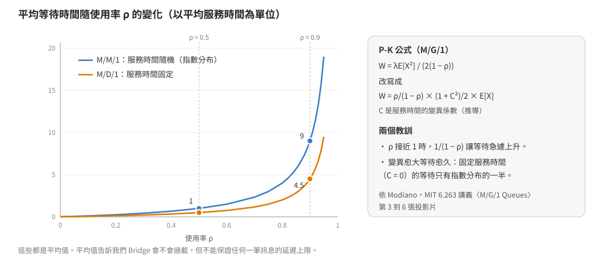
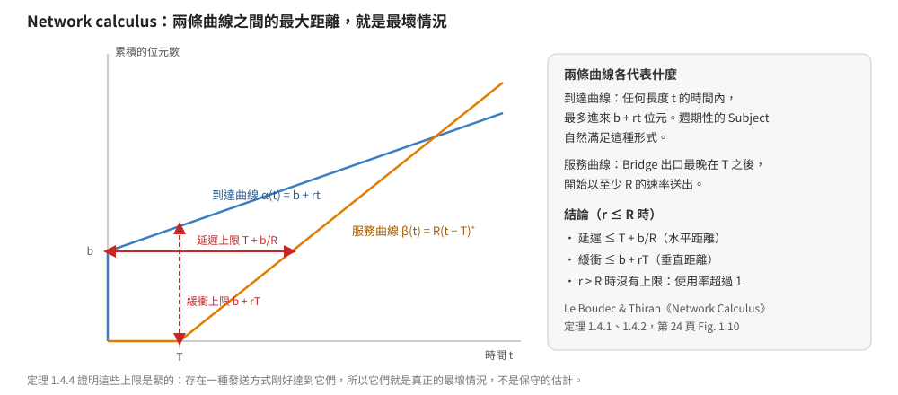
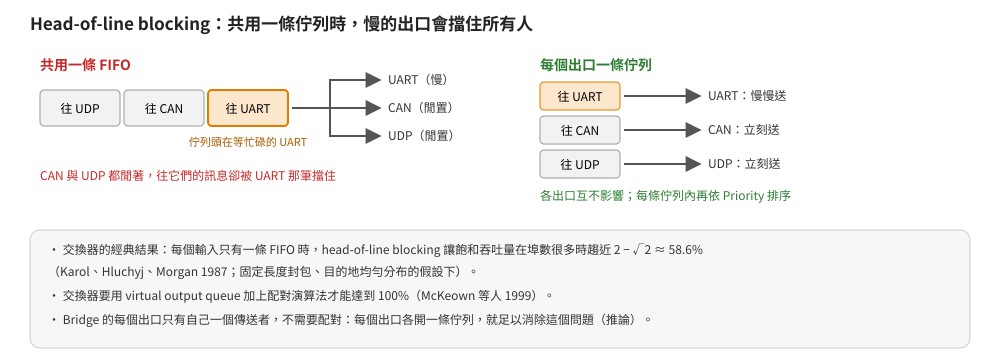

# Bridge 的排隊與延遲上限

Bridge 是跨匯流排流量的交會點，它會不會成為瓶頸？這個問題有兩種問法：平均來說會不會過載，以及最壞情況下一筆訊息最晚多久送達。
前者用排隊理論回答，後者用 network calculus。這篇先各自說明直覺與公式，再看優先序、head-of-line blocking、丟棄策略與 CAN 轉乙太網路的打包，
最後整理成 embnet-rs 在建置期檢查流量預算的方法。

延伸閱讀：Le Boudec & Thiran《Network Calculus》（線上版）第 1 章；Modiano 的 MIT 6.263 講義；Davis 等人 2007 的 CAN 回應時間分析；
`003` 第一節的瓶頸推算。

## 一、兩種問題，兩種工具

| 問題 | 工具 | 假設 | 給出什麼 |
|---|---|---|---|
| 平均會不會過載 | 排隊理論 | 到達與服務是隨機過程 | 平均等待時間 |
| 最壞情況多慢 | Network calculus | 到達與服務各有上下界 | 延遲與緩衝的上限 |

控制系統關心的是後者：期限是硬的，平均值好看不代表每一筆都準時。但前者的兩個直覺，對理解後者很有幫助。

## 二、平均值：排隊理論

單一佇列的平均等待時間由 Pollaczek–Khinchine 公式給出（Modiano，〈M/G/1 Queues〉第 3 到 6 張）：

W = λE[X²] / (2(1 − ρ))

λ 是到達率，X 是服務時間，ρ = λE[X] 是使用率。這個公式只用三件事推出來：服務中的那一筆平均還剩多久、Poisson 到達看到的是時間平均（PASTA）、
以及 Little's law。它帶出兩個教訓：

- **使用率接近 1 時，等待急遽上升。** 分母是 1 − ρ。ρ 從 0.5 升到 0.9，等待增為 9 倍。
- **變異愈大，等待愈久。** 分子是 E[X²]，不是 E[X]²。服務時間固定（M/D/1）時，等待只有指數分布（M/M/1）的一半。
  到達也不規律時，Kingman 的近似把兩者合在一起：等待約為 ρ/(1 − ρ) × (c_a² + c_s²)/2 × 平均服務時間，c_a、c_s 是到達間隔與服務時間的變異係數。

兩個延伸結果和 Bridge 直接相關：

- **輪詢的代價。** 若 Bridge 只在固定的 tick 檢查佇列，平均等待再加半個服務時間（Modiano 第 10 張，slotted M/D/1）。
- **非搶占優先序的代價。** 最高優先序的平均等待，分子仍包含所有類別的 E[X²]，也就是說低優先序的長訊息會拖慢高優先序（Modiano〈M/G/1 queues with priority〉第 11 張）。

## 三、最壞上限：network calculus

### 3.1 兩條曲線

network calculus 不假設流量是隨機的，只要求兩個界：

- **到達曲線 α：** 任何長度 t 的時間內，最多進來 α(t) 位元。最常用的形式是 token bucket：α(t) = b + rt，b 是最大突發量，r 是長期速率
  （Le Boudec & Thiran 定義 1.2.1，第 7 頁）。
- **服務曲線 β：** 節點保證的最低服務。最常用的是 rate-latency：β(t) = R(t − T)⁺，意思是「最晚在 T 之後，開始以至少 R 的速率送出」（第 1.3.2 節，第 21 頁）。

延遲上限是兩條曲線的最大水平距離（定理 1.4.2），緩衝上限是最大垂直距離（定理 1.4.1）。對上面兩種形式，閉式結果是（第 24 頁 Fig. 1.10）：

- 延遲 ≤ T + b/R
- 緩衝 ≤ b + rT
- 送出去的流量，突發量變成 b + rT
- 前提是 r ≤ R；r > R 時沒有上限

定理 1.4.4 證明這些上限是緊的：存在一種發送方式剛好達到它們。所以它們就是真正的最壞情況，不是保守估計。

### 3.2 週期性的 Subject 天然就有到達曲線

一個 Subject 每 P 秒發佈一筆，每筆在線上占 k 位元，發佈時刻的抖動不超過τ。它的到達曲線是 token bucket，
r = k/P，b = k(τ/P + 1)（命題 1.2.2，第 9 頁）。多個 Subject 共用一個出口時，把 r 與 b 各自相加即可。

所以只要設定檔裡寫了每個 Subject 的週期、大小與抖動，Bridge 每個出口的延遲上限與緩衝上限就能在建置期算出來。

### 3.3 一個算例

假設 Bridge 把三個 Subject 從 UDP 轉進一條 1 Mbit/s 的 CAN。每筆都是 8 B 的單框，以最壞填充計 160 位元；週期分別是 10、20、50 ms，抖動都是 1 ms。

| Subject | r = k/P | b = k(τ/P + 1) |
|---|---|---|
| 週期 10 ms | 16 kbit/s | 176 位元 |
| 週期 20 ms | 8 kbit/s | 168 位元 |
| 週期 50 ms | 3.2 kbit/s | 163.2 位元 |
| 合計 | 27.2 kbit/s | 507.2 位元 |

出口的服務曲線要另外決定。這裡假設 CAN 上還有本地流量，Bridge 只能分到 R = 500 kbit/s；
T 取 360 µs，包含被一個最長的低優先序框擋住（160 µs）與 Bridge 的處理和輪詢（假設 200 µs）。代入：

- 延遲 ≤ 360 µs + 507.2 位元 ÷ 500 kbit/s ≈ 1.37 ms
- 緩衝 ≤ 507.2 + 27.2 kbit/s × 360 µs ≈ 517 位元，約 3.2 個框，所以出口佇列開 4 格就夠
- 使用率 r/R 約 5%，遠小於 1

R 與 T 是假設值，實際數字要在 P1 與 P3 量測。這個算例要說明的是：整個計算只用到設定檔裡已有的數字，可以寫成 `embnet-config` 的建置期檢查。

### 3.4 多個 Bridge 串接

兩個節點串接時，整條路徑的服務曲線是兩者的「min-plus 卷積」。對 rate-latency 而言，結果是速率取最小、延遲相加（定理 1.4.6，第 28 頁）。

把整條路徑一起算，突發量 b 只付一次：D ≤ b/min(Rᵢ) + ΣTᵢ。逐跳算再相加，b 會被算兩次，第二跳還多了前一跳放大的突發量，
得到的上限比較寬（第 28 到 29 頁，pay bursts only once）。

Bridge 先重組再送（`docs/20-protocol/02` 第七節）時，每一跳還要多算一個最長封包的時間（第 1.7 節式 1.23）。

拓撲有沒有迴路決定分析能不能收斂：沒有迴路的網路，逐跳套用就能得到有限的上限；有迴路時，一般情況仍是未解的問題（第 6.3.1 節）。
乙太網路用 spanning tree 從任意拓撲中挑出無迴路的子集（Perlman 1985）；embnet-rs 的轉送表在建置期固定，直接檢查沒有迴路即可。

## 四、優先序與 starvation

### 4.1 非搶占的阻擋時間

匯流排上的一筆交易開始後就不能被打斷。所以即使是最高優先序，也可能要等一個正在傳的低優先序框送完。
network calculus 把這段時間放進服務曲線的 T：速率 C 的鏈路上，高優先序得到 rate C、latency l_max/C 的服務，l_max 是最長的低優先序封包
（命題 1.3.4，第 21 頁）。

CAN 的回應時間分析也有同一項：B = 任一個較低優先序訊息的最長傳輸時間（Davis 的投影片第 19 張）。Davis 等人 2007 年指出，
較早的分析忽略了「非搶占會把干擾推進下一個週期」，可能把超過期限的系統判成可排程，甚至接受 102% 的使用率（第 21 到 22 張）。
正確的分析讓 CAN 的設計使用率從 30% 到 40% 提高到 70% 到 80%（第 15 張）。

### 4.2 高優先序沒有約束，低優先序就可能永遠等不到

命題 1.3.4 推導低優先序的保證之前，先假設「高優先序的流量受到某個到達曲線約束」，原文說這是為了確保低優先序不會餓死。
反過來說，高優先序的流量若沒有上限，低優先序就沒有任何保證。

常見的對策有兩類：

- **限制高優先序的流量。** 在入口用 token bucket 整形，讓它符合到達曲線（命題 1.2.3）。
- **改用不完全偏向高優先序的排程。** 例如 IEEE 802.1Qav 的 credit-based shaper：每個佇列有 credit，等待時累積、傳送時扣除，
  credit 不為負才能傳。部分 Cortex-M7 MCU 的乙太網路控制器已內建這個功能（Microchip SAM E70 資料手冊第 37.6.19 節）。
  deficit round robin 則提供吞吐量上的公平（Shreedhar & Varghese 1996）。

## 五、Head-of-line blocking

所有出口共用一條佇列時，佇列頭那筆若要去一個忙碌的慢速出口，後面所有訊息都得等。交換器的經典分析顯示，這會讓飽和吞吐量降到約 58.6%
（Karol、Hluchyj、Morgan 1987，摘要轉述）。Bridge 的每個出口只有自己一個傳送者，每個出口各開一條佇列就能消除這個問題。

## 六、佇列滿了丟哪一筆

| 策略 | 適合 | 依據 |
|---|---|---|
| 丟最新的（tail drop） | 每一筆都重要、順序重要的資料，例如指令 | 最直接，但 RFC 2309 指出它在網路上會造成 lock-out |
| 丟最舊的（drop front） | 狀態類資料，例如感測值、位置 | 新值取代舊值，接收端拿到的永遠是最新的 |
| 逾期丟棄 | 有期限的資料 | libcanard 的發送佇列每筆帶期限，逾期就不送 |

狀態類資料丟舊的有理論依據。Age of Information 的研究顯示，用新封包取代佇列中等待的舊封包，在高到達率下能讓資料的平均新鮮度接近最佳
（Costa、Codreanu、Ephremides 2016，摘要）。DDS 的 HISTORY QoS 也是同樣的設計：KEEP_LAST 只保留最新的 depth 筆，預設 depth 為 1。

## 七、CAN 轉乙太網路的打包

一個 CAN 框只有 8 B 資料，單獨包成一個乙太網路框效率很差。Herber 等人（DATE 2015）分析了把多個 CAN 框聚合進一個 AVB 乙太網路框：

- 一個 AVB 框裝 N 個 CAN 框時，長度為 336 + 128N 位元（IEEE P1722a 的 CAN 封裝格式）。N = 1 時有效率約 13.8%，N = 15 時約 42.6%（由該式推算）。
- 聚合愈多，效率愈高，但第一個 CAN 框要等後面的框湊齊，延遲變長。實務做法是緩衝滿、逾時、或收到高優先序訊息時就整批送出。
- 用 FIFO 轉送時，高優先序與低優先序訊息的延遲上限相同；改用 EDF 排程可以把需要保留的頻寬再降低。

## 八、對 embnet-rs 的影響

| 觀察 | 對設計的影響 |
|---|---|
| 週期性 Subject 天然符合 token bucket 到達曲線 | 設定檔要求每個跨 Link 的 Subject 寫明週期、最大長度、抖動 |
| 延遲 ≤ T + Σb/R，緩衝 ≤ Σb + ΣrT，前提 Σr < R | `embnet-config` 在建置期算出每個出口的延遲與緩衝上限；Σr ≥ R 或延遲超過 Subject 的期限就拒絕建置；佇列深度依緩衝上限決定 |
| 上限是緊的 | P3 的負載測試，量到的最大延遲必須不超過建置期上限；超過就表示 R 或 T 的模型錯了，要先修模型 |
| R 與 T 來自實際的鏈路與實作 | R 用扣掉最壞填充與 framing 開銷的有效速率；T 包含非搶占阻擋、輪詢週期與處理時間，在 P1、P3 量測 |
| 高優先序沒有約束時，低優先序沒有保證 | Bridge 入口的限流（`003` 第 1.1 節）就是這個約束，必須對每個跨 Link 的 Subject 啟用 |
| 共用佇列會造成 head-of-line blocking | 每個出口一條佇列，佇列內依 Priority 排序 |
| 狀態類丟舊的、指令類丟新的或逾期丟棄 | 設定檔為每個 Subject 指定丟棄策略與期限（`002` 第 2.2 節） |
| 往乙太網路打包有效率與延遲的取捨 | UDP 出口的打包上限與等待時間寫進設定檔，並算進延遲上限 |
| 串接時整條路徑一起算較準，有迴路就無法分析 | 多個 Bridge 時以整條路徑計算；轉送表建置期檢查無迴路 |

## 來源

- J.-Y. Le Boudec, P. Thiran, *Network Calculus: A Theory of Deterministic Queuing Systems for the Internet*（線上版，2022-08-23）：
  <https://leboudec.github.io/netcal/latex/netCalBook.pdf>
- E. Modiano, MIT 6.263 講義〈M/G/1 Queues〉與〈Reservations systems, M/G/1 queues with priority〉：
  <https://web.mit.edu/modiano/www/6.263/lec8.pdf>、<https://web.mit.edu/modiano/www/6.263/lec9.pdf>
- J. F. C. Kingman, *The single server queue in heavy traffic*, Proc. Cambridge Phil. Soc. 57(4), 1961（依 Wikipedia 條目，原文未讀）
- R. Davis, CAN 回應時間分析投影片：<https://www-users.york.ac.uk/~rd17/papers/UpdatedCANPresentation.pdf>；
  R. Davis, A. Burns, R. Bril, J. Lukkien, *Controller Area Network (CAN) schedulability analysis: Refuted, revisited and revised*, Real-Time Systems 35(3), 2007
- Microchip SAM E70/S70/V70/V71 資料手冊第 37.6.19 節（credit-based shaper）：
  <https://onlinedocs.microchip.com/oxy/GUID-174CB4CE-C435-49E8-BF01-3B8ABC11F056-en-US-8/GUID-52B0B5EB-892D-456B-BBFE-BB6C7E336A71.html>
- M. Shreedhar, G. Varghese, *Efficient fair queuing using deficit round-robin*, IEEE/ACM Transactions on Networking, 1996（摘要）
- M. Karol, M. Hluchyj, S. Morgan, *Input Versus Output Queueing on a Space-Division Packet Switch*, IEEE Trans. Commun. 35(12), 1987（摘要轉述）
- RFC 2309, *Recommendations on Queue Management and Congestion Avoidance in the Internet*：<https://www.rfc-editor.org/rfc/rfc2309>
- M. Costa, M. Codreanu, A. Ephremides, *On the Age of Information in Status Update Systems With Packet Management*, IEEE Trans. IT, 2016（arXiv:1506.08637，摘要）
- OpenDDS Developer's Guide，HISTORY QoS：<https://opendds.readthedocs.io/en/master/devguide/quality_of_service.html>
- S. Herber, J. H. Richter, T. Wild, A. Herkersdorf, *Real-Time Capable CAN to AVB Ethernet Gateway Using Frame Aggregation and Scheduling*, DATE 2015：
  <https://past.date-conference.com/proceedings-archive/2015/pdf/0266.pdf>
- R. Perlman, *An algorithm for distributed computation of a spanning tree in an extended LAN*, SIGCOMM 1985（摘要）

## 待查證

- Kingman 1961 原文；Harchol-Balter 教科書中對應的式號。
- Karol 1987 中 58.6% 出現的頁碼；RFC 2309 的章節號。
- Thiele 等人 2015 年 CAN 轉乙太網路 gateway 策略的實際延遲數字。
- IEEE 1722 ACF CAN 的欄位定義；Herber 的長度式是否計入乙太網路最短框的補零。
- AUTOSAR PduR 的佇列參數與公開的 gateway 延遲實測。
- Age of Information 研究中常被引用的最佳使用率數字。
