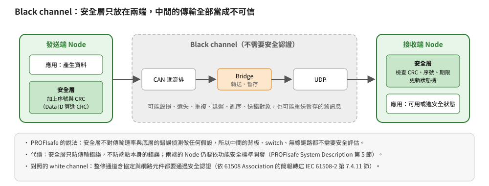
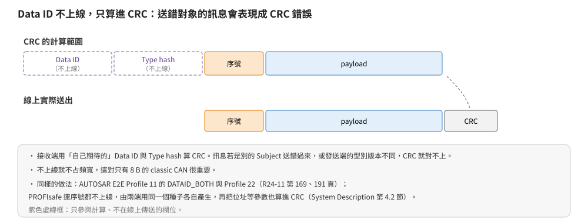
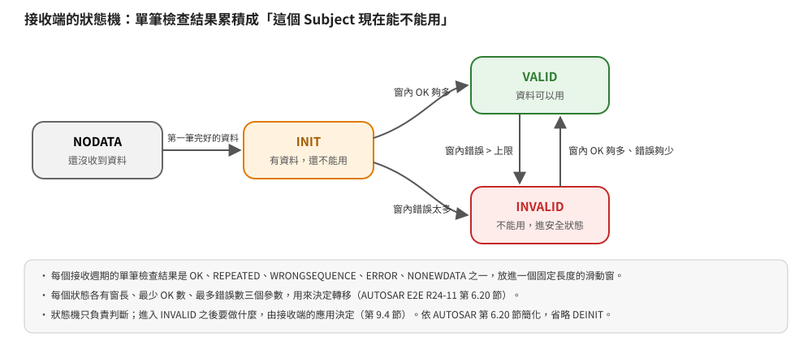

# 通訊故障模型與 E2E 保護

功能安全（functional safety）處理的是系統自己出錯時，會不會造成設備或人員的危險。embnet-rs 把錯了會造成這種危險的 Subject 標為 `protected`，
例如運動指令；其他 Subject 是 `normal`。計畫文件 `002` 決定：Bridge 預設不擔任功能安全的角色，`protected` Subject 由發送端與接收端自己保護。
這篇說明這個做法背後的原則（black channel）、
通訊可能出哪些錯、各用什麼機制偵測、殘餘錯誤率怎麼估，以及接收端怎麼用狀態機判斷資料能不能用。
參考的是工業與車用安全通訊的公開文件：PROFIsafe、OPC UA Safety、AUTOSAR E2E。

延伸閱讀：PROFIsafe System Description（PI，2016）；AUTOSAR E2E Protocol Specification R24-11；OPC 10000-15（OPC UA Safety）；
上一章的 [CRC 與 framing](../20-protocol/03-crc-and-framing.md)。

## 一、Black channel

要讓整條通訊路徑都通過功能安全認證，路徑上的每個元件都得照安全標準開發：匯流排控制器、驅動程式、協定堆疊、gateway、switch。
這幾乎不可能，也很昂貴。

工業安全通訊的解法是 black channel：把安全層放在兩端，中間的傳輸全部當成不可信的黑盒子。

PROFIsafe 的描述是：安全層不對傳輸速率與底層的錯誤偵測做任何假設，因此不需要對背板或其他傳輸路徑做安全評估（System Description 第 4 頁）。
OPC UA Safety 的說法相同：標準的傳輸系統不需要額外的功能安全評估（OPC 10000-15 第 5.4 節）。

代價有兩個：

- 安全層只防傳輸錯誤，不防端點自己的錯誤。兩端的 Node 仍要依功能安全標準開發（PROFIsafe 第 8 頁）。
- 安全層要防的不只是隨機的位元錯誤，還包括中間元件的系統性失效：例如 gateway 或 switch 的軟體錯誤、暫存後重送舊訊息（OPC 10000-15 第 5.4 節）。
  AUTOSAR 特別提醒，選擇 E2E profile 時要考慮「是否使用 gateway」（R24-11 第 13 頁）。

Bridge 在這個模型裡正好落在黑盒子中，所以它可以用一般的方式開發，但安全層必須假設它會出錯。

## 二、通訊會出哪些錯，各用什麼偵測

IEC 61784-3 把通訊錯誤分成八類（依 ODVA 2022 論文轉述，IEC 原文付費）：毀損（corruption）、非預期的重複、順序錯誤、遺失、無法接受的延遲、
插入、偽裝（masquerade）、定址錯誤。三份公開規格各自給了對照：

| 錯誤 | PROFIsafe | OPC UA Safety | AUTOSAR E2E Profile 22 |
|---|---|---|---|
| 毀損 | CRC | 資料完整性檢查 | CRC |
| 重複 | 逾時 | 序號、逾時 | 序號 |
| 順序錯誤 | 序號 | 序號 | 序號 |
| 遺失 | 序號、逾時 | 序號、逾時 | 序號、週期傳送加逾時 |
| 延遲 | 逾時 | 逾時 | 週期傳送加逾時 |
| 插入 | 序號、位址碼 | 序號 | 序號、Data ID 加 CRC |
| 偽裝 | CRC | 序號、ID、資料完整性檢查 | Data ID 加 CRC |
| 定址錯誤 | 序號、位址碼 | ID | Data ID 加 CRC |

（PROFIsafe 第 6 頁 Figure 7；OPC 10000-15 第 5.3 節 Table 2；AUTOSAR R24-11 第 189 頁 Table 6.53）

後三類容易混淆。插入：出現一筆根本不該存在的訊息，例如故障的 Node 多送了一筆。偽裝：一筆不安全的訊息被當成安全訊息，例如 `normal` Subject 的資料被當成 `protected` 的。
定址錯誤：安全訊息送到錯的接收端，例如 A 軸的指令被 B 軸收下。

歸納起來，四個機制就涵蓋全部八類：

- **CRC**：資料有沒有被改。
- **序號**：有沒有少、有沒有重複、順序對不對。
- **Data ID**：這筆是不是我要的那一種。
- **期限**：是不是太晚了。

AUTOSAR 另外提醒：只靠序號偵測不到延遲，必須搭配週期傳送與接收端的逾時（第 6.3.5 節）。

### 2.1 序號要多寬

PROFIsafe 的序號（Monitoring Number）原本可以只用一個 toggle 位元，但它選了 32 位元。理由是部分匯流排元件，例如 switch，有儲存緩衝，
可能把暫存的舊訊息重新送出（第 6 頁）。ODVA 的論文也指出，延遲類錯誤的來源包括 black channel 中做 store-and-forward、可能快取舊封包的網路設備。

這直接適用於 Bridge。推導如下：Bridge 的佇列與重組緩衝可能暫存最多 N 筆舊訊息；序號若在 N 筆以內就繞一圈，
一筆被延遲重送的舊訊息可能剛好帶著「下一個」序號，被接收端當成新的。所以 E2E 序號的範圍必須大於路徑上可能暫存的訊息數，
再加上接收端容許的跳號數（推導）。但 black channel 的前提是中間元件可能任意出錯，包括把舊訊息存得比設計的更久，
所以「路徑上可能暫存的量」不能只用建置期的計算當上限。做法是比照 PROFIsafe 的 32 位元序號：發送端維護完整寬度的序號並算進 CRC，
線上只送低位，接收端用自己的完整序號重建後驗證（同 `docs/30-safety-security/02` 的 FV 重建）。舊訊息的高位對不上，CRC 就驗不過。
Cyphal/CAN 的 Transfer-ID 只有 5 位元，而且屬於 Link 層、跨格式轉送時由 Bridge 重做（`003` K-13），不能拿來當 E2E 序號。

### 2.2 序號與 alive counter

AUTOSAR 區分兩種計數器（第 6.2 節）：

- **Sequence counter**：每次發送加 1，接收端檢查是否正確遞增。
- **Alive counter**：接收端只檢查它有沒有變，不檢查是否正確遞增。

E2E 用的是前者。接收端容許的最大跳號由 MaxDeltaCounter 設定：上次收到 1、MaxDeltaCounter 為 3，下一筆收到 2、3、4 都接受，
超過就判為順序錯誤（第 186 頁）。

## 三、Data ID 不上線

偽裝與定址錯誤的偵測需要 Data ID，但 Data ID 不一定要上線。AUTOSAR E2E Profile 11 的 `DATAID_BOTH` 模式把 16 位元的 Data ID 算進 CRC 但不送出；
Profile 22 也是把 Data ID 接在資料之後一起算 CRC（R24-11 第 169、191 頁）。PROFIsafe 更進一步，連序號都不上線：兩端用同一個種子各自產生序號，
再把位址、看門狗時間等參數也算進 CRC（第 7 頁 Figure 9）。

接收端用自己期待的 Data ID 計算。訊息若送錯對象，CRC 就對不上，所以偽裝與定址錯誤會表現成 CRC 錯誤。
`002` 第 2.1 節把 Subject-ID 與 Type hash 算進 E2E CRC，就是這個做法；Type hash 還能順便抓到「收發兩端的型別版本不同」。

## 四、本地計時能偵測什麼

接收端只用自己的時鐘，能偵測「資料停止更新」，但不能限制資料的年齡：

- **PROFIsafe**：接收端有一個看門狗計時器，每收到一筆帶著正確新序號的訊息就重新起算，逾時（`F_WD_Time`）就是錯誤（第 6、8 頁）。
  PROFIsafe 是一問一答：host 收到 device 對某個序號的確認後才送下一個序號，所以看門狗量到的是往返時間，能限制資料多舊。
- **AUTOSAR**：接收端週期性讀取，某個週期沒有新資料、或序號沒變，就記為這個週期沒有有效資料，再交給狀態機累積判斷（第 6.2.3.2、6.3.5 節）。
- EN 50159 的草案把這種時間戳稱為 relative time stamp：以本地時鐘為參考，和其他節點的時鐘沒有關係（prEN 50159:2025 第 3.1.46 節）。

看門狗時間不能太短：OPC UA Safety 要求它至少等於最壞的傳輸延遲加上兩端的處理時間，設太小會無故跳脫（第 8.2 節）。
這個最壞延遲正是 `docs/20-protocol/04` 用 network calculus 在建置期算出來的上限。

單向的週期發佈沒有往返，接收端只看得到接收間隔。若中間元件把每一筆都多壓 500 ms 再照原週期送出，接收間隔完全正常，看門狗不會跳。
所以要限制資料年齡的 `protected` Subject，有兩個選擇：比照 PROFIsafe 由接收端回送已收到的序號（一問一答），或讓兩端對時、帶時戳（`003` K-03）。

## 五、接收端的狀態機

單筆檢查只能說「這一筆好不好」。偶爾一筆壞掉不一定要停機，連續壞好幾筆才要。AUTOSAR 用狀態機把單筆結果累積成「這個資料流現在能不能用」：

- 單筆檢查的結果有 OK、OKSOMELOST（有跳號但在容許範圍內）、REPEATED、WRONGSEQUENCE、ERROR、NONEWDATA（Profile 11，第 183、185 頁）。
- 狀態機用一個滑動窗記錄最近幾次的結果。每個狀態各有窗長、最少 OK 數、最多錯誤數，用來決定轉移（第 6.20 節）。
- 參數之間有約束，例如每個狀態的「最少 OK 數加最多錯誤數」不能超過窗長（第 8.1.1 節）。
- 窗長與偵測時間有關：窗愈長，誤判愈少，但發現故障愈慢。AUTOSAR 用故障容忍時間（FTTI，從故障發生到系統必須進入安全狀態的最長時間）反推窗長的上限（第 6.20.4 節）。

AUTOSAR 的設計假設是：系統要能容忍一筆未被偵測的錯誤資料，但不必容忍連續兩筆（第 9.6 節）。

### 5.1 進入 INVALID 之後

狀態機只負責判斷，接下來要做什麼由接收端的應用決定（AUTOSAR 第 9.4 節）。三份規格的共通做法是：

- 用安全值取代實際值。PROFIsafe 與 OPC UA Safety 都用全 0，讓接收端進入安全狀態，例如斷電（PROFIsafe 第 7 頁；OPC 10000-15 第 6.3.4.2 節）。
- 通訊恢復後不自動回到正常，要人工確認（PROFIsafe 第 8 頁；OPC 10000-15 第 9.4 節）。

失效時的行為有幾種常見的分類（Dantas & Nigam 2021 的整理，不是 IEC 原文）：fail-silent 是失效時停止輸出、錯誤不往外傳；
fail-safe 是在此之外再切換到安全狀態；fail-operational 是承受一定數量的故障後仍維持同樣的安全等級。
`002` 對 Bridge 的要求是 fail-silent，對 `protected` Subject 的接收端要求是 fail-safe。

## 六、殘餘錯誤率

再好的 CRC 也有漏抓的機率。安全通訊用每小時的殘餘錯誤率衡量，概念上是：

Λ ≈ R(Pe) × 每小時訊息數 × 接收端數

R(Pe) 是位元錯誤率為 Pe 時，一筆訊息的錯誤沒被 CRC 抓到的機率。它要用該 CRC 在該資料長度下的權重分布計算
（權重分布：對每個錯誤位元數 w，有幾種 w 位元的錯誤樣式剛好被 CRC 整除而漏抓）。Pe 很高時，漏抓機率趨近 2⁻ʳ（r 是 CRC 的位元數），
HD 的影響變小：CRC-8 每筆錯誤約有 1/256 的機率漏抓，所以殘餘錯誤率算出來之前，不宜用 CRC-8 保護 `protected` Subject（`003` K-15）。Λ 的式子出自 ODVA 2022 第 3 頁轉述 IEC 61784-3（
正式符號與是否含其他項，待查 IEC 原文）。Pe 的取值有說法是 IEC 61784-3 要求取 10⁻²，已含 100 倍的安全係數（二手，待查證）。

預算多大？SIL（safety integrity level）是 IEC 61508 的安全完整性等級，分 1 到 4，數字愈大要求愈嚴。
PROFIsafe 與 ODVA 的說法是：SIL 3 的危險失效率上限是每小時 10⁻⁷，通訊部分不得超過其中的 1%，也就是每小時 10⁻⁹（PROFIsafe 第 6 到 7 頁；
ODVA 2022 第 2、4 頁）。OPC UA Safety 的上限則依錯誤統計區間而定，SIL 3 為每小時 4 × 10⁻¹⁰（第 9.4 節 Table 39）。
各來源的模型不同，不宜只引一個數字。

## 七、對 embnet-rs 的影響

| 觀察 | 對設計的影響 |
|---|---|
| Black channel 讓中間元件不需認證，但安全層要假設它們會出錯 | Bridge 維持一般開發；`protected` Subject 的安全層只在 Node 兩端。E2E 欄位只綁與 Link 無關的邏輯標頭，以 Transfer 為單位，Bridge 不改寫（`002` 第 2.1 節） |
| 四個機制涵蓋八類錯誤：CRC、序號、Data ID、期限 | E2E-32（`docs/spec/02-e2e.md`）：E2E 序號、CRC；Data ID（Subject-ID）與 Type hash 不上線，只算進 CRC；期限由接收端本地計時 |
| 序號範圍必須大於路徑上可能暫存的訊息數，而 black channel 下暫存量沒有可信的上限 | E2E 序號與 Transfer-ID 分開；完整寬度的序號算進 CRC，線上只送低位（`003` K-16） |
| 只靠序號偵測不到延遲；本地看門狗只能偵測停止更新 | `protected` Subject 必須週期發佈，接收端以看門狗判斷停止更新，看門狗時間不小於 network calculus 算出的延遲上限；要限制資料年齡時，加序號回送或對時（`003` K-03） |
| 單筆檢查要累積成狀態 | `embnet-node` 提供 AUTOSAR 式的接收狀態機，參數在設定檔中依 Subject 指定 |
| 進入 INVALID 後的行為由應用決定 | `embnet-node` 回報狀態，安全值與恢復方式由應用定義；文件提供建議做法（全 0、人工確認） |
| 殘餘錯誤率要依 CRC 權重分布與訊息率計算 | P1 對每種 E2E CRC 配置算出 Λ，寫進規格；需要的權重分布要另外取得或自行計算 |

## 來源

- PROFIBUS & PROFINET International, *PROFIsafe System Description*, 2016 Update：
  <https://cl.profibus.com/fileadmin/media/downloadsection/technical_description_%26_books/PROFsafe_System_Description_engl_2016_Update.pdf>
- AUTOSAR, *E2E Protocol Specification*, R24-11：<https://www.autosar.org/fileadmin/standards/R24-11/FO/AUTOSAR_FO_PRS_E2EProtocol.pdf>
- OPC Foundation, OPC 10000-15 *Safety*：<https://reference.opcfoundation.org/specs/OPC-10000-15/5.3> 等各節
- Peng 等, *CIP Safety Embracing IEC 61784-3 Edition 4*, ODVA 2022：
  <https://www.odva.org/wp-content/uploads/2022/03/2022-ODVA-Conference_CIP_Safety_Embracing_IEC61784-3_Edition_4_Peng-Seidlitz-Crane-Guru_FINAL.pdf>
- P. Brown, *Functional Safety and Communications*, 61508 Association, 2024：
  <https://61508.org/wp-content/uploads/2024/11/11A-Functional-Safety-and-Communications-V1-e092024.pdf>
- prEN 50159:2025 試閱本：<https://cdn.standards.iteh.ai/samples/79342/934696a195174425af6a0432f096b262/oSIST-prEN-50159-2025.pdf>
- H. Dantas, V. Nigam, ACM TCPS 5(3), 2021（arXiv:2201.10563）：<https://arxiv.org/pdf/2201.10563>

## 待查證

- IEC 61784-3 原文的錯誤與措施效果表，以及殘餘錯誤率的正式公式與 Pe 取值。
- IEC 61508-4 對 safe state 的原文定義；IEC 61508-2 第 7.4.11 節中 white channel 與 black channel 的原文。
- EN 50159 第 7.4.2 節的通用威脅與防護對照表。
- AUTOSAR R24-11 的參數表缺 MinOkStateInit，但第 8.1.1 節的約束用到它；Profile 22 的範例表出現參數表裡沒有的欄位。兩者都是規格本身的不一致。
- 各來源對 SIL 3 通訊部分上限的數字不同，原因待查 IEC 原文。
