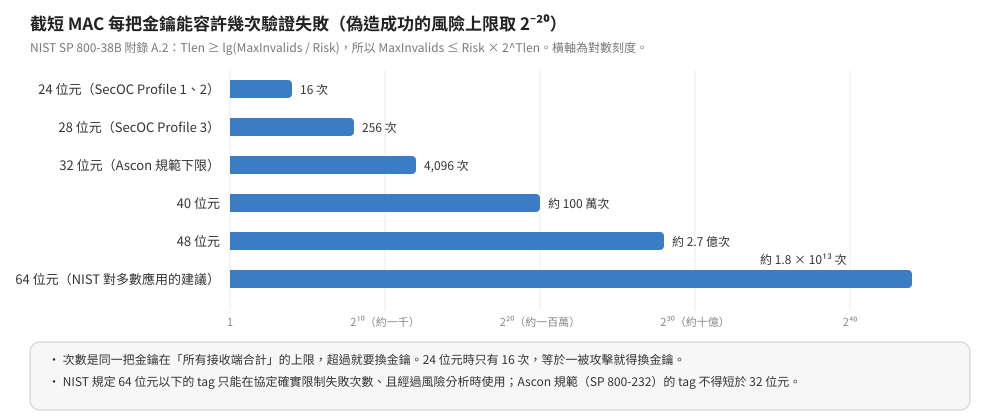
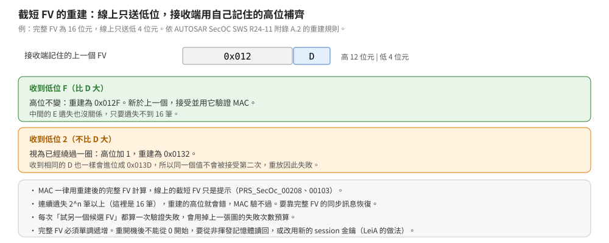
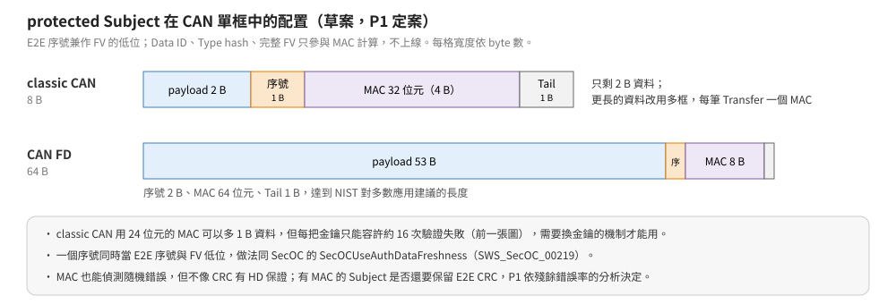

# MAC、新鮮度與重放

CRC 擋得住雜訊，擋不住有人故意改資料（[CRC 與 framing](../20-protocol/03-crc-and-framing.md) 第六節）。要確認訊息真的來自合法的發送端、
內容沒被改過、也不是錄下來的舊訊息，需要帶金鑰的 MAC 加上新鮮度值（FV）。這篇說明 CAN 這種 8 B 的框上怎麼做：
截短 MAC 的強度怎麼算、FV 怎麼只送一部分、重開機後怎麼辦、要花多少運算，以及對稱金鑰在廣播時的先天限制。

延伸閱讀：NIST SP 800-38B（CMAC）；RFC 4493；AUTOSAR SecOC Protocol Specification 與 SWS（R24-11）；
Schwabe & Stoffelen 2016（Cortex-M 上的 AES）；vatiCAN（CHES 2016）、LeiA（ESORICS 2016）。

## 一、MAC 解決什麼、不解決什麼

MAC（message authentication code）是用金鑰對訊息算出的標籤。沒有金鑰的人算不出正確的標籤，所以接收端驗證通過，就能確定：

- 訊息出自持有金鑰的一方。
- 內容在途中沒被改過。

MAC 不解決重放：攻擊者錄下一筆合法的訊息，稍後原封不動地重送，標籤依然正確。NIST 的建議是在訊息裡加入遞增的序號、時間戳或 nonce
（SP 800-38B 附錄 C）。這個值就是 FV。

## 二、選哪一種 MAC

nonce 是每次計算只能用一次的值。GMAC 與 Poly1305 都依賴它：同一把金鑰下 nonce 一旦重複，攻擊者就能推出祕密，之後偽造任意訊息。CMAC 不需要 nonce。

| MAC | 需要 nonce | nonce 重複的後果 | 出處 |
|---|---|---|---|
| AES-CMAC | 不需要，同樣輸入一定得到同樣輸出 | 不適用；重放靠 FV 擋 | SP 800-38B |
| HMAC | 不需要 | 同上 | RFC 2104 |
| GMAC（GCM） | 需要 | 攻擊者可以算出雜湊子金鑰，之後任意偽造 | SP 800-38D 附錄 A |
| Poly1305 | 需要一次性金鑰 | 一次性金鑰與金鑰流都相同 | RFC 8439 第 4 節 |
| Ascon-AEAD128 | 需要 | 機密性喪失；完整性在有限重用下仍保有部分強度 | SP 800-232 第 4.4.3 節 |

嵌入式系統很難保證 nonce 永遠不重複：重開機、計數器沒存好、複製出來的韌體映像，都可能讓 nonce 重來。
CMAC 與 HMAC 是確定性的，FV 重複時只會讓重放檢查失效，不會洩漏金鑰；GMAC 與 Poly1305 則會整體失效（推論）。
AUTOSAR SecOC 的三個 profile 都用 AES-128 CMAC（PRS_SecOcProtocol 第 5.3 節）。

## 三、截短 MAC 的強度

AES-CMAC 的完整輸出是 128 位元，CAN 放不下。SecOC 把它截短：Profile 1 與 2 取 24 位元，Profile 3 取 28 位元（第 5.3.2 到 5.3.4 節）。
截短不影響演算法本身，影響的是被猜中的機率：隨機猜一個 n 位元的標籤，猜中機率是 2⁻ⁿ（SP 800-38B 附錄 A.1）。

所以強度取決於攻擊者能猜幾次。NIST 給了一條不等式（附錄 A.2）：

n ≥ lg(容許的驗證失敗次數 ÷ 可接受的偽造風險）

lg 是以 2 為底的對數。風險取 2⁻²⁰ 時，24 位元的失敗次數上限是 2²⁴ × 2⁻²⁰ = 16：同一把金鑰在所有接收端合計只能容許 16 次驗證失敗，等於一遭到攻擊就得換金鑰。
失敗預算本身也是阻斷服務的槓桿：攻擊者不必偽造成功，亂送 MAC 就能把預算用完（`003` K-28）。NIST 的立場：

- 對多數應用，至少 64 位元（附錄 A.2）。RFC 4493 也引用了這個建議。
- 短於 64 位元的 tag 必須經過仔細的風險分析才能使用；除非協定確實限制了驗證失敗的次數，否則不應使用（附錄 A.2 的用語是 shall 與 should not）。

SecOC 自己也承認截短會降低安全等級（PRS_SecOcProtocol 第 14 頁）。

### 不限制失敗次數會怎樣

若接收端不計失敗、不換金鑰，攻擊者就能一直猜。以 1 Mbit/s 的 classic CAN 每秒約 7,600 框計算，平均要送 2ⁿ 框才猜中一次：
24 位元約 37 分鐘，32 位元約 6.5 天（推導）。這說明截短 MAC 本身不夠，失敗計數是設計的一部分。

## 四、FV：怎麼只送一部分

FV 必須單調遞增，但完整的 FV 可能有 64 位元，CAN 放不下。SecOC 的做法是：MAC 一律用完整 FV 計算，線上只送它的低位，
接收端用自己記住的高位補齊（PRS_SecOc_00208、00103）。

重建規則（SWS 附錄 A.2）：收到的低位比記住的低位大，就沿用原來的高位；否則視為繞過一圈，高位加 1。
這條規則讓同一個 FV 不可能被接受第二次，重放因此失敗。

代價有兩個：

- 連續遺失超過低位能表示的範圍，重建的高位就錯了，MAC 驗不過。要靠定期送出完整 FV 的同步訊息恢復。
- 接收端若嘗試多個候選 FV，每次嘗試失敗都算一次驗證失敗（SWS_SecOC_00237 到 00241），會吃掉上一節的失敗預算（推論）。

SecOC 允許直接拿 payload 中既有的計數器當 FV，例如 E2E 的序號（SWS_SecOC_00219，`SecOCUseAuthDataFreshness`）。
embnet-rs 打算這樣做：一個 E2E 序號同時負責順序檢查與 FV 低位。

## 五、重開機之後

FV 若只存在 RAM，重開機後從 0 開始，攻擊者錄下的舊訊息就又是「新」的了。兩種解法：

- **把高位存進非揮發記憶體。** SecOC 附錄 A.4（JASPAR 的做法）讓 FV 包含一個「行程計數器」，每次開機加 1 並寫回非揮發記憶體，
  其餘計數器開機時歸零（第 177、179 頁）。規格也提醒，任何計數器到達最大值後就無法再偵測重放（第 175 頁）。
- **每次開機換 session 金鑰。** LeiA 用一個 56 位元的 epoch，每次開機或計數器溢位時加 1，並由長期金鑰與 epoch 衍生新的 session 金鑰（第 3 節）。
  舊 session 錄下的訊息在新金鑰下驗不過，接收端不必相信 RAM 裡殘留的計數器。

前者要注意快閃記憶體的寫入壽命；後者需要一個所有節點都同意的 epoch 來源。

## 六、CAN 上的實際代價

| 研究 | 做法 | 量到的代價 |
|---|---|---|
| vatiCAN（Nürnberger & Rossow 2016） | 64 位元 MAC 放在另一個 ID 的獨立框；全域 nonce 每 50 ms 廣播一次 | ATmega328p 上一次 HMAC 約 2.95 ms；ping-pong 延遲從 1.08 ms 增為 4.5 ms；實車匯流排使用率從 13.4% 升到 16.2%（只保護 3 個發送端） |
| LeiA（Radu & Garcia 2016） | 64 位元 MAC 放在另一個框；計數器放在延伸 ID 中 | 每則訊息多一框，原文說通訊開銷加倍；每把 session 金鑰最多 2¹⁶ 則 |
| Ikumapayi 等人（RTAS 2023） | SecOC Profile 1（共 4 B），放不下就多一框 | 250 kbit/s 的 CAN 上，每則都帶 MAC 的配置可排程性最差 |

## 七、運算成本

| 項目 | 處理器 | 時脈週期 | 出處 |
|---|---|---|---|
| AES-128 單一區塊（查表式） | STM32F407（Cortex-M4） | 661.7 | Schwabe & Stoffelen 2016，Table 1 |
| AES-128 CTR 每區塊（常數時間 bitsliced，兩區塊並行的攤提值） | 同上 | 1617.6 | 同上，Table 2 |
| AES-128 key expansion | 同上 | 294.8 | 同上，Table 1 |
| AES-128-CMAC | Cortex-M3/M4 | 約 89 週期/byte | Mouha 等人 2014（Chaskey 論文） |

幾個要注意的地方：

- 查表式 AES 的執行時間會隨資料變化，在有 cache 的平台上有 timing 洩漏的風險（Schwabe & Stoffelen 第 4 節）：執行時間若隨金鑰或資料改變，攻擊者量時間就能推出祕密。常數時間的實作消除這個差異，約慢 2.4 倍。
- STM32F427 沒有硬體 AES。RM0090 第 23 章的 CRYP 只適用於 F415/417 與 F43x 系列，F437、F439 才有（ST 產品頁）。參考板 STM32F767 同樣沒有，同系列的 F777、F779 才有 CRYP（embassy stm32-data 的晶片資料）。
- CMAC 的子金鑰可以事先算好存起來（SP 800-38B 第 9 頁），每則訊息只剩 AES 區塊本身的成本。
- CMAC 是逐區塊串接計算，無法像 CTR 那樣兩個區塊並行，所以 bitsliced 實作的單一區塊成本可能接近表中數字的兩倍（推論，待實測）。
  MAC 的輸入含 Data ID、Type hash、完整 FV 與 payload，通常超過 16 B，要 2 個區塊。
- RustCrypto 的 `aes` crate 的軟體實作採 fixslicing，文件稱為常數時間；它在 Cortex-M4 上的週期數沒有公開數字，要自己量。

## 八、對稱金鑰在廣播時的限制

CMAC 與 HMAC 都是對稱金鑰：驗證用的金鑰就是產生用的金鑰。Subject 是一對多廣播，所有接收端都持有金鑰，
所以任何一個接收端被攻破，攻擊者就能偽造發送端的訊息（RFC 4082 第 1 節；LeiA 第 5 節稱之為對稱密碼的先天限制）。

緩解方式與它們的代價：

- **依發送端分金鑰。** 每個發送端一把，影響範圍縮到該發送端的 Subject。vatiCAN 討論過讓同功能的 ECU 共用一把以省空間，代價是安全性下降（第 3.4 節）。
- **TESLA**（RFC 4082）：發送端先用一把金鑰送出 MAC，過一段時間才公布這把金鑰。接收端拿到時金鑰已經作廢，無法偽造。
  代價是要延遲才能驗證，vatiCAN 與 LiBrA-CAN 都認為這不符合車內即時通訊的需求。
- **LiBrA-CAN**：把金鑰拆給多個節點組成的群組，每個驗證者只看到部分 MAC 位元，前提是被攻破的節點是少數。

## 九、Rust 的實作選擇

| crate | 版本 | 授權 | 說明 |
|---|---|---|---|
| `aes` | 0.9.4 | MIT OR Apache-2.0 | `no_std`；軟體實作採 fixslicing，文件稱為常數時間；經 NCC Group 稽核 |
| `cmac` | 0.8.0 | MIT OR Apache-2.0 | `no_std`；驗證時用常數時間比較 |
| `hmac` | 0.13.0 | MIT OR Apache-2.0 | `no_std` |
| `ascon-aead` | 0.6.1 | Apache-2.0 OR MIT | `no_std`；截短 tag 支援 32 到 128 位元，以 byte 為單位 |
| `subtle` | 2.6.1 | BSD-3-Clause | 常數時間比較的工具 |

（crates.io，查詢日 2026-11-16）

`digest` crate 的 `Mac` trait 提供 `verify_truncated_left`，以 byte 為單位比較截短的標籤。28 位元這種不是整數 byte 的長度，
要自己遮掉最後半個 byte，再用 `subtle` 做常數時間比較（推論）。

## 十、對 embnet-rs 的影響

依上面各節，`protected` Subject 在 CAN 單框中的配置如下，正式格式見 `docs/spec/05-mac.md`：

線上只送 FV 的低位（classic CAN 是 1 B 的序號），完整值由接收端重建（第四節）。MAC 以 Transfer 為單位，綁在與 Link 無關的邏輯標頭上，所以多框或跨格式轉送時改用「一個 Transfer 一個 MAC」的形式（`002` 第 4.4 節）。

| 觀察 | 對設計的影響 |
|---|---|
| 截短 MAC 的強度由失敗次數上限決定，24 位元只容許 16 次 | `protected` Subject 優先走 CAN FD 的 64 位元 MAC；classic CAN 至少 32 位元；MAC 以 Transfer 為單位、綁 E2E 邏輯標頭；失敗預算依來源、Link 與時間窗分開（`002` 第 4.3、4.4 節，`003` K-19、K-28） |
| CMAC 不怕 FV 重複洩漏金鑰 | 採用 AES-128 CMAC；不用 GMAC 或 Poly1305 |
| FV 只送低位，接收端重建 | E2E 序號兼任 FV 低位；定期送完整 FV 的同步 Transfer |
| 重開機後 FV 不能回到舊值 | 完整 FV 的高位寫入非揮發記憶體，或每次開機衍生 session 金鑰（`003` K-17） |
| STM32F427 與參考板 STM32F767 都沒有硬體 AES，軟體 AES 一個區塊約 660 到 3,200 週期，每則 MAC 約 2 個區塊 | Bridge 只在 Trust zone 邊界驗證；常數時間的實作才能用在對外 Link；P1 實測 `aes` crate 的週期數（`003` 第 1.2 節） |
| 對稱金鑰下任何接收端都能偽造 | 依發送端分金鑰；不採用 TESLA（`003` K-18） |
| RustCrypto 的 `aes`、`cmac` 是 MIT/Apache 雙授權且 `no_std` | 直接採用，不自寫密碼學原語 |

## 來源

- NIST SP 800-38B, *Recommendation for Block Cipher Modes of Operation: The CMAC Mode for Authentication*：
  <https://nvlpubs.nist.gov/nistpubs/SpecialPublications/NIST.SP.800-38b.pdf>
- RFC 4493, *The AES-CMAC Algorithm*：<https://www.rfc-editor.org/rfc/rfc4493>
- NIST SP 800-232, *Ascon-Based Lightweight Cryptography Standards*：<https://nvlpubs.nist.gov/nistpubs/SpecialPublications/NIST.SP.800-232.pdf>
- NIST SP 800-38D（GCM）；SP 800-107 Rev.1；RFC 2104；RFC 8439；RFC 4082（TESLA）
- AUTOSAR, *SecOC Protocol Specification*, R24-11：<https://www.autosar.org/fileadmin/standards/R24-11/FO/AUTOSAR_FO_PRS_SecOcProtocol.pdf>
- AUTOSAR, *Specification of Secure Onboard Communication*, R24-11：
  <https://www.autosar.org/fileadmin/standards/R24-11/CP/AUTOSAR_CP_SWS_SecureOnboardCommunication.pdf>
- P. Schwabe, K. Stoffelen, *All the AES You Need on Cortex-M3 and M4*, SAC 2016：<https://cryptojedi.org/papers/aesarm-20161019.pdf>
- N. Mouha 等, *Chaskey: An Efficient MAC Algorithm for 32-bit Microcontrollers*, SAC 2014：<https://eprint.iacr.org/2014/386>
- S. Nürnberger, C. Rossow, *vatiCAN - Vetted, Authenticated CAN Bus*, CHES 2016：<https://ndownloader.figshare.com/files/45782712>
- A.-I. Radu, F. D. Garcia, *LeiA: A Lightweight Authentication Protocol for CAN*, ESORICS 2016：<https://research.birmingham.ac.uk/files/29342174/leia.pdf>
- O. Ikumapayi 等, *Work in Progress: Schedulability Analysis of CAN and CAN FD Authentication*, RTAS 2023：<https://par.nsf.gov/servlets/purl/10498715>
- B. Groza 等, *LiBrA-CAN*, CANS 2012：<https://www.aut.upt.ro/~bgroza/Papers/LiBrA_CANS.pdf>
- ST RM0090 第 23 章（第三方鏡像）：<https://docs.dirba.io/rm0090-stm32f405-415-407-417-427-437-429-439/23-cryptographic-processor-cryp/>；
  ST 產品頁：<https://www.st.com/en/microcontrollers-microprocessors/stm32f427-437.html>
- crates.io：`aes`、`cmac`、`hmac`、`ascon-aead`、`subtle`

## 待查證

- SipHash、Ascon、HMAC-SHA256 在 Cortex-M3/M4 上的週期數；RustCrypto `aes` 軟體實作在 Cortex-M4 上的週期數。
- STM32F4 的快閃記憶體加速器是否讓查表式 AES 產生可利用的 timing 差異。
- CANAuth 原文的參數與數字。
- CiA 613-2（CANsec）原文的 ICV 長度與 FV 寬度。
- SP 800-107 Rev.1 是否已撤回。
