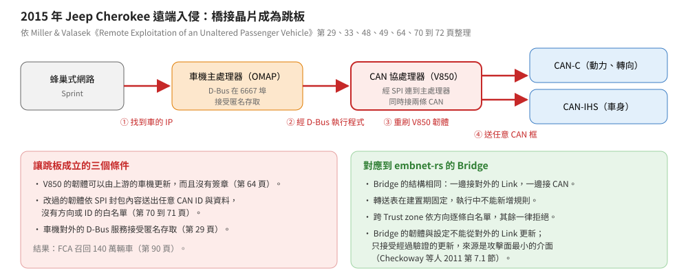
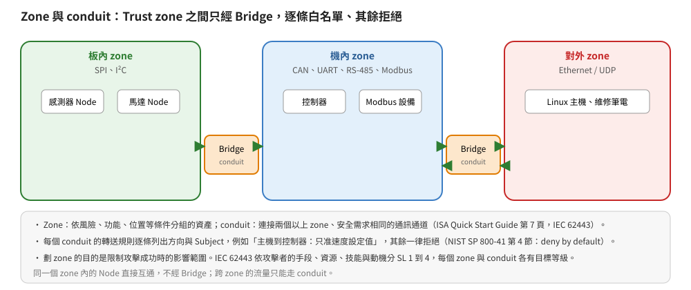
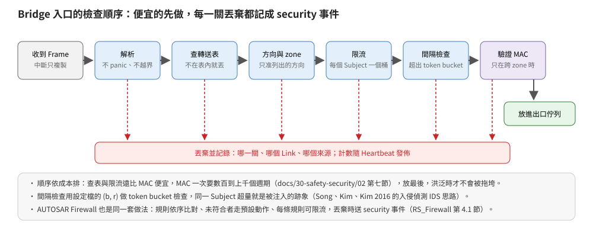

# Trust zone、Bridge 當防火牆與威脅建模

把 CAN 與乙太網路接起來，等於讓乙太網路上的攻擊者有了一條通往 CAN 的路。這篇先看一個真實案例：2015 年 Jeep Cherokee 的遠端入侵，
攻擊者正是經由一顆橋接晶片進入 CAN。接著說明 IEC 62443 的 zone 與 conduit、預設拒絕原則、Bridge 入口的檢查順序，
以及 STRIDE 與 ISO/SAE 21434 的威脅分析方法，最後整理出 Bridge 的資安要求。

延伸閱讀：Miller & Valasek 2015；Checkoway 等人 2011（USENIX Security）；ISA《Quick Start Guide: An Overview of ISA/IEC 62443 Standards》；
NIST SP 800-41 Rev.1；AUTOSAR《Requirements on Firewall》；`002` 第三節。

## 一、真實案例：橋接晶片成為跳板

2014 年款 Jeep Cherokee 的車機有兩顆處理器：跑作業系統的主處理器不能直接碰 CAN，真正收發 CAN 的是同一塊板子上的 V850 協處理器，
兩者之間用 SPI 連接（Miller & Valasek 第 33 頁）。攻擊鏈是：

1. 透過蜂巢式網路找到車的 IP。
2. 車機的 D-Bus 服務開在 6667 埠，接受匿名存取，攻擊者在主處理器上執行程式（第 29 頁）。
3. 主處理器原本就能更新 V850 的韌體，而且韌體沒有簽章（第 48、64 頁）。攻擊者刷入改過的韌體，約 25 秒（第 65 到 66 頁）。
4. 改過的韌體把某個 SPI 訊息改成「依內容送出任意 CAN ID 與資料」（第 70 到 71 頁）。

事件後 FCA 召回 140 萬輛車（第 90 頁）。

Checkoway 等人更早就在 2011 年指出這個模式：少數 ECU 同時接在多條匯流排上，扮演邏輯上的橋。修改這些「橋」ECU，
不論是利用漏洞，或只是照設計經 CAN 重刷，攻擊者就能把對一條匯流排的攻擊放大到另一條（第 5 到 6 頁）。
他們也注意到，過去的匯流排分割多半出於頻寬與整合的考量，不一定是為了安全（註腳 4）。

embnet-rs 的 Bridge 在結構上和 V850 相同：一邊接對外的 Link，一邊接 CAN。這個案例告訴我們 Bridge 要避免哪三件事：
可以從上游任意更新韌體、轉送內容沒有白名單、對外的服務沒有認證（圖中的三個條件）。

## 二、Zone 與 conduit

IEC 62443 用 zone 與 conduit 描述系統的分割（ISA Quick Start Guide 第 7 頁）：

- **Zone**：依風險、資產的重要性、功能、位置、存取需求等條件分組的資產。
- **Conduit**：連接兩個以上 zone、安全需求相同的通訊通道。

劃分的目的是限制攻擊成功時的影響範圍。IEC 62443 依攻擊者的能力把安全等級（SL）分成四級（第 8 頁 Table 3）：

| SL | 防範的對象 |
|---|---|
| 1 | 無意或偶然的違規 |
| 2 | 手段簡單、資源少、一般技能、動機低的蓄意攻擊 |
| 3 | 手段複雜、資源中等、具備工控專業技能、動機中等 |
| 4 | 手段複雜、資源充足、具備工控專業技能、動機高 |

每個 zone 與 conduit 各有一個目標等級（SL-T），由風險評估決定；系統實際達到的等級（SL-A）要在上線後評估（第 8 到 9 頁）。

embnet-rs 的 Trust zone 就是 zone；Bridge 加上它兩側的 Link 構成 conduit，Bridge 是 conduit 上負責過濾的設備。`002` 第 3.1 節的三個 zone（板內、機內、對外）是初步劃分，
實際部署時要依 IEC 62443-3-2 的流程評估各自的 SL-T。

## 三、預設拒絕

NIST SP 800-41 Rev.1 對防火牆政策的建議是：沒有明確允許的流量，一律擋下，稱為 deny by default（第 4 節），因為那些流量本來就不需要。
NIST SP 800-53 的 SC-7(5) 也有同樣的要求，並說明它同時適用於進與出兩個方向。
這個原則可以追溯到 Saltzer 與 Schroeder 的 fail-safe defaults：存取的決定應基於「允許了什麼」，而不是「排除了什麼」。

AUTOSAR 的防火牆需求寫得更具體（RS_Firewall R22-11 第 4.1 節）：

- 規則依序比對，第一條符合的規則生效；其餘封包走一個設定好的預設動作。
- 每條規則可以設定 security 警報、依車輛狀態啟用、在時間窗內計數限流。
- 規則的增刪只能透過更新設定檔（例如 OTA，over-the-air 的遠端韌體更新）；執行期的介面只能啟用或停用預先定義好的規則，不能產生新規則（第 4.1.3 節）。
- 規則命中或預設動作丟棄封包時，送出 security 事件給入侵偵測模組（第 4.1.4 節）。
- 只在中央 gateway 放一道防火牆不夠，要分散部署（第 1.2 節）。

## 四、Bridge 入口的檢查

檢查依成本排序：便宜的先做，最貴的 MAC 驗證放最後。這樣在洪泛攻擊時，大部分假封包在便宜的關卡就被擋下，不會拖垮 CPU。

其中的間隔檢查來自 CAN 入侵偵測的研究。Song、Kim、Kim（2016）用同一個 ID 的訊息時間間隔偵測注入攻擊，在實車資料上偵測到所有注入、沒有誤報（摘要）。
它的原理很簡單：週期性訊息被注入時，同一 ID 出現的間隔會突然變短。embnet-rs 的設定檔本來就為 network calculus 寫了每個 Subject 的發佈週期，
可以直接用來做這項檢查。但不能只比週期：有抖動或上游突發時，合法的接收間隔可能接近 0。所以檢查改用 network calculus 的同一組 (b, r)，
以 token bucket 判斷是否超量（第 3.2 節的到達曲線見 `docs/20-protocol/04`），超量才算可疑。

更進一步的做法是 Cho 與 Shin（2016）的 CIDS：用週期訊息的間隔估出每個 ECU（車上的電子控制單元）時脈的漂移，當成指紋，偵測到攻擊時還能指出是哪個 ECU 發的（摘要，誤報率 0.055%）。
這需要較多運算，列為日後的選項。

限流的必要性也有標準支持。MITRE EMB3D 的 MID-080 指出，裝置本身無法應付直接塞滿頻寬的洪泛，必須由上游的網路設備限流。
對內部的 Node 而言，Bridge 就是那個上游。

## 五、威脅建模

### 5.1 STRIDE

Microsoft 的 STRIDE 把威脅分成六類，每類對應一項要保護的安全屬性（Hernan 等人，MSDN Magazine 2006 年 11 月，Figure 3）：

| 威脅 | 違反的屬性 |
|---|---|
| Spoofing（冒充） | Authentication |
| Tampering（竄改） | Integrity |
| Repudiation（否認） | Non-repudiation |
| Information disclosure（資訊洩漏） | Confidentiality |
| Denial of service（阻斷服務） | Availability |
| Elevation of privilege（權限提升） | Authorization |

用法是先畫資料流圖，標出信任邊界，再對每個元素逐類檢查。資料流與資料儲存主要受竄改、洩漏、阻斷服務的威脅；
處理程序六類都要檢查；外部互動者主要受冒充與否認的威脅（Figure 5）。同一篇文章提醒：威脅常常在把系統接成更大的系統時才出現。
`002` 第 3.2 節的威脅表就是依這個方法整理的。

### 5.2 ISO/SAE 21434 的 TARA

車用資安標準 ISO/SAE 21434 第 15 章的威脅分析與風險評估（TARA）步驟如下（標準付費，依 IOActive 與課程筆記等二手來源整理）：

| 條款 | 步驟 | 做什麼 |
|---|---|---|
| 15.3 | 資產識別 | 列出資產與它的安全屬性；屬性被破壞時形成損害情境 |
| 15.4 | 威脅情境 | 找出可能破壞這些屬性的情境 |
| 15.5 | 衝擊評等 | 從道路使用者的角度，依安全、財務、運作、隱私四類評分 |
| 15.6 | 攻擊路徑分析 | 找出達成威脅情境的步驟 |
| 15.7 | 攻擊可行性評等 | 例如依所需時間、專業、對標的的了解、機會窗口、設備評分 |
| 15.8 | 風險值 | 由衝擊與可行性決定 |
| 15.9 | 風險處置 | 避免、降低、分擔或接受 |

本專案不是車用產品，不需要正式做 TARA；但 P1 的 security 規格可以照這個步驟，把 `002` 的威脅表整理成可追溯的形式。

## 六、不在本專案範圍、但必須由平台提供的部分

Jeep 案例中，V850 的韌體沒有簽章是關鍵。安全開機與韌體更新屬於平台的責任，本專案只能要求：

- **NIST SP 800-193** 的三原則：保護韌體與關鍵資料的完整性、偵測它們被破壞、恢復到完整的狀態（第 3.1 節）。
- **Uptane**（車用 OTA 更新框架）：用兩個簽章來源互相核對，主要的 ECU 必須做完整驗證（Uptane Standard 2.1.0 第 5.4.4 節）。
- **Checkoway 等人的建議**：同時接多條匯流排的 ECU，只能從外部攻擊面最小的那條匯流排重刷，而且更新要經過認證（第 7.1 節）。

## 七、對 embnet-rs 的影響

| 觀察 | 對設計的影響 |
|---|---|
| 橋接晶片被當跳板的三個條件：可任意更新、沒有白名單、對外服務沒有認證 | Bridge 的韌體與轉送表不能從對外 zone 更新；更新必須經過平台的簽章驗證，來源限定為攻擊面最小的介面（`003` K-25） |
| Zone 與 conduit 限制影響範圍 | Trust zone 對應 zone，Bridge 對應 conduit；部署時依 IEC 62443-3-2 評估各 zone 的目標等級 |
| 預設拒絕；規則只能經由設定檔更新 | 轉送表在建置期產生、依方向逐條列出；執行期只能在預先定義的規則組之間切換，不能新增規則 |
| AUTOSAR 依車輛狀態啟用不同規則 | 轉送表可以有多組，依 Heartbeat 的 `mode`（例如 MAINTENANCE）切換；切換本身也要受保護，只接受來自授權來源的模式變更（P1 定義） |
| 檢查依成本排序 | Bridge 入口依「解析、查表、方向、限流、間隔、MAC」的順序檢查 |
| 時間間隔就能偵測注入 | 以設定檔中 network calculus 的 (b, r) 做 token bucket 一致性檢查，超量計入 security 事件；不直接用週期比對，避免把抖動誤判成注入 |
| 裝置無法自己擋住洪泛 | Bridge 對進入內部 zone 的流量限流，保護下游的 Node |
| 威脅常在系統接成更大的系統時出現 | P1 依 STRIDE 對 Bridge 的資料流圖逐元素檢查，並用 TARA 的步驟整理成可追溯的表 |

## 來源

- C. Miller, C. Valasek, *Remote Exploitation of an Unaltered Passenger Vehicle*, 2015：<https://www.ioactive.com/pdfs/IOActive_Remote_Car_Hacking.pdf>
- S. Checkoway 等, *Comprehensive Experimental Analyses of Automotive Attack Surfaces*, USENIX Security 2011：<http://www.autosec.org/pubs/cars-usenixsec2011.pdf>
- ISA Global Cybersecurity Alliance, *Quick Start Guide: An Overview of ISA/IEC 62443 Standards*：
  <https://isasecure.org/hubfs/2023%20ISA%20Website%20Redesigns/ISAGCA/PDFs/ISAGCA%20Quick%20Start%20Guide%20FINAL.pdf>
- ISA-62443-3-3-2013 目錄：<https://www.isa.org/getmedia/4379f3a1-2687-4a0a-9d0f-20d743233c1b/ISA-62443-3-3_TOC.pdf>
- NIST SP 800-41 Rev.1, *Guidelines on Firewalls and Firewall Policy*：<https://nvlpubs.nist.gov/nistpubs/Legacy/SP/nistspecialpublication800-41r1.pdf>
- NIST SP 800-53 Rev.5 SC-7(5)、AC-6（csf.tools 轉載）
- J. Saltzer, M. Schroeder, *The Protection of Information in Computer Systems*：<https://www.cs.virginia.edu/~evans/cs551/saltzer/>
- AUTOSAR, *Requirements on Firewall*, R22-11：<https://www.autosar.org/fileadmin/standards/R22-11/FO/AUTOSAR_RS_Firewall.pdf>
- S. Hernan 等, *Uncover Security Design Flaws Using The STRIDE Approach*, MSDN Magazine, 2006：
  <https://learn.microsoft.com/en-us/archive/msdn-magazine/2006/november/uncover-security-design-flaws-using-the-stride-approach>
- H. M. Song, H. R. Kim, H. K. Kim, *Intrusion detection system based on the analysis of time intervals of CAN messages*, ICOIN 2016（摘要）
- K.-T. Cho, K. G. Shin, *Fingerprinting Electronic Control Units for Vehicle Intrusion Detection*, USENIX Security 2016（摘要）
- MITRE EMB3D MID-080：<https://emb3d.mitre.org/mitigations/MID-080.html>
- NIST SP 800-193, *Platform Firmware Resiliency Guidelines*：<https://doi.org/10.6028/NIST.SP.800-193>
- Uptane Standard 2.1.0：<https://uptane.org/docs/2.1.0/standard/uptane-standard>
- ISO/SAE 21434 第 15 章（二手）：IOActive 案例文章 <https://www.ioactive.com/accelerating-threat-assessment-in-vehicle-ecus/>；
  Abouelnaga & Jakobs, arXiv:2307.02261

## 待查證

- ISO/SAE 21434 第 15 章的條款標題與風險處置選項的正式用詞（目前只有二手來源）。
- IEC 62443-3-3 SR 5.2（zone 邊界保護）與 SR 7.1（阻斷服務防護）的條文與強化要求。
- Song 等人 2016 的偵測門檻與實驗細節；Cho 與 Shin 2016 誤報率的計算單位。
- 以 CAN ID 白名單、方向、頻率過濾的 gateway 的標準化條文（目前只找到專利摘要）。
- 《Writing Secure Code》中 STRIDE 的章節。
