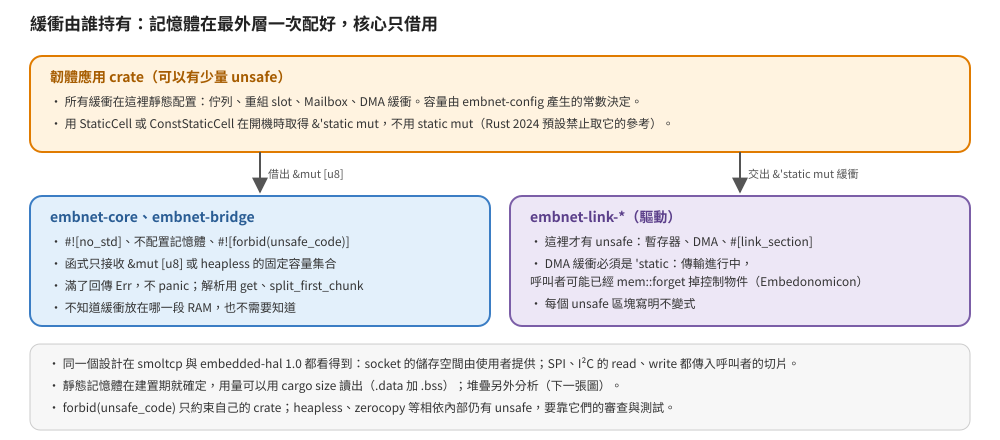
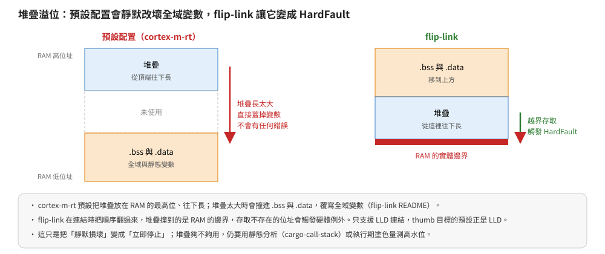

# no_std 與不配置記憶體：緩衝由誰持有

embnet-rs 的核心要跑在 STM32F4 這類 MCU 上，而且不配置記憶體（no heap）。這篇說明為什麼要這樣做、緩衝改由誰持有、
容量怎麼在編譯期決定，以及在 MCU 上特別容易被忽略的兩個問題：堆疊溢位與 panic。最後是量測程式大小的方法。
讀者假設會寫一般的 Rust，但沒寫過嵌入式。

延伸閱讀：The Embedded Rust Book（Collections、Panicking、Optimizations 各章）；The Embedonomicon 的 DMA 章；
Holzmann《The Power of Ten》；`heapless`、`static_cell`、`flip-link` 的文件。

## 一、為什麼不用 heap

在桌面程式裡，`Vec` 不夠就再要一塊記憶體。在 MCU 上這會帶來三個問題（The Embedded Rust Book，Collections 章）：

- **記憶體不足隨時可能發生**，而且發生在任何一個集合需要長大的地方。
- **碎片化**：配置器管理零碎的空間，實際用量比資料本身多，而且多多少很難事先知道。
- **執行時間不可預測**：集合長大時要重新配置並搬移資料，花多久取決於配置器。固定容量的集合不會重新配置，每個操作的時間都可預測。

安全關鍵軟體的規則也這樣要求。NASA/JPL 的 Power of Ten 第 3 條是「初始化之後不得動態配置記憶體」，理由是配置器的行為難以預測，
而把程式限制在事先配好的固定區域內，記憶體用量就能被驗證（Holzmann，第 2 到 3 頁）。MISRA C:2012 的 Rule 21.3 也禁用 `malloc`、`free` 這一類函式
（依 MathWorks 的整理，MISRA 原文未讀）。

不用 heap 的代價是：容量要事先決定，所有「放進去」的操作都可能失敗，而失敗必須由呼叫者處理。

## 二、容量是型別的一部分

`heapless` crate 提供固定容量的集合，容量用 const generic 寫在型別裡（0.9.3 版，MIT OR Apache-2.0）：

```rust
use heapless::Vec;

let mut v: Vec<u8, 8> = Vec::new();   // 最多 8 個元素，記憶體在變數本身裡面
match v.push(42) {
    Ok(()) => {}
    Err(rejected) => { /* 滿了：元素原封不動還給呼叫者 */ }
}
```

`push` 滿了回傳 `Err`，把元素還給呼叫者，不會 panic。`extend_from_slice`、`from_slice` 回傳 `CapacityError`。
例外是 `insert` 在索引超過長度時仍會 panic，用之前要先檢查。

常用的還有：

| 型別 | 用途 | 要注意的地方 |
|---|---|---|
| `spsc::Queue<T, N>` | 單一生產者、單一消費者的無鎖佇列，例如中斷收框、主迴圈處理 | 實際可用容量是 N − 1；官方範例用 `static mut`，見第四節 |
| `mpmc` | 多生產者、多消費者的無鎖佇列 | 需要 8 位元的原子操作 |
| `pool` | 無鎖的記憶體池 | ARM 上需要 LDREX/STREX 指令；Cortex-M4 有（推論，文件只舉 thumbv7m） |

## 三、緩衝由呼叫者持有

另一種做法是讓函式根本不擁有記憶體，只借用呼叫者給的切片：

<p align="center"></p>

成熟的嵌入式函式庫都這樣設計：

- **smoltcp**（0.14.0）完全不需要 heap。`SocketSet` 與每個 socket 的收發緩衝，都由使用者提供儲存空間，型別是 `managed` crate 的 `ManagedSlice`，
  可以是借來的切片，也可以在有 `alloc` 時是 `Vec`。它的 `RingBuffer` 是零拷貝的：所有方法都回傳指向緩衝內部的參考。
  要注意 `SocketSet::add` 在固定大小的儲存已滿時會 panic。
- **embedded-hal 1.0** 的 `SpiBus` 有 `read(&mut [Word])`、`write(&[Word])`、`transfer(read, write)`，I²C 也是類似的形式。驅動不配置任何東西，
  呼叫者決定緩衝放哪裡、多大。

`xrce-rs` 的協定層已經是這種寫法：編碼寫進呼叫者的緩衝區。embnet-rs 的核心沿用。

## 四、靜態配置與 `'static`

緩衝總要有人真正配置。最外層的韌體 crate 在開機時配置一次，之後一直存在，生命週期是 `'static`。

最直覺的寫法 `static mut BUF: [u8; 1024]` 在 Rust 2024 edition 會被擋下：`static_mut_refs` lint 預設為 deny。理由是取 `static mut` 的參考本身就是未定義行為，
即使從來沒有讀寫；要保證「可變就不能有別名」，需要整個程式的推理（Edition Guide）。

替代做法：

- **`static_cell`**（2.1.1）：`StaticCell` 在開機時初始化一次，取得 `&'static mut T`；`ConstStaticCell` 的值在編譯期就決定，
  全零的大緩衝會落在 `.bss`，不占快閃記憶體，也不經過堆疊。兩者重複取用時會 panic，有 `try_` 版本可以改用。
- **RTIC**（2.4.0）：`#[local]` 資源只屬於一個 task，不需要鎖；`#[shared]` 資源經 `lock` 存取，用優先序天花板協定避免死結。
  只有 `#[init]` 與 `#[idle]` 的 local 資源是 `'static`。

## 五、DMA 緩衝為什麼必須是 `'static`

DMA 是周邊硬體直接讀寫記憶體，CPU 只負責啟動。The Embedonomicon 用一個例子說明危險：如果 DMA 寫入的是堆疊上的緩衝，
而呼叫者用 `mem::forget` 丟掉了傳輸的控制物件，函式返回後那塊堆疊就被釋放了，DMA 卻還在寫。`mem::forget` 是 safe 的，
所以不能靠 `Drop` 保證安全。解法是要求緩衝的生命週期是 `'static`。`embedded-dma` crate 把這個要求寫成 trait。

記憶體順序也要處理：啟動 DMA 前放一個 Release 的 compiler fence，等待完成後放 Acquire。Cortex-M4 通常 compiler fence 就夠；
有資料快取的 Cortex-M7 需要硬體 barrier（Embedonomicon）。

需要連續寫入區的 DMA 收發，可以用 `bbqueue`（0.7.0）。它基於 BipBuffer：一種永遠能提供一段連續空間的環形緩衝，
因為 DMA 只認「起始位址加長度」，不懂環形緩衝會繞回開頭（Ferrous Systems 的部落格，2019）。

## 六、堆疊溢位

不用 heap 之後，剩下唯一會在執行中長大的記憶體是堆疊。在 Cortex-M 上，堆疊溢位不會報錯：

<p align="center"></p>

三種對策，互相補充：

| 對策 | 原理 | 限制 |
|---|---|---|
| `flip-link`（0.1.12） | 連結時把堆疊移到 RAM 最低位，溢位時存取不存在的位址，觸發 HardFault | 只把靜默損壞變成立即停止；只支援 LLD |
| 靜態分析：`cargo-call-stack`（0.1.16） | 由呼叫圖算出每個函式的最大堆疊用量 | 需要 nightly 與 fat LTO；函式指標、trait object、中斷都會讓結果不完整；最後測試的 nightly 是 2023-11-13 |
| 執行期量測：cortex-m-rt 的 `paint-stack` | 開機時把堆疊區塗上固定值，執行一段時間後看被改掉多少 | 只量到測試涵蓋的情況，不是上限 |

Power of Ten 第 1 條禁止遞迴，理由之一就是：沒有遞迴，堆疊用量的上限才能靜態算出（第 2 到 3 頁）。

## 七、Panic

`no_std` 下 panic 的行為要自己指定（The Embedded Rust Book，Panicking 章）：

| crate | 行為 | 適合 |
|---|---|---|
| `panic-halt` | 停在無窮迴圈 | 除錯時接上除錯器看停在哪裡 |
| `panic-probe` | 觸發 HardFault，讓主機端的工具印出 backtrace 並以失敗結束 | 開發與自動化測試 |
| `panic-reset` | 重設晶片 | 現場運作；文件沒有說明重設迴圈與 panic 資訊遺失的風險，要自己評估 |

對 Bridge 來說，panic 等於停止轉送，`002` 要求它 fail-silent，所以 panic 處理器的選擇屬於設計的一部分。
但更重要的是，解析外部輸入的程式根本不應該 panic。手段有三層：

- **用不會 panic 的 API。** `slice.get(range)` 越界回傳 `None`；`split_first_chunk::<N>()` 回傳 `Option`；`split_at_checked` 是 `split_at` 的不 panic 版本。
  直接索引 `buf[i]` 與 `split_at` 在越界時會 panic。
- **用 Clippy 擋下會 panic 的寫法。** `indexing_slicing`、`arithmetic_side_effects`、`unwrap_used` 都屬於 restriction 組，預設不開，要在核心 crate 明確啟用。
  `arithmetic_side_effects` 很重要：release 建置預設不檢查溢位，溢位會靜默繞回；除以零則在任何建置都會 panic。
- **用 `no-panic` 證明。** 在函式上加 `#[no_panic]`，若編譯器無法證明它不會 panic，連結就失敗。限制是它只在 `panic = "unwind"` 時有效，
  而 thumb 目標預設是 abort（rustc 原始碼 `spec/base/thumb.rs`）。所以這項證明只能在主機端的 `std` 建置做，韌體建置本身不會報錯。

### 安全的零拷貝解析

`zerocopy`（0.8.63）讓結構體可以直接從位元組切片取得參考，不必逐欄位複製。它用 derive 在編譯期檢查型別是否任何位元組合都合法（`FromBytes`）、
是否不需對齊（`Unaligned`）；長度不足或對齊不對時回傳 `Err`。`byteorder` 模組提供對齊為 1 的大小端整數型別。
它的口號是「我們寫 unsafe，你不必寫」：使用端的 crate 可以維持 `forbid(unsafe_code)`。

## 八、`forbid(unsafe_code)` 的範圍

- 它擋下的不只是 `unsafe` 區塊，還有 `no_mangle`、`export_name`、`link_section` 這些屬性（rustc 的 lint 說明）。
  所以把 DMA 緩衝放到特定 RAM 區段的工作，不能在核心 crate 做，要放在 Link crate 或韌體 crate（推論）。
- Cargo 會降低相依 crate 的 lint 等級，所以 `forbid` 只約束自己的 crate。`heapless`、`zerocopy` 內部仍有 unsafe，安全性依賴它們的審查與測試。

## 九、量程式大小

| 設定 | 作用 |
|---|---|
| `opt-level = "z"` 或 `"s"` | 以大小為優先；`"z"` 另外關閉迴圈向量化。有時 `"s"` 反而比較小（min-sized-rust） |
| `lto = "fat"` | 跨整個相依圖最佳化 |
| `codegen-units = 1` | 讓最佳化看到整個 crate，通常更小 |
| `panic = "abort"` | 移除 unwinding 的程式碼；thumb 目標本來就預設 abort |

量測工具：

- **`cargo size`**（cargo-binutils 0.4.0）：`cargo size --release -- -A -x` 列出 `.text`、`.rodata`、`.data`、`.bss` 的大小。
  `001` 的體積判準是 `.text` 加 `.rodata`；靜態 RAM 是 `.data` 加 `.bss`（推論）。
- **`cargo bloat`**（0.12.1）：列出最大的函式或依 crate 分組。它只算 `.text`，README 自承數字是推估的。

## 十、對 embnet-rs 的影響

| 觀察 | 對設計的影響 |
|---|---|
| 不用 heap 時，容量要事先決定，放入可能失敗 | 核心的佇列、重組 slot、Mailbox 用 `heapless` 或呼叫者的切片；容量由 `embnet-config` 依流量預算產生（`docs/20-protocol/04`） |
| 緩衝由呼叫者持有是成熟函式庫的共通做法 | 核心只接收 `&mut [u8]` 與固定容量集合；韌體 crate 用 `StaticCell` 或 `ConstStaticCell` 配置 |
| `static mut` 在 Rust 2024 預設禁止 | 不用 `static mut`；`heapless::spsc` 的拆分方式要另外確認不需 unsafe 的寫法（待查證） |
| DMA 緩衝必須是 `'static`，`link_section` 屬於 unsafe | DMA 與記憶體區段只在 Link crate 處理（`CLAUDE.md` 的 unsafe 規則補上韌體 crate） |
| 堆疊溢位在 Cortex-M 上是靜默的 | 韌體一律用 `flip-link`；P5 用 `paint-stack` 量高水位，並嘗試 `cargo-call-stack` 靜態分析（`003` K-26） |
| 解析外部輸入不得 panic | 核心啟用 `indexing_slicing`、`arithmetic_side_effects`、`unwrap_used`；解析函式在主機端 unwind 建置加 `#[no_panic]` 驗證；fuzz 補足剩下的（`docs/40-rust-embedded/03`） |
| Bridge 要 fail-silent | 現場韌體的 panic 處理器停止輸出並重設；重設次數記錄在非揮發記憶體，避免無限重設迴圈（P5 定義） |
| 程式大小要可比較 | `001` 的 `EMBNET_SIZE` 通過行用 `cargo size` 的 `.text`、`.rodata`、`.data`、`.bss`，profile 固定為 `opt-level = "z"`、`lto = "fat"`、`codegen-units = 1` |

## 來源

- The Embedded Rust Book：<https://docs.rust-embedded.org/book/collections/index.html>、
  <https://docs.rust-embedded.org/book/start/panicking.html>、<https://docs.rust-embedded.org/book/unsorted/speed-vs-size.html>
- The Embedonomicon，DMA 章：<https://docs.rust-embedded.org/embedonomicon/dma.html>
- G. J. Holzmann, *The Power of Ten: Rules for Developing Safety Critical Code*：<https://spinroot.com/gerard/pdf/P10.pdf>
- MathWorks，MISRA C:2012 Rule 21.3：<https://www.mathworks.com/help/bugfinder/ref/misrac2012rule21.3.html>
- `heapless` 0.9.3：<https://docs.rs/heapless/0.9.3/heapless/>
- smoltcp 0.14.0：<https://docs.rs/smoltcp/0.14.0/smoltcp/>；`managed`：<https://docs.rs/managed/latest/managed/enum.ManagedSlice.html>
- embedded-hal 1.0：<https://docs.rs/embedded-hal/latest/embedded_hal/spi/trait.SpiBus.html>
- `static_cell` 2.1.1：<https://docs.rs/static_cell/2.1.1/static_cell/>
- Rust Edition Guide，`static mut` references：<https://doc.rust-lang.org/edition-guide/rust-2024/static-mut-references.html>
- RTIC，資源章：<https://rtic.rs/2/book/en/by-example/resources.html>
- `embedded-dma` 0.2.0：<https://docs.rs/embedded-dma/0.2.0/embedded_dma/>；`bbqueue`：<https://docs.rs/bbqueue/latest/bbqueue/>；
  Ferrous Systems，lock-free ring buffer：<https://ferrous-systems.com/blog/lock-free-ring-buffer/>
- cortex-m-rt：<https://docs.rs/cortex-m-rt/latest/cortex_m_rt/>；flip-link：<https://github.com/knurling-rs/flip-link>；
  cargo-call-stack：<https://github.com/japaric/cargo-call-stack>
- panic-halt、panic-probe、panic-reset（docs.rs）；no-panic：<https://github.com/dtolnay/no-panic>
- Clippy lint 列表：<https://clippy.rust-lang.org/master/index.html>
- zerocopy 0.8.63：<https://docs.rs/zerocopy/0.8.63/zerocopy/>
- rustc lint 說明：<https://doc.rust-lang.org/rustc/lints/listing/allowed-by-default.html>；rustc thumb 目標預設：
  <https://rust.googlesource.com/rust/+/b032fac34e5be72aa02748eadd4e8d8917a7e758/compiler/rustc_target/src/spec/base/thumb.rs>
- Cargo profiles：<https://doc.rust-lang.org/cargo/reference/profiles.html>；min-sized-rust：<https://github.com/johnthagen/min-sized-rust>
- cargo-binutils：<https://github.com/rust-embedded/cargo-binutils>；cargo-bloat：<https://github.com/RazrFalcon/cargo-bloat>

## 待查證

- Power of Ten 的出版資訊；MISRA C:2012 Rule 21.3 與 Directive 4.12 的原文。
- `heapless::spsc` 在不使用 unsafe 時的拆分方式。
- `split_at_checked` 的穩定版本；Clippy `unwrap_used`、`expect_used` 的原文說明。
- `cargo-call-stack` 在目前的 nightly 是否仍能運作。
- `panic-reset` 的重設機制。
