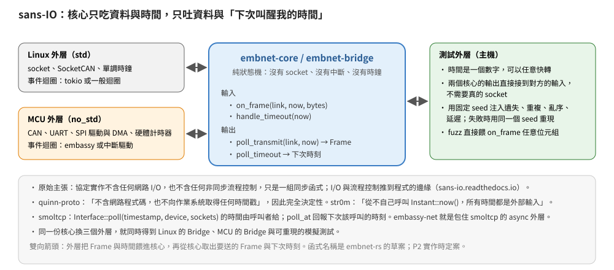
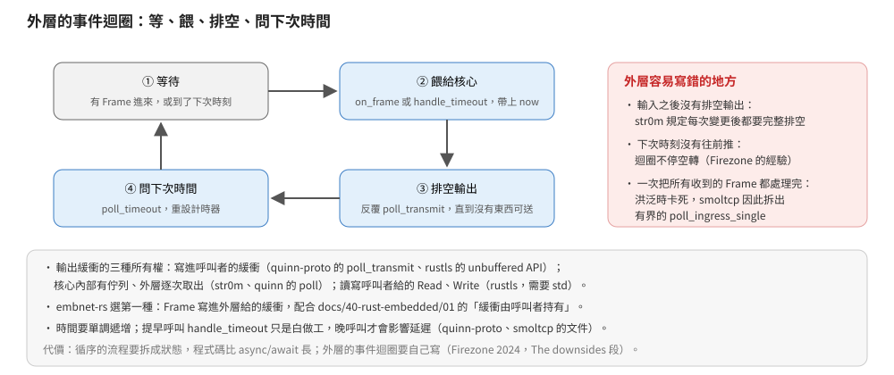
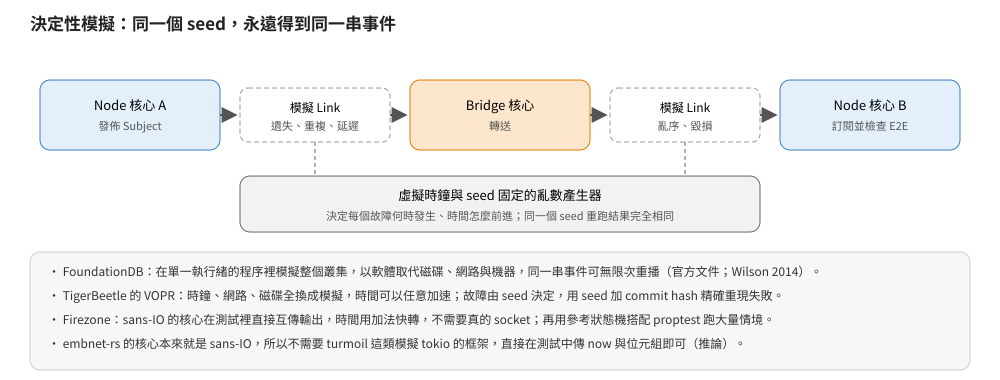

# sans-IO：把協定和 I/O、時鐘分開

embnet-rs 的核心要同時跑在三個地方：Linux 上的 Bridge、MCU 上的 Bridge 與 Node，以及主機上的測試。三者的 I/O 完全不同：
socket 與 SocketCAN（Linux 把 CAN 介面包成 socket 的子系統）、硬體驅動與 DMA、模擬的 Link。sans-IO 的做法是讓協定的程式碼完全不碰 I/O 與時鐘，
只處理「給它位元組與時間，它回答要送什麼、下次何時叫醒它」。這篇說明這個設計的來源、Rust 的實例、外層的事件迴圈怎麼寫，
以及它帶來的最大好處：決定性的模擬測試。

延伸閱讀：sans-io.readthedocs.io；quinn-proto、smoltcp、str0m 的文件；Firezone《sans-IO: The secret to effective Rust for network services》（2024）；
TigerBeetle 的 VOPR 文件；上一篇 [no_std 與不配置記憶體](01-no-alloc.md)。

## 一、原始主張

sans-IO 這個詞來自 Python 社群（sans-io.readthedocs.io，Brett Cannon、Cory Benfield 等人，2016）。它的定義是：協定實作不含任何網路 I/O，
也不含任何非同步的流程控制，只是一組同步函式、同步回傳結果（How To 頁）。I/O 與流程控制推到程式的邊緣。

理由有四個（同頁）：

- **簡單**：可能出錯的空間大幅縮小。
- **可測試**：餵位元組進去、比對輸出的位元組，測試只有通過或不通過。
- **正確**：協定邏輯和 I/O 的錯誤分開。
- **可重用**：當時 Python 的各家 HTTP 函式庫，沒有任何一家共用了實質的協定程式碼，因為每一家的協定都和自己的 I/O 綁在一起。

Python 的 h11 自稱「自帶 I/O」（bring-your-own-I/O）的協定函式庫，完全不含 I/O 程式碼。

## 二、Rust 的實例

| 專案 | 核心與外層的分法 | 時間怎麼來 |
|---|---|---|
| quinn（QUIC） | `quinn-proto` 是「不做任何 I/O 的決定性狀態機」，`quinn` 是基於 tokio 的 async 外層 | 「不向作業系統取得任何時間戳」；`poll_transmit(now, ...)`、`handle_timeout(now)` |
| smoltcp（TCP/IP） | `Interface::poll(timestamp, device, sockets)`；embassy-net 是包住它的 async 外層 | 由呼叫者傳入；`poll_at` 回報下次該呼叫的時刻 |
| rustls（TLS） | 不建立連線、不做 DNS、不讀寫檔案；`read_tls`、`process_new_packets`、`write_tls` | 不涉及 |
| str0m（WebRTC） | `Rtc` 自己不收發網路；`handle_input` 與 `poll_output` | 「從不呼叫 `Instant::now()`，所有時間都是外部輸入」 |

（quinn-proto 0.11.19、smoltcp 0.14.0、rustls 0.23.46、str0m 0.25.0 的 docs.rs 頁面）

quinn-proto 的文件寫得最直接：它包含 QUIC 協定邏輯的完全決定性實作，不含網路程式碼，也不向作業系統取得時間。輸入的時間必須單調遞增。

## 三、計時器交給外層

協定需要計時：重組逾時、Heartbeat 週期、看門狗、FV 同步。sans-IO 的核心不自己開計時器，而是回報「下次需要被叫醒的時間」，由外層排程：

- quinn-proto：`poll_timeout()` 回傳下次該呼叫 `handle_timeout` 的時刻；多呼叫幾次是無害的。
- smoltcp：`poll_at` 回傳下次該呼叫 `poll` 的時刻，`poll_delay` 回傳還剩多久。太早呼叫只是浪費電，太晚呼叫會影響服務品質。
- str0m：`poll_output` 的最後一個輸出是 `Timeout(Instant)`。

## 四、外層的事件迴圈

外層要遵守的契約，各專案都寫進了文件：

- **每次輸入之後要排空輸出。** str0m 規定每次變更之後，都要把 `poll_output` 取到 `Timeout` 為止，才能再輸入。
- **下次時刻要真的往前推。** Firezone 的文章提到，這一步寫錯會讓迴圈不停空轉。
- **每次呼叫的工作量要有上限。** smoltcp 的 `poll` 會把裝置佇列整個處理完，文件警告這有阻斷服務的風險，建議改用一次只處理一個封包的 `poll_ingress_single`，
  搭配 `poll_egress`。這和 `003` 第一節的瓶頸分析是同一件事：Bridge 入口不能因為洪泛而卡死。

### 輸出緩衝歸誰

| 做法 | 實例 |
|---|---|
| 寫進呼叫者給的緩衝 | quinn-proto 的 `poll_transmit(now, max_datagrams, buf)`；rustls 的 unbuffered API（可用於 `no_std`） |
| 核心內部有佇列，外層逐次取出 | str0m 的 `poll_output`；quinn 的 `poll` |
| 讀寫呼叫者給的 `Read`、`Write` | rustls 的一般 API（需要 `std`） |

embnet-rs 用第一種，和上一篇的「緩衝由呼叫者持有」一致。

## 五、時間型別

核心不能綁死任何一種時鐘：

- smoltcp 自訂了 `Instant`，內部是從任意起點單調遞增的 64 位元微秒計數，不綁牆上時鐘。MCU 上可以直接用計時器的 tick 換算。
- embassy-time 的 `Instant` 以 tick 計，時鐘來源是編譯期選定的全域驅動，一個程式只能有一個；測試時有可以手動推進時間的模擬驅動。
- fugit 把時間基底寫在型別參數裡，換算在編譯期完成。

embnet-rs 的核心照 smoltcp 的做法：自訂一個以微秒計的時間型別，由外層換算，同時不依賴 `std` 與 embassy（推論）。

## 六、決定性模擬測試

sans-IO 最大的回報在測試。核心不碰 I/O 也不讀時鐘，給它同樣的輸入序列，就一定得到同樣的輸出。把多個核心接起來、中間放一個模擬的 Link，就能在主機上重現整個網路：

這個做法在大型系統上已經被驗證過：

- **FoundationDB** 在單一執行緒的程序裡模擬整個叢集，用軟體取代磁碟、網路與機器。官方文件說，決定性讓錯誤可以完美重現（Testing 頁；Will Wilson，Strange Loop 2014）。
- **TigerBeetle 的 VOPR** 把時鐘、網路、磁碟全換成模擬，時間可以任意加速；遺失、亂序、分割、磁碟損毀都由 seed 決定，用 seed 加上 commit hash 就能精確重現一次失敗。
- **Firezone** 的 sans-IO 核心在測試裡直接把一方的輸出交給另一方的輸入，時間用加法快轉；再用參考狀態機搭配 proptest 在 CI 跑大量情境。

Rust 也有 `turmoil` 這類在單一執行緒模擬 tokio 網路的框架，適合測 async 的外層。embnet-rs 的核心本身是 sans-IO，不需要它，直接在測試裡傳時間與位元組即可（推論）。

## 七、代價

Firezone 的文章列了三個缺點（The downsides 段）：

- 外層的事件迴圈要自己寫，容易出細微的錯，例如下次時刻沒有往前推。
- 循序的流程要拆成一個個狀態，程式碼比 `.await` 長。
- 這種風格在 Rust 生態中較少見，能借用的函式庫不多。

好處是避開了 async 的「函式顏色」問題（async 函式只能由 async 函式呼叫，這個限制會一路往上傳染），`&mut self` 就夠，不需要 `Arc<Mutex<T>>` 或 channel，也沒有 task 排序帶來的非決定性。

## 八、對 embnet-rs 的影響

| 觀察 | 對設計的影響 |
|---|---|
| 計時器由核心回報、外層排程 | 核心介面草案改為四個入口：`on_frame(link, now, bytes)`、`handle_timeout(now)`、`poll_transmit(link, now, buf)`、`poll_timeout()`（`001` 第 5.2 節） |
| 每次呼叫的工作量要有上限 | `on_frame` 一次只處理一個 Frame；`poll_transmit` 一次只產出一個 Frame；外層決定每輪處理多少 |
| 輸出寫進呼叫者的緩衝 | `poll_transmit` 由外層對發送端有空位的 Link 呼叫，寫進外層給的 `&mut [u8]`，回傳長度；帶 `now` 讓核心能丟棄逾期的 Transfer |
| 時間要單調、不綁時鐘 | 核心自訂微秒計數的時間型別；外層負責從 SocketCAN 時戳、`std::time::Instant` 或硬體計時器換算 |
| 決定性讓測試可重現 | P2 的故障注入用模擬 Link 加固定 seed；失敗時記錄 seed 與 commit，通過行附 seed（`002` 第六節） |
| 外層的事件迴圈容易寫錯 | Linux 外層與 MCU 外層各寫一份並各自測試；把「排空輸出」「下次時刻前進」寫成外層的斷言 |
| embassy-net 是包住 smoltcp 的 async 外層 | MCU 外層優先評估 embassy；中斷驅動的寫法作為替代（RTIC 的細節待查證） |

## 來源

- *Network protocols, sans I/O*：<https://sans-io.readthedocs.io/>、<https://sans-io.readthedocs.io/how-to-sans-io.html>
- h11：<https://h11.readthedocs.io/en/latest/>
- quinn：<https://github.com/quinn-rs/quinn>；quinn-proto：<https://docs.rs/quinn-proto/latest/quinn_proto/struct.Connection.html>
- smoltcp：<https://docs.rs/smoltcp/latest/smoltcp/iface/struct.Interface.html>、<https://docs.rs/smoltcp/latest/smoltcp/time/struct.Instant.html>
- rustls：<https://docs.rs/rustls/latest/rustls/>、<https://docs.rs/rustls/latest/rustls/unbuffered/index.html>
- str0m：<https://docs.rs/str0m/latest/str0m/struct.Rtc.html>
- embassy-time：<https://docs.rs/embassy-time/latest/embassy_time/>；fugit：<https://docs.rs/fugit/latest/fugit/>
- embassy book：<https://embassy.dev/book/>；embassy-net：<https://docs.rs/embassy-net/latest/embassy_net/>
- T. Eizinger, *sans-IO: The secret to effective Rust for network services*, Firezone, 2024：<https://www.firezone.dev/blog/sans-io>
- W. Wilson, *Testing Distributed Systems w/ Deterministic Simulation*, Strange Loop 2014：
  <https://thestrangeloop.com/2014/testing-distributed-systems-w-slash-deterministic-simulation.html>
- FoundationDB Testing：<https://apple.github.io/foundationdb/testing.html>
- TigerBeetle VOPR：<https://github.com/tigerbeetle/tigerbeetle/blob/main/docs/internals/vopr.md>
- turmoil：<https://docs.rs/turmoil/latest/turmoil/>

## 待查證

- RTIC v2 的硬體 task、async task 與 Monotonic 的官方說明。
- embassy-time 模擬驅動的確切方法名稱；smoltcp `Instant::now()` 是否只在 `std` 下提供。
- embassy-net 的 `Runner` 如何呼叫 smoltcp 的 `poll` 與 `poll_at`。
- turmoil 設定 seed 的 API。
