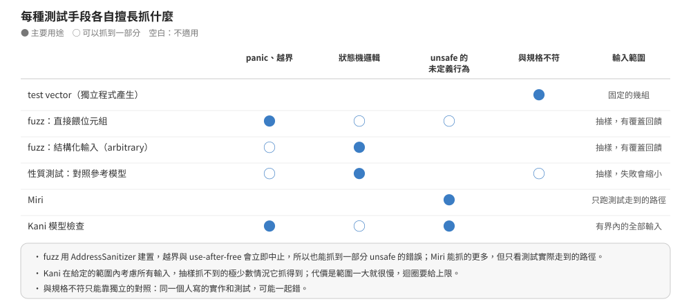
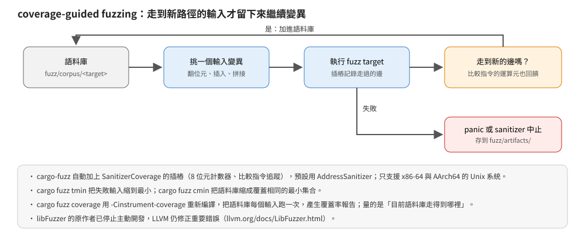

# fuzz、性質測試、Miri 與 Kani

`CLAUDE.md` 的判準要求「畸形輸入不 panic、不越界，fuzz 附覆蓋率」。這篇整理達成這個判準的工具：
coverage-guided fuzzing、結構化 fuzzing、對照參考模型的性質測試、Miri、Kani 模型檢查，以及覆蓋率怎麼量。
重點不在每個工具的細節，而在它們各自抓得到什麼、抓不到什麼，以及在 embnet-rs 裡各用在哪裡。

延伸閱讀：Rust Fuzz Book；proptest book；Miri README；Kani 文件；上一篇 [sans-IO](02-sans-io.md)（決定性是這些工具能用的前提）。

## 一、各自擅長什麼

<p align="center"></p>

兩件事決定了工具的分工：

- **輸入範圍。** fuzz 與性質測試是抽樣，test vector 是固定幾組，Kani 是在給定範圍內考慮全部輸入，Miri 只看測試實際走到的路徑。
- **有沒有對照。** 測試若和實作出自同一個人，兩者可能一起錯。與規格不符的錯誤，只有獨立產生的對照才抓得到。

## 二、coverage-guided fuzzing

<p align="center"></p>

Rust 的標準工具是 cargo-fuzz，它驅動 LLVM 的 libFuzzer（Rust Fuzz Book）。寫法是一個 `fuzz_target!`，接收任意位元組：

```rust
#![no_main]
use libfuzzer_sys::fuzz_target;

fuzz_target!(|data: &[u8]| {
    let _ = embnet_core::decode_frame(data);   // 只要求不 panic、不越界
});
```

運作方式：fuzzer 從語料庫挑一個輸入、隨機變異、執行；若這個輸入讓程式走到之前沒走過的分支，就把它加回語料庫。
cargo-fuzz 自動加上 SanitizerCoverage 的插樁（instrumentation：編譯時在每個分支插入記錄程式碼），包含比較指令的追蹤，讓 fuzzer 能猜出 magic number 與長度欄位（`src/project.rs`）。
預設用 AddressSanitizer 建置，所以 fuzz 也能抓到一部分越界與 use-after-free。

幾個要知道的限制與工具：

- cargo-fuzz 需要 nightly，只支援 x86-64 與 AArch64 的 Unix 系統（README）。`no_std` 的核心要在主機上以 std 環境編譯來 fuzz。
- `cargo fuzz tmin` 把失敗的輸入縮到最小；`cargo fuzz cmin` 把語料庫縮成覆蓋相同的最小集合。
- libFuzzer 的原作者已經停止主動開發，LLVM 仍會修正重要錯誤，但不要期待新功能（llvm.org 的 LibFuzzer 文件）。
- 其他選擇：AFL++ 的 Rust 綁定 `afl.rs`、`honggfuzz-rs`，以及用來組裝自訂 fuzzer 的 LibAFL（支援 `no_std`，CCS 2022）。

### 結構化輸入

直接餵位元組時，大部分輸入在解析標頭時就被拒絕，到不了後面的狀態機。`arbitrary` crate 讓 fuzz target 接收結構化的型別：

```rust
#[derive(arbitrary::Arbitrary, Debug)]
enum Op { Frame { link: u8, bytes: Vec<u8> }, Advance { micros: u32 } }

fuzz_target!(|ops: Vec<Op>| { /* 依序餵給 sans-IO 核心，最後檢查不變式 */ });
```

Rust Fuzz Book 的例子正是這樣：把一串操作重放到被測物件上，這是狀態機 fuzz 的原型。書中也提到，有一項實驗顯示自訂 mutator 的覆蓋率成長比 `arbitrary` 好，
格式帶 checksum 時尤其如此。帶 CRC 的框可以在 target 裡先補上正確的 CRC，否則幾乎所有變異都會被 CRC 擋下。

兩種輸入要並用：「不 panic、不越界」的攻擊面是原始位元組，一定要有直接餵位元組的 target；狀態機的邏輯則交給結構化輸入。

## 三、性質測試：對照參考模型

性質測試不寫具體的輸入，而是寫「對所有輸入都要成立的性質」，由框架產生大量輸入，失敗時自動縮小到最簡單的反例。

| | proptest | quickcheck |
|---|---|---|
| 產生方式 | 明確的 `Strategy` 物件，同一個型別可以有多種 | 依型別決定 |
| 縮小 | 保留中間狀態，縮得更細；不會縮到 strategy 範圍外 | 依輸出值，無狀態 |
| 速度 | 產生複雜值時可能慢一個數量級 | 較快 |

（proptest book，vs-quickcheck 頁）

proptest 把失敗案例的 seed 存在 `proptest-regressions/`，建議 commit 進版控，之後每次執行都先重放（failure-persistence 頁）。

對協定最有用的是狀態機測試（`proptest-state-machine`）。寫兩個東西：

- **參考模型**（`ReferenceStateMachine`）：一個極簡、明顯正確的抽象版本，例如「已收到的 Transfer-ID 集合」。
- **被測系統**（`StateMachineTest`）：真正的實作，每一步之後和參考模型比對，並檢查不變式。

框架產生一串轉移（收到某個 Frame、時間前進、丟包），失敗時先從尾端刪轉移，再縮小各個轉移。
在 embnet-rs 裡，參考模型可以是 E2E 接收狀態機的簡化版，不變式例如「序號單調」「重組 slot 數不超過上限」「同一筆 Transfer 不交給應用兩次」。

## 四、Miri：檢查 unsafe

Miri 是 Rust 的直譯器，逐步執行程式並檢查未定義行為（Miri README）：

- 越界存取、use-after-free、讀未初始化的記憶體。
- 未對齊的存取、不合法的值（例如不是 0 或 1 的 `bool`）。
- 資料競爭，以及部分弱記憶體效應。
- 別名規則：Rust 規定 `&mut` 參考存在時不能有其他參考指向同一塊記憶體。Stacked Borrows 與 Tree Borrows 是這條規則的兩種形式化模型，預設用前者，`-Zmiri-tree-borrows` 改用後者（PLDI 2025）。

限制：大部分平台 API 與 FFI 不能用，不支援網路，速度很慢；只檢查測試實際走到的路徑，也不保證抓到所有違規。
Miri 的論文（POPL 2026）說，它能在超過 70% 的函式庫測試上成功執行。

embnet-rs 的核心是 `forbid(unsafe_code)`，Miri 的價值在 Link crate 的 unsafe 部分。直接讀寫暫存器的程式碼 Miri 跑不了，所以要把不碰硬體的邏輯（例如環形緩衝的索引運算）拆出來單獨測。

## 五、Kani：在有界範圍內窮舉

Kani 是 AWS 開發的 Rust 模型檢查器（model checker，kani-verifier 0.68.0）：把程式和要檢查的性質轉成邏輯式，由求解器判斷是否存在違反性質的輸入。它不抽樣，而是在給定範圍內考慮所有可能的輸入：

```rust
#[cfg(kani)]
#[kani::proof]
fn tail_byte_never_panics() {
    let byte: u8 = kani::any();          // 代表所有 256 個值
    let _ = embnet_core::TailByte::decode(byte);
}
```

它能證明 panic 不會發生、沒有算術溢位、斷言成立，也檢查一部分記憶體安全問題，例如 unsafe 程式碼中的空指標解參考（Kani README）。
結果是「成立」「反例」或「資源耗盡」三者之一（Kani 文件）。限制：

- 有迴圈時要用 `#[kani::unwind(N)]` 給迴圈展開上限（loop unwinding），N 要比實際次數多 1；上限不夠時其他性質都無法判定。上面的例子沒有迴圈，所以不需要。
- 規模放大後很慢。Kani 的教學提到，解析器常要十幾二十個字元的輸入才會露出問題，這時代價很高。
- 不支援並行、inline assembly，以及 panic 時的堆疊展開（stack unwinding，和上面的迴圈展開無關）。

它和 fuzz 是互補的。s2n-quic 的例子：同一個測試入口函式（harness）同時當 fuzz target 與 Kani 證明；一個 libFuzzer 跑了 1,600 多萬次輸入都沒發現的錯誤，
Kani 約 20 秒就找到了（Kani 部落格，2023-05-30）。Firecracker 用 Kani 驗證 rate limiter，找到一個讓 guest 多做約 0.01% I/O 的捨入錯誤（2023-08-31）。

適合 embnet-rs 的範圍：固定長度的欄位，例如 CAN ID 解碼、Tail byte、E2E 標頭、COBS 的單一 code byte。整個變長框的解析交給 fuzz。

## 六、覆蓋率怎麼量

rustc 的 `-C instrument-coverage` 插入計數器，執行後寫出 `.profraw`，再用 `llvm-profdata` 合併、`llvm-cov` 產生報告。指標有四種（rustc 文件）：

| 指標 | 意義 |
|---|---|
| function | 至少執行過一次的函式比例 |
| instantiation | 泛型的每個實例分開算 |
| line | 至少執行過一次的行比例 |
| region | 最細，例如 `x \|\| (y && z)` 拆成三個區域 |

`cargo-llvm-cov`（0.9.1）把這個流程包成一個指令，可以輸出 HTML、lcov、JSON，並用 `--fail-under-lines` 當 CI 門檻；分支覆蓋率仍需要 nightly。

fuzz 的覆蓋率要分開看。fuzz 執行時的插樁是給 fuzzer 導引用的，不是報告；`cargo fuzz coverage` 另外用 `-Cinstrument-coverage` 重新編譯，
把目前的語料庫每個輸入跑一次。所以 fuzz 的覆蓋率量的是「這個語料庫走得到哪裡」。報一個數字時，要同時寫明 target、語料庫大小、fuzz 時數與指標種類。

## 七、差分測試

Csmith（PLDI 2011）用隨機產生的 C 程式比對多個編譯器的輸出，三年內找到超過 325 個編譯器錯誤。論文指出差分測試的優點：不需要知道正確答案，
只要多個實作的結果不同，就一定有錯（第 2.1 節）。前提是輸入不能落在規格未定義的地方，否則差異無法歸因。

密碼學也有類似的做法：Project Wycheproof 提供社群維護的測試向量，涵蓋已知的攻擊與規格不一致之處。

embnet-rs 的線格式不和任何現有實作相容，所以對照組要自己建立：

- 用 Python 寫一個獨立的編碼器產生 test vector，不共用 Rust 的程式碼（`CLAUDE.md` 硬規則；`003` K-10）。
- CRC 用 RevEng catalogue 的 check 值核對（[CRC 與 framing](../20-protocol/03-crc-and-framing.md) 第五節）。
- AES-CMAC 用 RFC 4493 第 4 節的測試向量核對。

## 八、在目標硬體上測

主機上的測試涵蓋協定邏輯，驅動與時序要在目標上測：

- **embedded-test**（0.7.3）：搭配 `probe-rs`，一次燒錄所有測試，每個測試前重設裝置，輸出與 libtest 相容。
- **defmt-test**（0.5.1）：在裝置上跑單元測試，測試循序執行。
- **QEMU**：Embedded Rust Book 的例子模擬 LM3S6965（Cortex-M3），不是 Cortex-M4F，測不到 FPU 相關的行為。
- **Renode**：整合 Robot Framework，可以寫「等待 UART 輸出某行」「等待送出封包」之類的測試（Renode 1.17.0 有 bxCAN 模型，但送出順序不依 ID、錯誤計數器不會累加，`docs/plans/005` 第四節）。

## 九、對 embnet-rs 的影響

| 工具 | 用在哪裡 | 里程碑 |
|---|---|---|
| Python 產生的 test vector、RevEng check 值、RFC 4493 向量 | 線格式、CRC、CMAC 是否符合規格 | P1 起 |
| fuzz：直接餵位元組 | `decode_frame`、COBS 解碼、CAN ID 解碼、E2E 標頭解析 | P2 起，每個解析器一個 target |
| fuzz：結構化輸入 | 一串 `on_frame`、`handle_timeout` 操作餵給 Bridge 核心，最後檢查不變式 | P2、P3 |
| proptest 狀態機測試 | 重組、去重複、E2E 接收狀態機，對照極簡的參考模型 | P2 |
| Kani | 固定長度欄位的解碼不 panic、不溢位 | P2，選擇性 |
| Miri | Link crate 中不碰硬體的 unsafe 邏輯 | P3 起 |
| cargo-llvm-cov | 單元測試覆蓋率 | P2 起 |
| embedded-test 或 Renode | 驅動、DMA、中斷延遲 | P5 |

通過行的格式更新為 `EMBNET_FUZZ target=<名稱> hours=<N> corpus=<N> cov_metric=<line|region> cov=<N>% crashes=0`（`002` 第六節）。

授權方面：`libfuzzer-sys` 內含 LLVM 的 libFuzzer 原始碼，授權是 `(MIT OR Apache-2.0) AND NCSA`。它只是開發用的相依，不進韌體，但相依授權清單要列入。

## 來源

- Rust Fuzz Book：<https://rust-fuzz.github.io/book/cargo-fuzz.html>、structure-aware fuzzing 與 coverage 各頁
- cargo-fuzz：<https://github.com/rust-fuzz/cargo-fuzz>；`src/project.rs`、`src/options.rs`
- LLVM, libFuzzer：<https://llvm.org/docs/LibFuzzer.html>
- arbitrary：<https://docs.rs/arbitrary/latest/arbitrary/>
- afl.rs：<https://github.com/rust-fuzz/afl.rs>；honggfuzz-rs：<https://github.com/rust-fuzz/honggfuzz-rs>；LibAFL：<https://github.com/AFLplusplus/LibAFL>
- proptest book：<https://proptest-rs.github.io/proptest/proptest/vs-quickcheck.html>、
  <https://proptest-rs.github.io/proptest/proptest/state-machine.html>、<https://proptest-rs.github.io/proptest/proptest/failure-persistence.html>
- quickcheck：<https://github.com/BurntSushi/quickcheck>
- Miri：<https://github.com/rust-lang/miri>；R. Jung 等, *Miri: Practical Undefined Behavior Detection for Rust*, POPL 2026；
  N. Villani 等, *Tree Borrows*, PLDI 2025
- Kani：<https://model-checking.github.io/kani/>；s2n-quic 案例：
  <https://model-checking.github.io/kani-verifier-blog/2023/05/30/how-s2n-quic-uses-kani-to-inspire-confidence.html>；
  Firecracker 案例：<https://model-checking.github.io/kani-verifier-blog/2023/08/31/using-kani-to-validate-security-boundaries-in-aws-firecracker.html>
- rustc instrument-coverage：<https://doc.rust-lang.org/rustc/instrument-coverage.html>；cargo-llvm-cov：<https://github.com/taiki-e/cargo-llvm-cov>
- X. Yang 等, *Finding and Understanding Bugs in C Compilers*, PLDI 2011：<https://www-old.cs.utah.edu/~regehr/papers/pldi11-preprint.pdf>
- Project Wycheproof：<https://github.com/C2SP/wycheproof>
- embedded-test：<https://github.com/probe-rs/embedded-test>；defmt-test：<https://github.com/knurling-rs/defmt/tree/main/firmware/defmt-test>；
  Embedded Rust Book QEMU 章；Renode testing：<https://renode.readthedocs.io/en/latest/introduction/testing.html>

## 待查證

- fuzz 與單元測試的 profdata 能否合併成一份報告。
- `arbitrary` 的欄位屬性（例如自訂某欄位的產生方式）。
- 分支與 MC/DC 覆蓋率在目前 rustc 的確切旗標。
- Kani 的後端是否為 CBMC（文件正文沒有明寫）。
- proptest-state-machine 縮小順序的原始碼核對。
