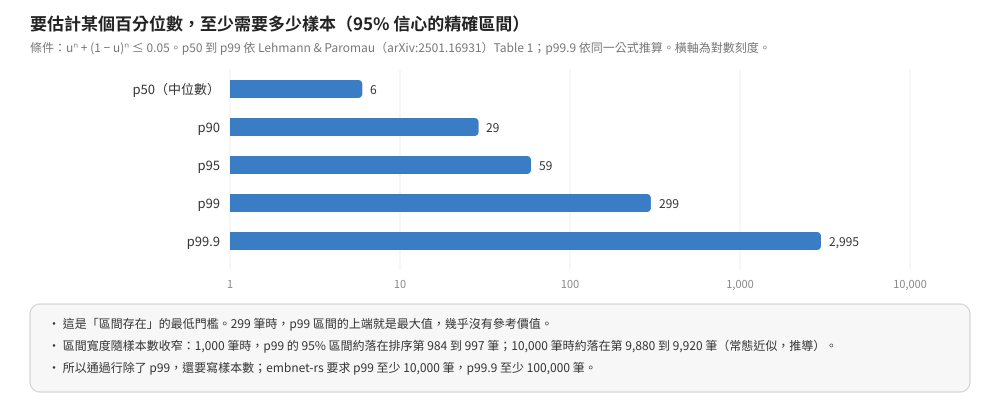
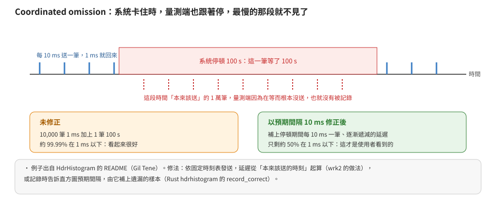
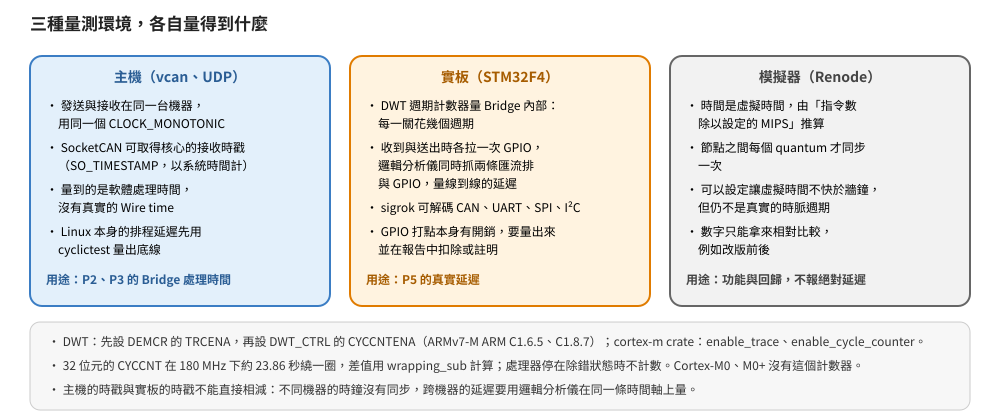

# 延遲分布怎麼量

`CLAUDE.md` 的判準要求延遲報「分布（p50、p99、max）與樣本數」，不用平均值。這篇說明為什麼、p99 要多少樣本才可信、
量測端最常犯的錯誤（coordinated omission），以及在主機、實板、模擬器上分別怎麼量。這是知識庫的最後一篇，前面所有「延遲」的數字最後都要用這裡的方法驗證。

延伸閱讀：Gil Tene《How NOT to Measure Latency》（QCon 2013、2015）；HdrHistogram 的 README；ARMv7-M Architecture Reference Manual 第 C1.8 節；
上一章 [Wire time 與延遲的組成](../10-buses/02-wire-time.md) 與 [Bridge 的排隊與延遲上限](../20-protocol/04-bridge-queueing.md)。

## 一、為什麼看分布、不看平均

延遲幾乎從來不是常態分布。它常有多個峰：例如大部分訊息直接轉送，少數要等佇列，極少數碰上重組逾時。平均值把這些峰混成一個數字，
哪一個峰都不代表。Brendan Gregg 用延遲熱圖說明過：I/O 延遲常是雙峰的，單一直方圖甚至會遮住隨時間移動的峰（Latency Heat Maps 頁）。

Gil Tene 的演講提出幾條簡單的規則（投影片第 13 到 31 頁）：

- **不能平均百分位數。** 把十五分鐘內每段的 p100（也就是 max）取平均，得到的數字沒有意義。要合併多次量測，合併的是直方圖，不是百分位數。
- **一定要看 max。** 不量、不畫 max，就是在迴避什麼。
- **多數使用者會碰到 p99。** 一次操作若牽涉幾十個請求，至少一個落在 p99 以上的機率就很高。對 Bridge 而言，一個控制週期常要等好幾個 Subject 都到齊，同樣的道理成立。

這也是 `docs/20-protocol/04` 用 network calculus 算「上限」而不是平均的原因：控制系統的期限是硬的。

## 二、p99 要多少樣本

百分位數是從樣本估計出來的，樣本少時估計很不準。統計上有不需要假設分布形狀的精確方法：把 n 個樣本排序，
第 k 小與第 l 小的樣本之間包住真正 u 分位數的機率，可以用二項分布算出來（Lehmann & Paromau，arXiv:2501.16931，第 3.2.1 節）。

299 這個數字的直覺：若 299 筆全部落在真正的 p99 以下，機率是 0.99²⁹⁹ ≈ 0.05。所以至少要這麼多筆，樣本最大值才有 95% 的機會超過真正的 p99。
一般的條件是 uⁿ + (1 − u)ⁿ ≤ 0.05：樣本全部落在 u 分位數同一側的機率夠小，區間才包得住它。

這張表是「區間存在」的最低門檻。只有 299 筆時，p99 區間的上端就是樣本的最大值，幾乎沒有參考價值。同樣的結論也可以從 Wilks（1941）的容忍區間得出：
要有 95% 的信心讓樣本最大值超過真正的 p99，至少需要 299 筆。

實用的做法是讓區間夠窄。以常態近似推算：1,000 筆時，p99 的 95% 區間約落在排序第 984 到 997 筆之間，相當於經驗分布的 p98.4 到 p99.7；
10,000 筆時收窄到第 9,880 到 9,920 筆，相當於 p98.8 到 p99.2（推導）。

## 三、Coordinated omission

這是量延遲最常見、也最隱蔽的錯誤。

HdrHistogram 的 README 用這個例子說明：系統每 10 ms 被量一次，正常時 1 ms 回應，量了 100 秒共 10,000 筆。接著系統停頓 100 秒，
量測端送出的那一筆等了 100 秒，但因為量測端在等，停頓期間本來該送的一萬筆都沒有送，也就沒有被記錄。結果約 99.99% 的樣本在 1 ms 以下。
以預期間隔 10 ms 修正後，只有約 50% 在 1 ms 以下（Corrected vs. Raw value recording calls 段）。

Tene 的說法是：這種錯誤讓你以為量的是回應時間，實際上只量到服務時間（投影片第 50 頁）。wrk2 的例子中，修正前的 p99 約 6 ms，修正後約 1.27 秒。

兩種修法：

- **依固定時刻表發送，延遲從「本來該送的時刻」起算**，不管上一筆回來了沒有（wrk2 的做法）。
- **記錄時告訴直方圖預期的間隔**，由它補上遺漏的樣本。Rust 的 `hdrhistogram` crate（7.6.0）提供 `record_correct(value, interval)`。
  這種「記錄時修正」和事後修正的 `clone_correct` 不能用在同一份資料上。

embnet-rs 的情況特別適合第一種：Subject 本來就是週期發佈，發送時刻在設定檔裡是已知的。負載測試的發送端照時刻表發送，延遲一律從排定的時刻起算。

## 四、記錄：HdrHistogram

HdrHistogram 用固定的相對精度記錄數值：例如設定 3 位有效數字、範圍從 1 ns 到 1 小時，量化誤差不超過 0.1%，記憶體用量固定，和樣本數無關（HdrHistogram 網站）。
記錄一筆只要幾奈秒。這讓「每一筆都記錄、最後再算任意百分位數」變得可行，也讓多次量測可以正確地合併。

Rust 的 `hdrhistogram` crate 用在主機端的量測程式。它在 `no_std` 下能不能用，文件沒有說明，待查證；MCU 上可以只記原始的週期數，交給主機彙整。

## 五、三種量測環境

### 5.1 主機

- **時鐘。** 發送端與接收端在同一台機器上，用同一個 `CLOCK_MONOTONIC`。它不受系統時間跳動影響，但會被 NTP 微調頻率；需要完全不受調整的時鐘時用 `CLOCK_MONOTONIC_RAW`（clock_gettime(2)）。
- **核心時戳。** SocketCAN 可以用 `SO_TIMESTAMP` 取得每個接收框的核心時戳；`SO_TIMESTAMPING` 還能選軟體或硬體時戳，硬體時戳要看驅動是否支援（Linux 的 timestamping 文件；can-utils 的 `candump`）。
  這些時戳以系統時間計，和 `CLOCK_MONOTONIC` 不是同一個時域，比較前要換算（推論，待查證）。
- **Linux 自己的延遲。** 量 Bridge 之前，先用 `cyclictest` 量出這台機器的排程延遲當底線：它反覆量測「執行緒預定醒來的時刻」與「實際醒來的時刻」之差。
  PREEMPT_RT 從 Linux 6.12 起併入主線（kernelnewbies），需要低延遲時可以直接用。
- **限制。** `vcan`（Linux 的虛擬 CAN 介面，沒有實體線）與 pty（虛擬終端機，用來模擬序列埠）沒有真實的 Wire time，這裡量到的只是軟體處理時間（`003` K-32）。

### 5.2 實板

- **DWT 週期計數器。** Cortex-M3、M4 有一個 32 位元的週期計數器 `DWT_CYCCNT`。啟用要兩步：先設 `DEMCR` 的 `TRCENA`，再設 `DWT_CTRL` 的 `CYCCNTENA`（ARMv7-M ARM 第 C1.6.5、C1.8.7 節）。
  Rust 的 `cortex-m` crate（0.7.10）對應 `DCB::enable_trace` 與 `DWT::enable_cycle_counter`，讀值用 `DWT::cycle_count()`。
  參考板的 Cortex-M7 開機後 DWT 是鎖住的，要先寫 Lock Access Register 才能改設定；`cortex-m` 的文件說 `DWT::unlock()` 就是為 STM32F7 準備的（docs.rs；ST 社群，二手）。
- **它的限制。** 在 180 MHz 下約 23.86 秒繞一圈，差值要用 `wrapping_sub`；處理器停在除錯狀態時不計數（第 C1.8.3 節）。Cortex-M0、M0+ 沒有這個計數器（Keil 支援文件 3999）。
  它適合量 Bridge 內部每一關花幾個週期（`003` 第 1.2 節），量不到線上的時間。
- **線到線的延遲。** 收到框與送出框時各拉一次 GPIO，用邏輯分析儀同時抓兩條匯流排與 GPIO，所有事件在同一條時間軸上。sigrok 的協定解碼器支援 CAN、UART、SPI、I²C。
  GPIO 打點本身有開銷：用 HAL 函式切換比直接寫暫存器慢一個數量級（metebalci 在 STM32H7 上的量測），所以要直接寫 BSRR（STM32 一次寫入就能設定或清除 GPIO 腳位的暫存器），並把打點的開銷量出來，在報告中註明。

### 5.3 模擬器

Renode 的時間是虛擬時間，由執行的指令數除以設定的 MIPS 推算，預設 100 MIPS；節點之間每個 quantum 才同步一次（Time framework 文件）。
可以設定讓虛擬時間不快於牆鐘，但它仍不是真實的時脈週期。所以模擬器上的延遲只能拿來相對比較，例如同一個功能改版前後；絕對值要等實板（`001` 第九節）。

### 5.4 跨機器不能直接相減

主機的時戳與實板的時戳來自不同的時鐘，沒有同步，不能直接相減得到延遲。跨機器的延遲要在同一條時間軸上量，也就是用邏輯分析儀。

## 六、對 embnet-rs 的影響

| 觀察 | 對設計的影響 |
|---|---|
| 平均值會掩蓋多峰分布 | 延遲一律報 p50、p99、max 與樣本數，另附直方圖 |
| p99 至少 299 筆，要窄的區間需要上萬筆 | 通過行要求 p99 至少 10,000 筆、p99.9 至少 100,000 筆；樣本不足時通過行標 `INSUFFICIENT` |
| 不能平均百分位數 | 多次量測合併直方圖，不合併百分位數；hdrhistogram 序列化後存進 run 目錄 |
| Coordinated omission | 負載測試的發送端照設定檔的週期發送，延遲從排定時刻起算 |
| 主機與實板的時鐘不同 | 主機數字只稱為處理時間；線到線的延遲只用邏輯分析儀量 |
| Linux 本身有排程延遲 | 主機量測前先跑 `cyclictest`，結果附在 run 目錄 |
| DWT 只量 CPU 內部，約 24 秒繞一圈 | P1 用 DWT 量 AES 與轉送每一步的週期數，P5 量實板上的處理時間；量測區間遠小於 24 秒 |
| 模擬器的時間是推算的 | Renode 只用於功能與回歸，不報絕對延遲 |

通過行格式更新為：
`EMBNET_HOP PASS in=<link> out=<link> env=<host|board> samples=<N> p50_us=<N> p99_us=<N> p99_ci_us=<低>-<高> max_us=<N>`。

## 來源

- G. Tene, *How NOT to Measure Latency*, QCon London 2013 / QCon SF 2015：<https://www.infoq.com/presentations/latency-pitfalls/>；
  投影片：<https://www.slideshare.net/InfoQ/how-not-to-measure-latency-60111840>
- HdrHistogram：<https://hdrhistogram.github.io/HdrHistogram/>、<https://github.com/HdrHistogram/HdrHistogram>；wrk2：<https://github.com/giltene/wrk2>
- Rust `hdrhistogram`：<https://docs.rs/hdrhistogram/7.6.0/hdrhistogram/struct.Histogram.html>
- B. Gregg, *Latency Heat Maps*：<https://www.brendangregg.com/HeatMaps/latency.html>
- C. Lehmann, P. Paromau, arXiv:2501.16931：<https://arxiv.org/html/2501.16931v2>
- S. S. Wilks, *Determination of Sample Sizes for Setting Tolerance Limits*, Ann. Math. Statist. 12, 1941
- NIST/SEMATECH e-Handbook，第 7.2.6 節：<https://www.itl.nist.gov/div898/handbook/prc/section2/prc264.htm>
- ARM, *ARMv7-M Architecture Reference Manual*, DDI 0403E.b：第 C1.6.5、C1.8.3、C1.8.6 到 C1.8.8 節
- `cortex-m` crate：<https://docs.rs/cortex-m/latest/cortex_m/peripheral/struct.DWT.html>；Keil 支援文件 3999：<https://www.keil.com/support/docs/3999.htm>
- Linux kernel, *Timestamping*：<https://docs.kernel.org/networking/timestamping.html>；*SocketCAN*：<https://docs.kernel.org/networking/can.html>；
  can-utils `candump.c`
- clock_gettime(2)：<https://man7.org/linux/man-pages/man2/clock_gettime.2.html>
- kernelnewbies, Linux 6.12：<https://kernelnewbies.org/Linux_6.12>；cyclictest(8)：<https://manpages.debian.org/trixie/rt-tests/cyclictest.8.en.html>
- sigrok 協定解碼器：<https://sigrok.org/wiki/Protocol_decoders>；metebalci, *STM32H7 GPIO toggling*：<https://metebalci.com/blog/stm32h7-gpio-toggling/>
- Renode, *Time framework*：<https://renode.readthedocs.io/en/latest/advanced/time_framework.html>

## 待查證

- `hdrhistogram` 能否在 `no_std` 下使用。
- SocketCAN 軟體時戳所屬的時鐘（核心文件只寫「system time」）；各 CAN 控制器驅動的硬體時戳支援。
- 處理器進入睡眠、時脈被關閉時 CYCCNT 是否停止；ARMv6-M 手冊中 DWT 不含 CYCCNT 的原文。
- PREEMPT_RT 支援的架構清單（原始 commit）；cyclictest 輸出欄位的官方定義。
- RM0090 中 BSRR 的原文；Renode 的「非 cycle-accurate」官方說法。
